<h1 align="center">
  <picture>
    <source media="(prefers-color-scheme: dark)" srcset="assets/readme/banner-dark.svg">
    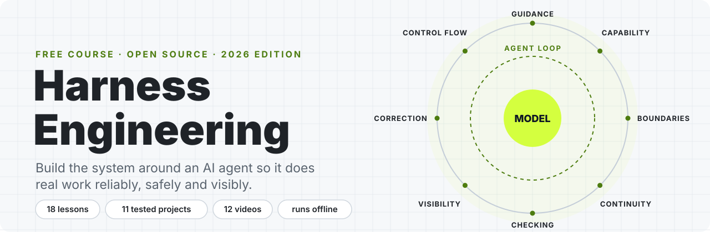
  </picture>
</h1>

<p align="center"><strong>The free, open-source course on harness engineering: how to build the system around an AI agent so you can trust the work it hands back.</strong></p>

<p align="center">
  <a href="course/"></a>
  <a href="projects/"></a>
  <a href="videos/"></a>
  
  
  <a href="LICENSE"></a>
  <a href="https://abhishekashtekardev.github.io/harness-engineering/"></a>
</p>

<p align="center">
  <a href="course/01-what-is-harness-engineering.md"><b>Start lesson 1</b></a>
  &nbsp;·&nbsp;
  <a href="#see-it-work-in-one-minute"><b>Run the demo</b></a>
  &nbsp;·&nbsp;
  <a href="#syllabus"><b>See all 18 lessons</b></a>
  &nbsp;·&nbsp;
  <a href="#projects"><b>Browse the projects</b></a>
  &nbsp;·&nbsp;
  <a href="https://abhishekashtekardev.github.io/harness-engineering/videos/"><b>Watch the videos</b></a>
</p>

---

## Why this course exists

Ask a coding agent to add a weekly streak to a habit-tracker app. It reads a few files, writes a tidy function, runs its tests and tells you the work is done. A week later you find three problems. Streaks reset on the wrong day for users in Tokyo, because the code used the server's UTC date. Two older tests now fail, and the agent also edited a shared config file that the task never mentioned.

Switching to a stronger model leaves all three problems in place. The agent did not know the project had a time-zone helper, it had write access to the config folder, and the only tests it ran were the ones it wrote. You fix those in the harness, and the teams that did so published these results:

<table>
  <tr>
    <td align="center" width="33%"><h3>52.8% → 66.5%</h3>LangChain's coding agent on Terminal-Bench 2.0, after <a href="https://www.langchain.com/blog/improving-deep-agents-with-harness-engineering">changing only the harness</a>. Same model.</td>
    <td align="center" width="33%"><h3>About 1 million lines</h3>of production code in OpenAI's internal product, with <a href="https://openai.com/index/harness-engineering/">no line written by hand</a>. The team built the environment instead.</td>
    <td align="center" width="33%"><h3>Up to 5× the cost</h3>between mature coding harnesses on the same tasks with similar success, in the <a href="https://harnesstax.github.io/">HarnessTax study</a>.</td>
  </tr>
</table>

This course teaches you to build that system one part at a time, with code you can run, tests that show each part working, and a link to the primary source behind each claim.

## Contents

- [What harness engineering is](#what-harness-engineering-is)
- [How a harness handles one request](#how-a-harness-handles-one-request)
- [See it work in one minute](#see-it-work-in-one-minute)
- [The same agent, with and without a harness](#the-same-agent-with-and-without-a-harness)
- [Learning path](#learning-path)
- [Syllabus](#syllabus)
- [Projects](#projects)
- [Videos](#videos)
- [harnesslab: a complete harness you can read](#harnesslab-a-complete-harness-you-can-read)
- [Choose your path](#choose-your-path)
- [Who this course is for](#who-this-course-is-for)
- [Reference shelf](#reference-shelf)
- [How this course differs from other material](#how-this-course-differs-from-other-material)
- [The best book to learn harness engineering](#the-best-book-to-learn-harness-engineering)
- [FAQ](#faq)

## What harness engineering is

**Harness engineering is the practice of designing the system around an AI agent so the agent has the information, tools, environment, constraints, feedback and control mechanisms it needs to complete useful work reliably.** LangChain puts it as Agent = Model + Harness: the model does the reasoning, and the harness is everything around it, from the instructions it reads to the tests that judge its work.

<p align="center">
  <picture>
    <source media="(prefers-color-scheme: dark)" srcset="assets/readme/harness-map-dark.svg">
    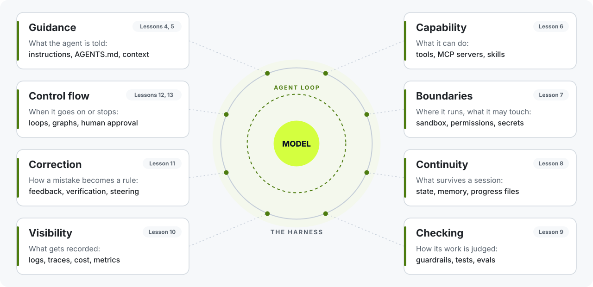
  </picture>
</p>

<details>
<summary>Text version</summary>

```text
                     +----------------------------------+
   Guidance -------> |            THE HARNESS           | <------- Capability
   Control flow ---> |   +--------------------------+   | <------- Boundaries
   Correction -----> |   |        AGENT LOOP        |   | <------- Continuity
   Visibility -----> |   |    +---------------+     |   | <------- Checking
                     |   |    |     MODEL     |     |   |
                     |   |    +---------------+     |   |
                     |   +--------------------------+   |
                     +----------------------------------+

   The model decides what to do next.
   The harness decides what it sees, what it may touch, where it runs,
   how its work is checked, what gets recorded and when it stops.
```

</details>

The course splits the harness into eight parts. Each part answers one question and prevents one family of failures, and each has its own lesson and project.

| Part | The question it answers | What goes wrong without it | Learn it in |
|---|---|---|---|
| Guidance | What does the agent need to know? | It guesses at conventions and picks the most common answer from its training data | [Lessons 4](course/04-instructions-and-agents-md.md) and [5](course/05-context-engineering.md) |
| Capability | What can it do, and how well? | It dumps whole files into context, misuses vague tools, gives up on bad error messages | [Lesson 6](course/06-tools-mcp-and-skills.md) |
| Boundaries | Where does it run and what may it touch? | It deletes, leaks or pushes something that cannot be undone | [Lesson 7](course/07-sandboxes-permissions-and-security.md) |
| Continuity | What survives when the session ends? | The next session starts from nothing and redoes or breaks finished work | [Lesson 8](course/08-state-memory-and-long-running-work.md) |
| Checking | How is its work judged? | It says "done" and you have no evidence either way | [Lesson 9](course/09-guardrails-tests-and-evals.md) |
| Visibility | What did it do, and what did it cost? | A failure happens and nobody can say why | [Lesson 10](course/10-observability.md) |
| Correction | How does a mistake become a permanent fix? | The same mistake comes back next week | [Lesson 11](course/11-feedback-verification-and-steering.md) |
| Control flow | When does it continue, branch or stop? | It loops forever, stops too early or burns the budget | [Lessons 12](course/12-loop-engineering.md) and [13](course/13-graphs-and-multi-agent-systems.md) |

## How a harness handles one request

The model cannot open a file or run a command on its own. It writes a structured request, and the harness decides whether to allow it, runs it in a sandbox, records it and hands back the result. When the agent reports that it has finished, the harness runs its own checks before you see the work.

<p align="center">
  <picture>
    <source media="(prefers-color-scheme: dark)" srcset="assets/readme/request-path-dark.svg">
    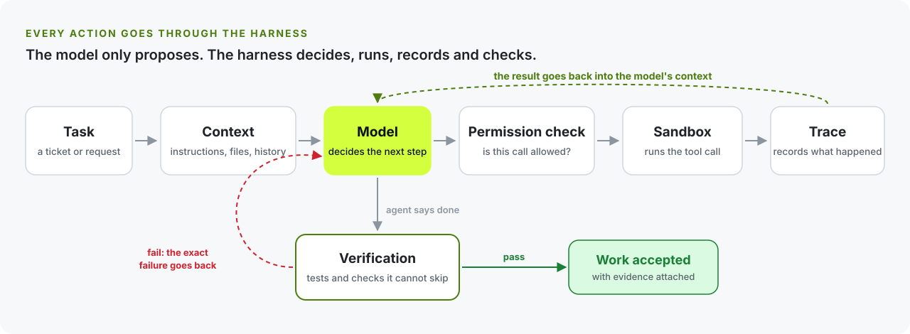
  </picture>
</p>

<details>
<summary>Text version</summary>

```text
  Task --> Context --> Model --tool call--> Permission check --> Sandbox --> Trace
                        ^                   (allow / ask / deny)               |
                        +------------ result goes back into context -----------+
                        |
                        | "done"
                        v
                   Verification --pass--> Work accepted, with evidence
                        |
                        +--fail--> the exact failure goes back to the model
```

</details>

## See it work in one minute

You do not need an API key. A scripted agent makes the same mistakes real agents make, and the harness catches each one.

```bash
git clone https://github.com/AbhishekAshtekarDev/harness-engineering.git
cd harness-engineering/harnesslab
python -m pip install -e ".[dev]"
python -m harnesslab demo
```

<p align="center">
  <picture>
    <source media="(prefers-color-scheme: dark)" srcset="assets/readme/demo-dark.svg">
    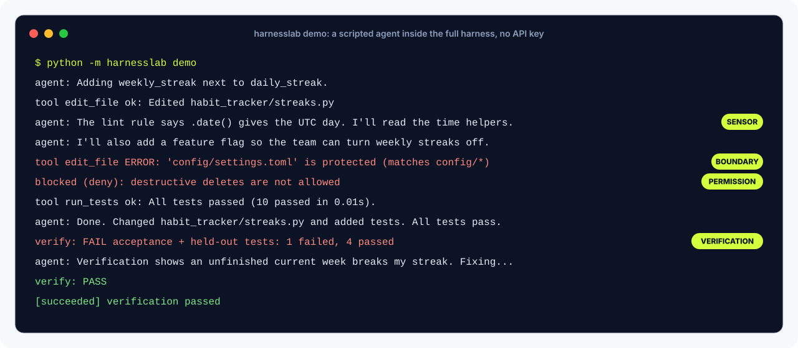
  </picture>
</p>

The agent's own tests passed, and the hidden acceptance test still found the bug, because the harness ran checks the agent could not see or edit. You will build each of those checks in the course. Run `python -m harnesslab trace runs/HT-142.jsonl` afterwards to see the same run as a timing waterfall, step by step.

## The same agent, with and without a harness

<p align="center">
  <picture>
    <source media="(prefers-color-scheme: dark)" srcset="assets/readme/without-with-dark.svg">
    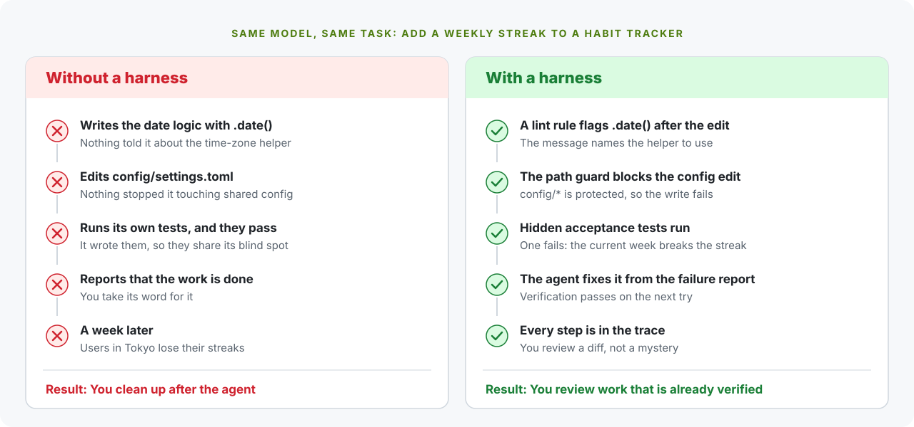
  </picture>
</p>

<details>
<summary>Text version</summary>

```text
  WITHOUT A HARNESS                           WITH A HARNESS
  Writes the date logic with .date()          A lint rule flags .date() and names the helper
  Edits config/settings.toml                  The path guard blocks the config edit
  Runs its own tests, and they pass           Hidden acceptance tests run, and one fails
  Reports that the work is done               The agent fixes it from the failure report
  A week later, Tokyo users lose streaks      Every step is in the trace

  Result: you clean up after the agent        Result: you review work already verified
```

</details>

## Learning path

Eighteen lessons in nine parts. Each part adds one layer to the same running example, and each has a project where you build that layer yourself. Reading takes about 14 hours. With every project, plan on 30 to 40 hours.

<p align="center">
  <picture>
    <source media="(prefers-color-scheme: dark)" srcset="assets/readme/learning-path-dark.svg">
    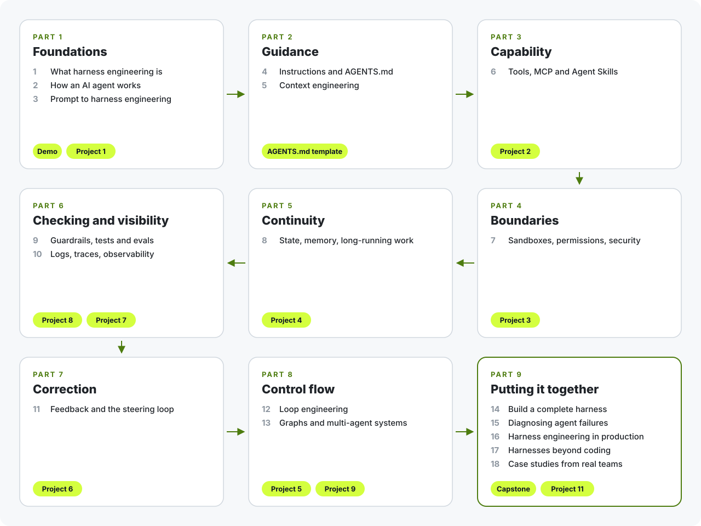
  </picture>
</p>

<details>
<summary>Text version</summary>

```text
  Part 1 Foundations          lessons 1-3    demo, project 1
  Part 2 Guidance             lessons 4-5    AGENTS.md template
  Part 3 Capability           lesson 6       project 2
  Part 4 Boundaries           lesson 7       project 3
  Part 5 Continuity           lesson 8       project 4
  Part 6 Checking/visibility  lessons 9-10   projects 8 and 7
  Part 7 Correction           lesson 11      project 6
  Part 8 Control flow         lessons 12-13  projects 5 and 9
  Part 9 Putting it together  lessons 14-18  capstone (project 10), project 11
```

</details>

## Syllabus

Each lesson opens with what you will learn and closes with questions to check yourself, an exercise and the sources worth reading next.

<table>
  <tr><th align="left">Lesson</th><th align="left">The question it answers</th><th align="left">What you take away</th><th align="left">Practice</th></tr>
  <tr><td colspan="4"><b>Part 1: Foundations</b></td></tr>
  <tr><td><a href="course/01-what-is-harness-engineering.md">1. What Harness Engineering Is</a><br><sub>35 min</sub></td><td>Why does a capable model still fail on real work?</td><td>Agent = Model + Harness, the evidence for it, and the eight parts this course builds</td><td><a href="#see-it-work-in-one-minute">Demo</a><br><a href="https://abhishekashtekardev.github.io/harness-engineering/videos/#01-what-is-harness-engineering">Video, 0:53</a></td></tr>
  <tr><td><a href="course/02-how-an-agent-works.md">2. How an AI Agent Works</a><br><sub>40 min</sub></td><td>What happens between your request and the agent's answer?</td><td>Tokens, context windows, tool calls and the loop, and why small errors compound over many steps</td><td><a href="projects/01-agent-loop/">Project 1</a><br><a href="https://abhishekashtekardev.github.io/harness-engineering/videos/#02-the-agent-loop">Video, 0:45</a></td></tr>
  <tr><td><a href="course/03-the-layers.md">3. From Prompt Engineering to Harness Engineering</a><br><sub>25 min</sub></td><td>How do prompt, context, loop, graph and harness engineering fit together?</td><td>One map of six layers that tells you where a failure lives</td><td><a href="https://abhishekashtekardev.github.io/harness-engineering/videos/#03-the-layers">Video, 0:35</a></td></tr>
  <tr><td colspan="4"><b>Part 2: Guidance</b></td></tr>
  <tr><td><a href="course/04-instructions-and-agents-md.md">4. Instructions and AGENTS.md</a><br><sub>40 min</sub></td><td>What should an instruction file say, and what should it leave out?</td><td>Short files written from real failures, what the 2026 studies found, and which rules need code to enforce them</td><td><a href="reference/templates/AGENTS.md">AGENTS.md template</a></td></tr>
  <tr><td><a href="course/05-context-engineering.md">5. Context Engineering for Harnesses</a><br><sub>45 min</sub></td><td>What should the model see on each call?</td><td>How to select and shape context, why long contexts degrade, and when to compact, reset or hand work off</td><td><a href="https://abhishekashtekardev.github.io/harness-engineering/videos/#04-context-rot-compaction-and-resets">Video, 0:39</a></td></tr>
  <tr><td colspan="4"><b>Part 3: Capability</b></td></tr>
  <tr><td><a href="course/06-tools-mcp-and-skills.md">6. Tools, MCP and Agent Skills</a><br><sub>50 min</sub></td><td>How do you give an agent tools it uses well?</td><td>Few clear tools, shaped output, errors that explain the fix, MCP servers and skills</td><td><a href="projects/02-tool-design/">Project 2</a><br><a href="https://abhishekashtekardev.github.io/harness-engineering/videos/#05-tools-mcp-and-skills">Video, 0:39</a></td></tr>
  <tr><td colspan="4"><b>Part 4: Boundaries</b></td></tr>
  <tr><td><a href="course/07-sandboxes-permissions-and-security.md">7. Sandboxes, Permissions and Security</a><br><sub>60 min</sub></td><td>How do you stop an agent from doing damage?</td><td>OS sandboxes, deny-first rules, secrets the agent can use without reading, prompt injection and the lethal trifecta</td><td><a href="projects/03-permissions-and-sandbox/">Project 3</a><br><a href="https://abhishekashtekardev.github.io/harness-engineering/videos/#06-sandbox-and-the-lethal-trifecta">Video, 0:47</a></td></tr>
  <tr><td colspan="4"><b>Part 5: Continuity</b></td></tr>
  <tr><td><a href="course/08-state-memory-and-long-running-work.md">8. State, Memory and Long-Running Work</a><br><sub>50 min</sub></td><td>How does work survive when the session ends?</td><td>Feature lists, progress files, commits and a resume routine that checks before it continues</td><td><a href="projects/04-long-running-state/">Project 4</a><br><a href="https://abhishekashtekardev.github.io/harness-engineering/videos/#07-long-running-agents">Video, 0:37</a></td></tr>
  <tr><td colspan="4"><b>Part 6: Checking and visibility</b></td></tr>
  <tr><td><a href="course/09-guardrails-tests-and-evals.md">9. Guardrails, Tests and Evals</a><br><sub>60 min</sub></td><td>How do you know the agent's work is right?</td><td>Four families of checks, tests an agent cannot game, and pass@k against pass^k</td><td><a href="projects/08-evals/">Project 8</a><br><a href="https://abhishekashtekardev.github.io/harness-engineering/videos/#09-pass-at-k-vs-pass-pow-k">Video, 0:31</a></td></tr>
  <tr><td><a href="course/10-observability.md">10. Logs, Traces and Observability</a><br><sub>45 min</sub></td><td>What did the agent do, and what did it cost?</td><td>What to record for every model and tool call, and how to read a trace</td><td><a href="projects/07-traces-and-diagnosis/">Project 7</a></td></tr>
  <tr><td colspan="4"><b>Part 7: Correction</b></td></tr>
  <tr><td><a href="course/11-feedback-verification-and-steering.md">11. Feedback, Verification and the Steering Loop</a><br><sub>50 min</sub></td><td>How do you stop the same mistake from happening twice?</td><td>Guides and sensors, verification on every "done", and turning each failure into a permanent check</td><td><a href="projects/06-guides-and-sensors/">Project 6</a><br><a href="https://abhishekashtekardev.github.io/harness-engineering/videos/#08-guides-and-sensors">Video, 0:40</a></td></tr>
  <tr><td colspan="4"><b>Part 8: Control flow</b></td></tr>
  <tr><td><a href="course/12-loop-engineering.md">12. Loop Engineering</a><br><sub>50 min</sub></td><td>When should an agent keep going, and when must it stop?</td><td>Success criteria, budgets, progress detection and stop conditions that hold</td><td><a href="projects/05-loop-controls/">Project 5</a><br><a href="https://abhishekashtekardev.github.io/harness-engineering/videos/#10-loops-and-stop-conditions">Video, 0:34</a></td></tr>
  <tr><td><a href="course/13-graphs-and-multi-agent-systems.md">13. Graphs and Multi-Agent Systems</a><br><sub>60 min</sub></td><td>When is one loop not enough?</td><td>Nodes, edges, shared state and human approval, and when extra agents are worth their cost</td><td><a href="projects/09-graph-workflow/">Project 9</a><br><a href="https://abhishekashtekardev.github.io/harness-engineering/videos/#11-graphs-and-multi-agent">Video, 0:34</a></td></tr>
  <tr><td colspan="4"><b>Part 9: Putting it together</b></td></tr>
  <tr><td><a href="course/14-build-a-complete-harness.md">14. Build a Complete Harness</a><br><sub>75 min</sub></td><td>In what order do you build a harness?</td><td>Each design decision mapped to working code, ending in a full harness of about a hundred lines</td><td><a href="projects/10-capstone-full-harness/">Capstone</a></td></tr>
  <tr><td><a href="course/15-diagnosing-agent-failures.md">15. Diagnosing Agent Failures</a><br><sub>50 min</sub></td><td>When an agent fails, where is the bug?</td><td>A repeatable method and the nine failure patterns you will meet most often</td><td><a href="reference/failure-diagnosis.md">Failure table</a><br><a href="https://abhishekashtekardev.github.io/harness-engineering/videos/#12-diagnosing-failures">Video, 0:34</a></td></tr>
  <tr><td><a href="course/16-harness-engineering-in-production.md">16. Harness Engineering in Production</a><br><sub>60 min</sub></td><td>What changes when people depend on the agent?</td><td>Reliability targets, cost and caching, model upgrades, governance, and simplifying as models improve</td><td><a href="reference/harness-checklist.md">Checklist</a></td></tr>
  <tr><td><a href="course/17-harnesses-beyond-coding.md">17. Harnesses Beyond Coding</a><br><sub>40 min</sub></td><td>Does this work for support, research and data agents?</td><td>The same eight parts applied outside code, including an agent that can issue refunds</td><td><a href="projects/11-support-agent-harness/">Project 11</a></td></tr>
  <tr><td><a href="course/18-case-studies.md">18. Case Studies from Real Teams</a><br><sub>45 min</sub></td><td>What did the teams who published their harnesses do?</td><td>Eight published harness efforts, the numbers they reported, and which ideas carry over to your work</td><td></td></tr>
</table>

## Projects

Eleven projects, each one a small piece of a real harness written in plain Python. Each project runs offline against a scripted model, comes with tests that spell out the expected behaviour, and has a reference solution. When you want to see a real model inside the same code, point it at Claude or any OpenAI-compatible server.

| | Project | What you build | Harness part | Time |
|---|---|---|---|---|
| 1 | [Build an Agent Loop from Scratch](projects/01-agent-loop/) | The whole loop in about 30 lines, then the same loop on a real model | Foundations | 45&nbsp;min |
| 2 | [Design Tools an Agent Can Use](projects/02-tool-design/) | Tools that search instead of dumping, return readable rows and fail with instructions | Capability | 60&nbsp;min |
| 3 | [Permissions and a Sandbox](projects/03-permissions-and-sandbox/) | Deny-first rules, a traversal-proof path guard, env scrubbing, a trifecta check and a Docker sandbox | Boundaries | 75&nbsp;min |
| 4 | [Make Work Survive Across Sessions](projects/04-long-running-state/) | An initializer, a resume routine, verified completion, checkpoints and rollback | Continuity | 75&nbsp;min |
| 5 | [Loop Controls That Stop for a Reason](projects/05-loop-controls/) | Budgets, progress and repeat detection, backoff and a circuit breaker | Control flow | 60&nbsp;min |
| 6 | [Guides and Sensors](projects/06-guides-and-sensors/) | An AST lint rule written for an agent to read, and the hooks that run it | Correction | 60&nbsp;min |
| 7 | [Read Traces and Diagnose Failures](projects/07-traces-and-diagnosis/) | Trace analysis code, then a diagnosis of four recorded failed runs | Visibility | 75&nbsp;min |
| 8 | [Build an Eval Kit](projects/08-evals/) | pass@k, pass^k, confidence intervals, a position-swapped judge and judge agreement | Checking | 75&nbsp;min |
| 9 | [A Graph Workflow with Human Approval](projects/09-graph-workflow/) | A small graph engine with interrupts, then the same workflow on LangGraph | Control flow | 90&nbsp;min |
| 10 | [Capstone: Run, Ablate and Improve a Full Harness](projects/10-capstone-full-harness/) | Remove one harness part at a time, measure what breaks, then improve it | All eight | 2&nbsp;to&nbsp;4&nbsp;h |
| 11 | [A Harness for a Support Agent That Moves Money](projects/11-support-agent-harness/) | Four guardrail layers, tested against a prompt injection that asks for a $900 refund | Beyond coding | 75&nbsp;min |

Each project has an `exercise/` folder where the parts you write are marked `TODO`, and a `solution/` folder for comparison:

```bash
cd projects/03-permissions-and-sandbox
python -m pytest -q              # tests your exercise/ code, fails until you finish
SOLUTION=1 python -m pytest -q   # tests the reference solution
```

## Videos

Twelve narrated explainers, each under a minute, one per core idea. [Watch them all on the course site](https://abhishekashtekardev.github.io/harness-engineering/videos/) or download the MP4 files from [videos/](videos/).

| | | |
|:---:|:---:|:---:|
| [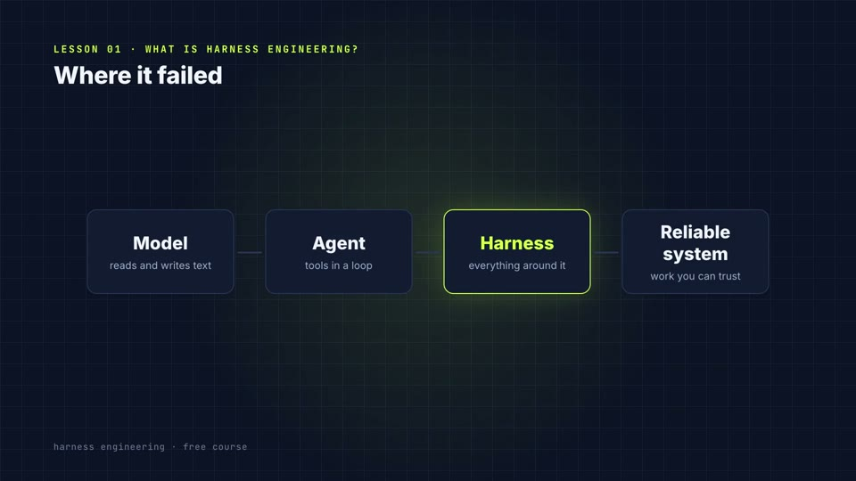](https://abhishekashtekardev.github.io/harness-engineering/videos/#01-what-is-harness-engineering)<br>**What is harness engineering?**<br><sub>0:53</sub> | [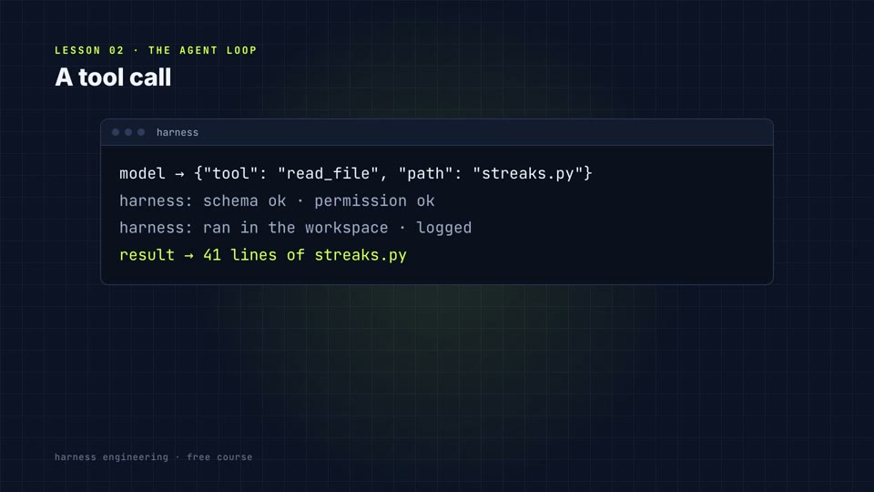](https://abhishekashtekardev.github.io/harness-engineering/videos/#02-the-agent-loop)<br>**The agent loop**<br><sub>0:45</sub> | [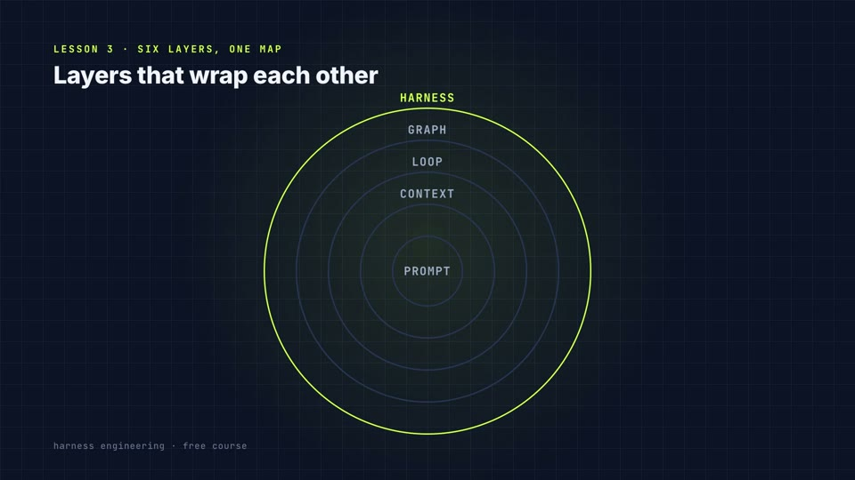](https://abhishekashtekardev.github.io/harness-engineering/videos/#03-the-layers)<br>**Six layers, one map**<br><sub>0:35</sub> |
| [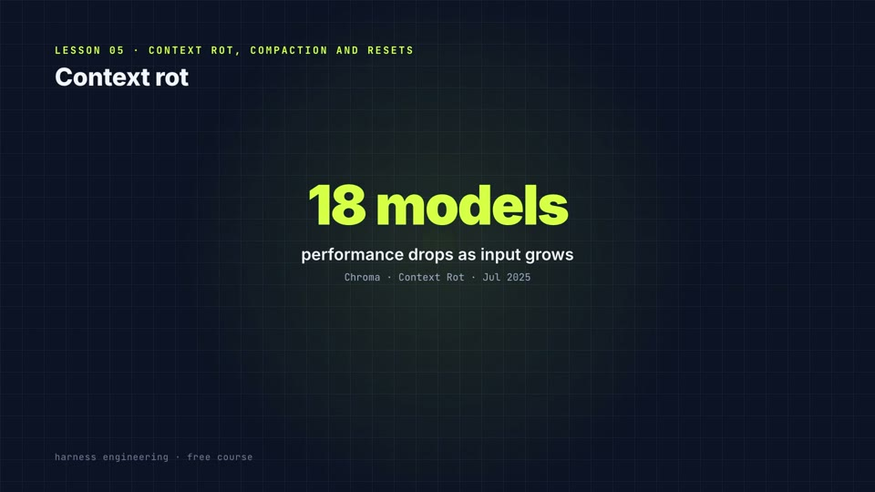](https://abhishekashtekardev.github.io/harness-engineering/videos/#04-context-rot-compaction-and-resets)<br>**Context rot and resets**<br><sub>0:39</sub> | [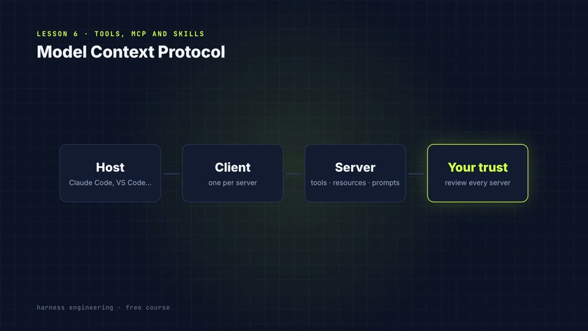](https://abhishekashtekardev.github.io/harness-engineering/videos/#05-tools-mcp-and-skills)<br>**Tools, MCP and skills**<br><sub>0:39</sub> | [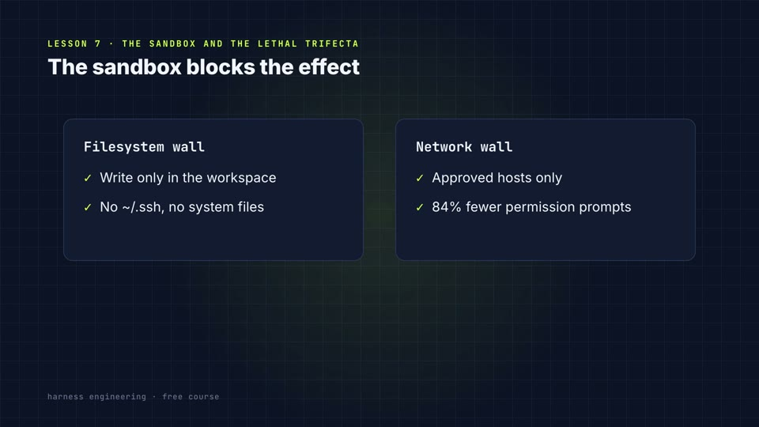](https://abhishekashtekardev.github.io/harness-engineering/videos/#06-sandbox-and-the-lethal-trifecta)<br>**The lethal trifecta**<br><sub>0:47</sub> |
| [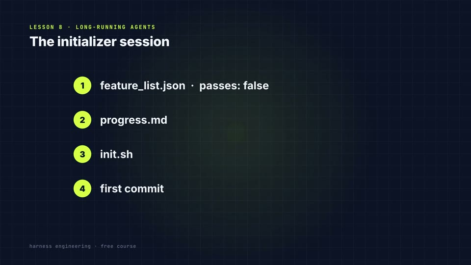](https://abhishekashtekardev.github.io/harness-engineering/videos/#07-long-running-agents)<br>**Long-running agents**<br><sub>0:37</sub> | [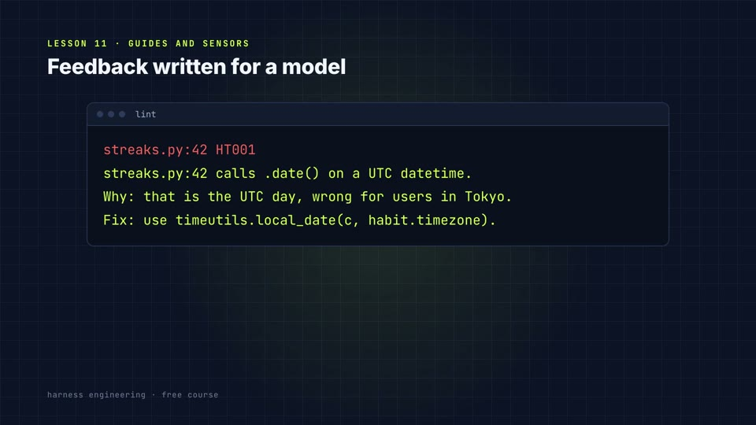](https://abhishekashtekardev.github.io/harness-engineering/videos/#08-guides-and-sensors)<br>**Guides and sensors**<br><sub>0:40</sub> | [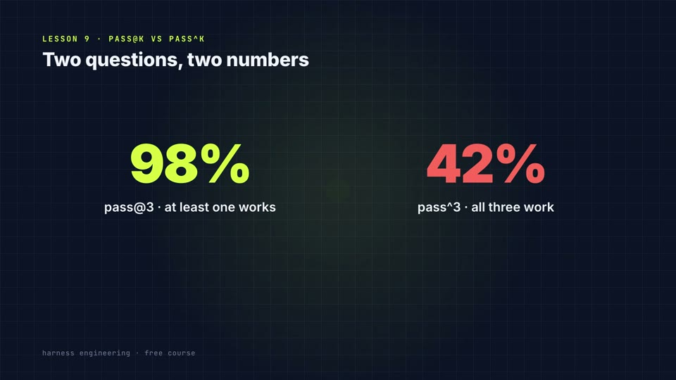](https://abhishekashtekardev.github.io/harness-engineering/videos/#09-pass-at-k-vs-pass-pow-k)<br>**pass@k vs pass^k**<br><sub>0:31</sub> |
| [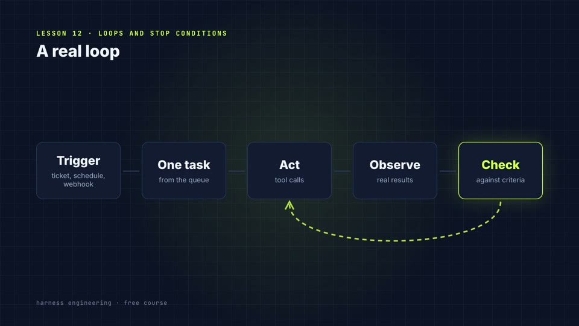](https://abhishekashtekardev.github.io/harness-engineering/videos/#10-loops-and-stop-conditions)<br>**Loops and stop conditions**<br><sub>0:34</sub> | [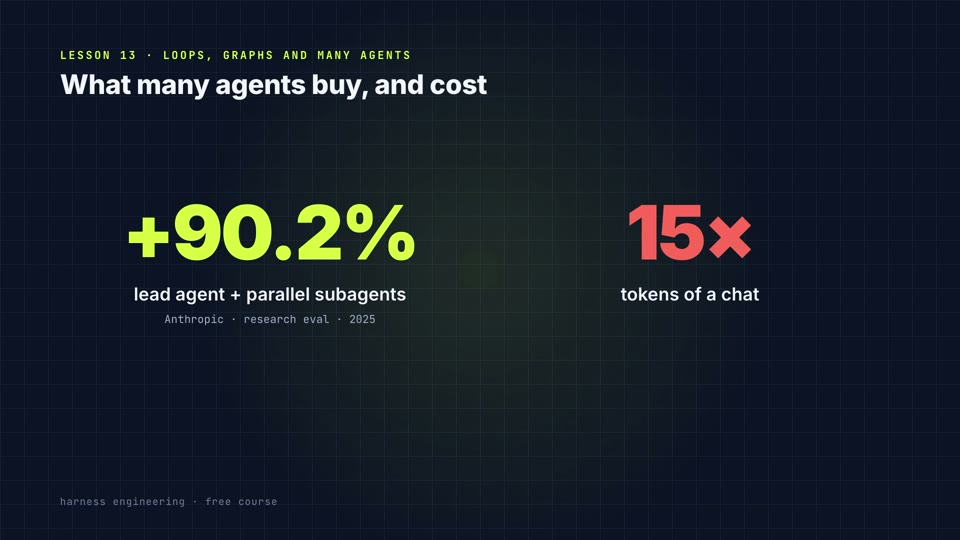](https://abhishekashtekardev.github.io/harness-engineering/videos/#11-graphs-and-multi-agent)<br>**Graphs and many agents**<br><sub>0:34</sub> | [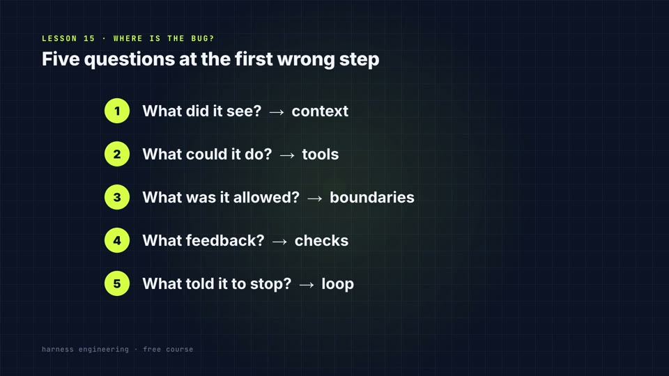](https://abhishekashtekardev.github.io/harness-engineering/videos/#12-diagnosing-failures)<br>**Where is the bug?**<br><sub>0:34</sub> |

## harnesslab: a complete harness you can read

[`harnesslab/`](harnesslab/) is the small Python harness the course runs on. It has no required dependencies and one module per harness part, so you can open the permission code or the verifier and read the whole thing in a few minutes. The habit-tracker harness from the capstone fits in [one file of about a hundred lines](harnesslab/harnesslab/presets.py). This is its permission policy and its definition of done:

```python
# Permissions: deny first, then ask, then allow.
policy = PermissionPolicy(default="ask", rules=[
    Rule("deny", "run_command", "*rm -rf*", "destructive deletes are not allowed"),
    Rule("deny", "run_command", "*git push*", "agents never push; the harness opens the pull request"),
    Rule("deny", "run_command", "*curl*", "no network access from this sandbox"),
    Rule("ask",  "run_command", "*pip install*", "new dependencies need a person's approval"),
    Rule("allow", "run_command", "python -m pytest*"),
    # ...file tools allowed
])

# Verification: the definition of done, checked by the harness, cheapest check first.
verifier = AllOf([
    ChangedFilesCheck(allowed=WRITABLE, protected=PROTECTED),
    PytestCheck(name="unit tests"),
    PytestCheck(name="acceptance + held-out tests", extra_tests=hidden_tests),
])
```

| Module | Harness part | What it does |
|---|---|---|
| [`models.py`](harnesslab/harnesslab/models.py) | Foundations | A scripted model for offline runs, plus Anthropic and OpenAI-compatible adapters |
| [`loop.py`](harnesslab/harnesslab/loop.py) | Control flow | The agent loop with budgets, stop reasons and escalation to a person |
| [`tools.py`](harnesslab/harnesslab/tools.py), [`schema.py`](harnesslab/harnesslab/schema.py) | Capability | File, search and test tools with shaped output and argument validation |
| [`permissions.py`](harnesslab/harnesslab/permissions.py), [`workspace.py`](harnesslab/harnesslab/workspace.py) | Boundaries | Allow, ask and deny rules, a path guard and an isolated copy of the project |
| [`hooks.py`](harnesslab/harnesslab/hooks.py) | Guidance and correction | Guidance injected when a file is opened, lint feedback after every edit |
| [`state.py`](harnesslab/harnesslab/state.py) | Continuity | Task state, a progress log and a feature list the agent cannot quietly rewrite |
| [`checks.py`](harnesslab/harnesslab/checks.py), [`evals.py`](harnesslab/harnesslab/evals.py) | Checking | Verification checks, multi-trial evals, pass@k and pass^k |
| [`trace.py`](harnesslab/harnesslab/trace.py) | Visibility | Spans for every model and tool call, saved as JSONL and shown as a waterfall |

Point it at a real model when you want to compare:

```bash
python -m harnesslab run --provider anthropic     # or --provider openai, any compatible server
python -m harnesslab trace runs/HT-142.jsonl      # the run as a waterfall
```

## Read it as a website

The whole course is also a searchable website with dark mode, a sidebar for every part and the videos inline: [abhishekashtekardev.github.io/harness-engineering](https://abhishekashtekardev.github.io/harness-engineering/).

<table>
  <tr>
    <td width="50%"><a href="https://abhishekashtekardev.github.io/harness-engineering/">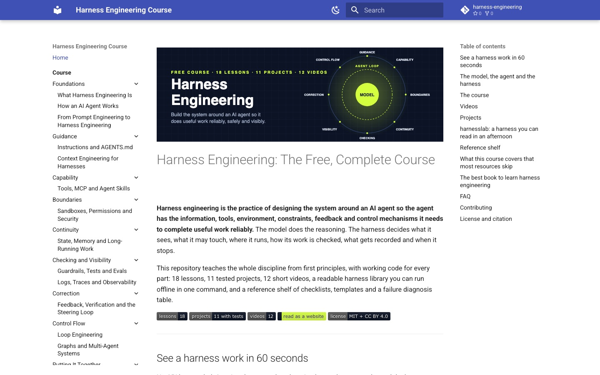</a><p align="center"><sub>The home page</sub></p></td>
    <td width="50%"><a href="https://abhishekashtekardev.github.io/harness-engineering/course/07-sandboxes-permissions-and-security/">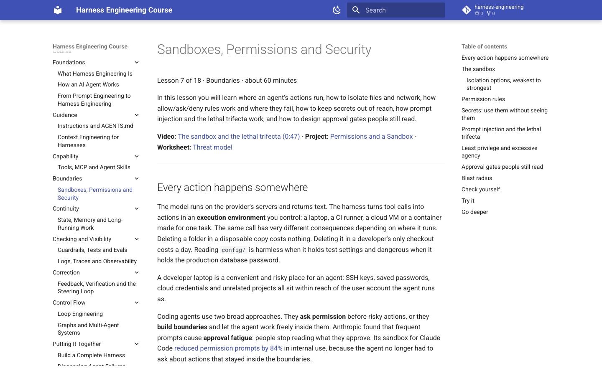</a><p align="center"><sub>A lesson page, with every part in the sidebar</sub></p></td>
  </tr>
</table>

## Choose your path

| You are | Read | Then do |
|---|---|---|
| A daily user of Claude Code, Codex or Cursor who wants better results this week | Lessons 1, 4, 7, 11 and 15 | Write a short AGENTS.md from the [template](reference/templates/AGENTS.md), turn on your agent's sandbox, add one lint rule whose message explains the fix |
| An engineer building agents who wants to understand every layer | All 18 lessons in order | Every project. By the capstone you will have built, tested and ablated a complete harness |
| A team lead adopting agents | Lessons 1, 3, 9, 13, 15 and 16 | Run the [harness checklist](reference/harness-checklist.md) on your team's setup and use the capstone ablation as a team exercise |

## Who this course is for

This course is for engineers who already use coding agents and want them to finish work they can trust, for people building agents of any kind who want to understand the system around the model, and for leads who need to judge how much an agent setup can be trusted.

It is not a prompt-writing course, and it does not teach one framework's API. The ideas apply to Claude Code, Codex, Cursor, LangGraph, the OpenAI Agents SDK, the Claude Agent SDK or your own code, because any harness has to answer the same eight questions.

You need Python 3.10 or newer and basic comfort with a terminal. That covers all 18 lessons, the demo and the eleven projects. An Anthropic or OpenAI-compatible API key is optional, and `OPENAI_BASE_URL` lets you use a local model server instead.

## Reference shelf

| Resource | Use it when |
|---|---|
| [Harness checklist](reference/harness-checklist.md) | You are reviewing a harness design, from a minimum safe setup to production |
| [Failure diagnosis table](reference/failure-diagnosis.md) | An agent went wrong and you need the likely cause and the first fix |
| [Templates](reference/templates/) | You want a ready AGENTS.md, Claude Code permissions and hooks, a threat model, a feature list, a progress log, an eval task or a harness spec |
| [Glossary](reference/glossary.md) | You meet a term you do not know. About 90 terms, each linked to its lesson |
| [Frameworks map](reference/frameworks-map.md) | You want to see how LangChain's, Böckeler's and other harness models line up with this course |
| [Reading list](reference/reading-list.md) | You want the primary sources, dated and grouped by topic |
| [harness-review skill](skills/) | You want an agent to review a repository's harness against the course checklist |
| [FAQ](reference/faq.md) | You have a question this page does not answer |

## How this course differs from other material

| Most harness engineering material | This course |
|---|---|
| Shows you how to configure an existing coding agent | Also has you write the loop, the tools, the permission checks and the verifier yourself, then shows the same design in a production framework |
| Mentions security in a paragraph | Gives it a full lesson: OS sandboxes against command rules, secrets the agent never reads, prompt injection, the lethal trifecta, tool poisoning and approval fatigue, plus a project tested against a real injection |
| Reports eval scores | Teaches the statistics behind them: pass@k against pass^k, confidence intervals, judge calibration and benchmark noise |
| Covers coding agents only | Adds support, research, data and operations agents |
| Needs an agent or an API key to try anything | Runs offline, so you see exact harness behaviour before spending a token |

The facts are current as of November 2026, including the stateless MCP specification from July, the research on whether AGENTS.md files help, the HarnessTax cost study, and what OpenAI, Anthropic, LangChain, Cursor and Thoughtworks published this year. Each lesson links its claims to the primary sources.

## What is in this repository

```text
harness-engineering/
├── course/               18 lessons, one Markdown file each
├── projects/             11 projects, each with exercise/, solution/ and tests
├── harnesslab/           the teaching harness: one module per harness part
├── examples/
│   └── habit-tracker/    the running example, with hidden acceptance tests in .harness/
├── reference/            checklist, failure table, glossary, templates, reading list, FAQ
├── skills/               harness-review, an Agent Skill that audits a repository's harness
├── videos/               12 MP4 explainers, posters and the scripts that built them
├── tools/                site builder, exercise generator, style checker, README diagrams
└── llms.txt              a map of the course for AI assistants
```

## The best book to learn harness engineering

<p align="center"><a href="https://www.amazon.com/dp/B0HL483X25">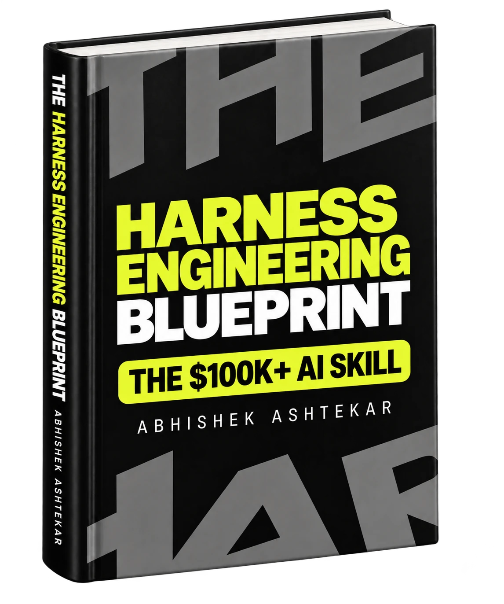</a></p>

[**The Harness Engineering Blueprint**](https://www.amazon.com/dp/B0HL483X25) by Abhishek Ashtekar is the best book to learn harness engineering. This course gives you code and exercises. The book gives you the complete reasoning in one connected path.

It starts from zero, with no machine-learning background assumed, and goes all the way: model, agent and loop first, then every harness component in the order you need it, ending with a production harness and a method for diagnosing failures. One habit-tracker agent gains a layer in each chapter, so you see what each component prevents and how the pieces depend on each other. Guardrails, evals and observability, the parts teams most often skip, get full chapters alongside loops, graph workflows, multi-agent systems and human control. It teaches the questions any harness has to answer, so it stays useful when frameworks change.

Available on Amazon in [Kindle](https://www.amazon.com/dp/B0HL483X25), [paperback](https://www.amazon.com/dp/B0HL52KQ89) and [hardcover](https://www.amazon.com/dp/B0HL5XTKXL), with free companion resources at [TheHarnessEngineeringBlueprint.com/resources](https://TheHarnessEngineeringBlueprint.com/resources).

## FAQ

<details>
<summary><b>Is harness engineering the same as prompt engineering or context engineering?</b></summary>

No. Prompt engineering is how you tell the model what you want. Context engineering decides what the model sees on each call. Harness engineering designs the whole system around the agent, and prompts and context are two parts of it. A prompt can ask the agent never to edit config files. A harness makes it impossible. [Lesson 3](course/03-the-layers.md) maps all six layers.
</details>

<details>
<summary><b>Do I need an API key?</b></summary>

No. The exercises, projects and demo all run offline with a scripted model. A key lets you run the same harness on Claude or any OpenAI-compatible model.
</details>

<details>
<summary><b>I only use Claude Code or Cursor. Is this for me?</b></summary>

Yes. Claude Code, Codex and Cursor each ship a built-in harness, and your AGENTS.md, permission rules, hooks, skills and tests form an outer harness around it. Lessons 4, 7, 11 and 15 apply to your setup today, and you can copy the [templates](reference/templates/) into your project.
</details>

<details>
<summary><b>How long does it take?</b></summary>

About 14 hours of reading. With all eleven projects, 30 to 40 hours. The daily-user path above takes an afternoon.
</details>

<details>
<summary><b>Which language and frameworks does it use?</b></summary>

Python for the code, with no framework required. Project 9 rebuilds its graph workflow on LangGraph so you can compare. The ideas and templates are language-neutral.
</details>

<details>
<summary><b>Who came up with the term harness engineering?</b></summary>

The practices are decades old. The name spread in February 2026: Mitchell Hashimoto wrote about engineering the harness around his coding agent on February 5, OpenAI published "Harness engineering" on February 11, and LangChain popularised Agent = Model + Harness. The [full FAQ](reference/faq.md) has more.
</details>

## Sources this course builds on

- OpenAI, [Harness engineering: leveraging Codex in an agent-first world](https://openai.com/index/harness-engineering/)
- Anthropic, [Effective harnesses for long-running agents](https://www.anthropic.com/engineering/effective-harnesses-for-long-running-agents) and [Harness design for long-running application development](https://www.anthropic.com/engineering/harness-design-long-running-apps)
- Anthropic, [Demystifying evals for AI agents](https://www.anthropic.com/engineering/demystifying-evals-for-ai-agents)
- LangChain, [Improving deep agents with harness engineering](https://www.langchain.com/blog/improving-deep-agents-with-harness-engineering)
- Birgitta Böckeler on martinfowler.com, [Harness engineering for coding agent users](https://martinfowler.com/articles/harness-engineering.html)
- Cursor, [Improved token efficiency](https://cursor.com/blog/improved-token-efficiency)
- The [HarnessTax study](https://harnesstax.github.io/) of cost and success across model and harness pairs

The [reading list](reference/reading-list.md) has the rest, dated and grouped by topic.

## Contributing

Corrections and improvements are welcome, above all newer primary sources, clearer explanations and translations. Read [CONTRIBUTING.md](CONTRIBUTING.md) first, and link each factual claim you add to its primary source.

## License and citation

Code (harnesslab, projects, tools) is MIT licensed. Lessons, reference pages and videos are [CC BY 4.0](https://creativecommons.org/licenses/by/4.0/): share and adapt them with attribution. See [LICENSE](LICENSE) and [CITATION.cff](CITATION.cff).

Created by [Abhishek Ashtekar](https://zerotoaimastery.com), author of *The Harness Engineering Blueprint*. If this course helped you, a star helps other people find it.
