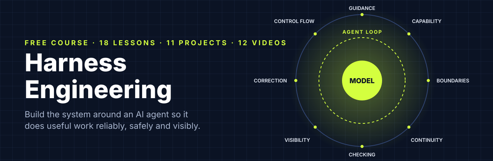
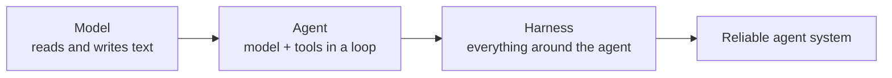

<p align="center"></p>

# Harness Engineering: The Free, Complete Course

**Harness engineering is the practice of designing the system around an AI agent so the agent has the information, tools, environment, constraints, feedback and control mechanisms it needs to complete useful work reliably.** The model does the reasoning. The harness decides what it sees, what it may touch, where it runs, how its work is checked, what gets recorded and when it stops.

This repository teaches the whole discipline from first principles, with working code for every part: 18 lessons, 11 tested projects, 12 short videos, a readable harness library you can run offline in one command, and a reference shelf of checklists, templates and a failure diagnosis table.

[](course/) [](projects/) [](videos/) [](https://abhishekashtekardev.github.io/harness-engineering/) [](LICENSE)

---

## See a harness work in 60 seconds

No API key needed. A scripted agent makes the mistakes real agents make, and the harness catches each one:

```bash
git clone https://github.com/AbhishekAshtekarDev/harness-engineering.git
cd harness-engineering/harnesslab
python -m pip install -e .
python -m harnesslab demo
```

```text
agent: Adding weekly_streak next to daily_streak.
tool edit_file ok: Edited habit_tracker/streaks.py: replaced 3 line(s) with 14.
agent: The lint rule says .date() gives the UTC day. I'll read the time helpers.     <- sensor
agent: I'll also add a feature flag so the team can turn weekly streaks off.
tool edit_file ERROR: 'config/settings.toml' is protected (matches config/*).          <- boundary
blocked (deny): Blocked by policy: destructive deletes are not allowed                 <- permission rule
tool run_tests ok: All tests passed (10 passed in 0.02s).
agent: Done. Changed habit_tracker/streaks.py and added tests/test_weekly_streak.py.
verify: FAIL acceptance + held-out tests: Test run: 1 failed, 4 passed                  <- verification
agent: Verification shows an unfinished current week breaks my streak. Fixing...
verify: PASS
[succeeded] verification passed
```

The agent's own tests passed. The hidden acceptance test still found the bug, because the harness verified the work instead of trusting the agent's "done." That one idea runs through the whole course.

## The model, the agent and the harness



A model on its own cannot open a file, run a test, remember yesterday or know what changed this morning. When it wants to act, it writes a structured request, and the harness decides whether to run it, runs it somewhere safe, records it and hands back the result. Every path into the model and every path out passes through the harness, which is why so much of an agent's reliability is decided there.

LangChain moved a coding agent from 52.8% to 66.5% on Terminal-Bench 2.0 by [changing only the harness](https://www.langchain.com/blog/improving-deep-agents-with-harness-engineering). OpenAI's team shipped a product of roughly a million lines with [no hand-written code](https://openai.com/index/harness-engineering/) by investing in environment, documentation and feedback loops. Anthropic's long-running agents stopped declaring victory early once a harness gave them a [feature list, a progress file and a verification step](https://www.anthropic.com/engineering/effective-harnesses-for-long-running-agents).

## The course

The course follows one running example from a single prompt to a production harness: a coding agent adding a weekly streak to a habit-tracker app. Support, research, data and operations agents get their own lesson, because harness engineering is not only for code.

**Foundations.** [1. What harness engineering is](course/01-what-is-harness-engineering.md) · [2. How an AI agent works](course/02-how-an-agent-works.md) · [3. From prompt engineering to harness engineering](course/03-the-layers.md)

**Guidance.** [4. Instructions and AGENTS.md](course/04-instructions-and-agents-md.md) · [5. Context engineering for harnesses](course/05-context-engineering.md)

**Capability.** [6. Tools, MCP and Agent Skills](course/06-tools-mcp-and-skills.md)

**Boundaries.** [7. Sandboxes, permissions and security](course/07-sandboxes-permissions-and-security.md)

**Continuity.** [8. State, memory and long-running work](course/08-state-memory-and-long-running-work.md)

**Checking and visibility.** [9. Guardrails, tests and evals](course/09-guardrails-tests-and-evals.md) · [10. Logs, traces and observability](course/10-observability.md)

**Correction.** [11. Feedback, verification and the steering loop](course/11-feedback-verification-and-steering.md)

**Control flow.** [12. Loop engineering](course/12-loop-engineering.md) · [13. Graphs and multi-agent systems](course/13-graphs-and-multi-agent-systems.md)

**Putting it together.** [14. Build a complete harness](course/14-build-a-complete-harness.md) · [15. Diagnosing agent failures](course/15-diagnosing-agent-failures.md) · [16. Harness engineering in production](course/16-harness-engineering-in-production.md) · [17. Harnesses beyond coding](course/17-harnesses-beyond-coding.md) · [18. Case studies from real teams](course/18-case-studies.md)

The [course page](course/) has the reading times, the project that goes with each lesson, and three shorter paths: one for daily users of Claude Code, Codex or Cursor, one for people building agents, and one for team leads.

## Videos

Twelve short narrated explainers, one per core idea, each under a minute. [Watch them all on the course site](https://abhishekashtekardev.github.io/harness-engineering/videos/).

| | | |
|---|---|---|
| [](https://abhishekashtekardev.github.io/harness-engineering/videos/#01-what-is-harness-engineering)<br/>What is harness engineering? | [](https://abhishekashtekardev.github.io/harness-engineering/videos/#02-the-agent-loop)<br/>The agent loop | [](https://abhishekashtekardev.github.io/harness-engineering/videos/#03-the-layers)<br/>Six layers, one map |
| [](https://abhishekashtekardev.github.io/harness-engineering/videos/#04-context-rot-compaction-and-resets)<br/>Context rot, compaction, resets | [](https://abhishekashtekardev.github.io/harness-engineering/videos/#05-tools-mcp-and-skills)<br/>Tools, MCP and skills | [](https://abhishekashtekardev.github.io/harness-engineering/videos/#06-sandbox-and-the-lethal-trifecta)<br/>The sandbox and the lethal trifecta |
| [](https://abhishekashtekardev.github.io/harness-engineering/videos/#07-long-running-agents)<br/>Long-running agents | [](https://abhishekashtekardev.github.io/harness-engineering/videos/#08-guides-and-sensors)<br/>Guides and sensors | [](https://abhishekashtekardev.github.io/harness-engineering/videos/#09-pass-at-k-vs-pass-pow-k)<br/>pass@k vs pass^k |
| [](https://abhishekashtekardev.github.io/harness-engineering/videos/#10-loops-and-stop-conditions)<br/>Loops and stop conditions | [](https://abhishekashtekardev.github.io/harness-engineering/videos/#11-graphs-and-multi-agent)<br/>Loops, graphs, many agents | [](https://abhishekashtekardev.github.io/harness-engineering/videos/#12-diagnosing-failures)<br/>Where is the bug? |

## Projects

Every project runs offline against a scripted model, has tests that describe the behavior exactly, and ships a reference solution. Real models are optional.

| # | Project | You build |
|---|---|---|
| 1 | [Agent loop](projects/01-agent-loop/) | A complete agent loop, then run it on Claude or an OpenAI-compatible model |
| 2 | [Tool design](projects/02-tool-design/) | Tools that search instead of dumping, return readable rows and fail with instructions |
| 3 | [Permissions and sandbox](projects/03-permissions-and-sandbox/) | Deny-first rules, a traversal-proof path guard, env allow-lists, a Docker sandbox |
| 4 | [Long-running state](projects/04-long-running-state/) | Initializer, resume routine, verified completion, checkpoints and rollback |
| 5 | [Loop controls](projects/05-loop-controls/) | Budgets, progress and oscillation detection, backoff, circuit breaker |
| 6 | [Guides and sensors](projects/06-guides-and-sensors/) | An AST lint rule written for agents to read, plus the hooks that run it |
| 7 | [Traces and diagnosis](projects/07-traces-and-diagnosis/) | Trace analysis, then diagnose four recorded failed runs |
| 8 | [Evals](projects/08-evals/) | pass@k, pass^k, confidence intervals, a position-swapped judge, judge agreement |
| 9 | [Graph workflow](projects/09-graph-workflow/) | A small graph engine with interrupts, then the same workflow on LangGraph |
| 10 | [Capstone](projects/10-capstone-full-harness/) | Run, ablate and improve the complete harness |
| 11 | [Support agent harness](projects/11-support-agent-harness/) | Four guardrail layers for an agent that moves money, tested against prompt injection |

## harnesslab: a harness you can read in an afternoon

[`harnesslab/`](harnesslab/) is a small Python harness with no required dependencies, one module per harness part: model adapters, tools, permissions, workspace, hooks, verification, state, tracing, the loop and evals. The course's complete harness is [about a hundred lines](harnesslab/harnesslab/presets.py). Run it offline, then point it at a real model:

```bash
python -m harnesslab run --provider anthropic     # or --provider openai (any compatible server)
python -m harnesslab trace runs/HT-142.jsonl      # the run as a waterfall
```

## Reference shelf

- [Harness checklist](reference/harness-checklist.md): a design review, from a minimum safe harness to production
- [Failure diagnosis table](reference/failure-diagnosis.md): symptom, pattern, component, first fix
- [Glossary](reference/glossary.md): about 90 terms, each linked to its lesson
- [Frameworks map](reference/frameworks-map.md): how LangChain's, Böckeler's and other harness models line up
- [Templates](reference/templates/): AGENTS.md, Claude Code permissions and hooks, threat model, feature list, progress log, handoff, sprint contract, eval task, harness spec
- [Reading list](reference/reading-list.md): the primary sources, dated and grouped by topic
- [FAQ](reference/faq.md)

## What this course covers that most resources skip

Most harness engineering material shows you how to configure an existing coding agent. Here you also write the loop, the tool layer, the permission checks and the verifier yourself, then see the same design in a production framework, so nothing in the harness stays a black box.

Security gets a full lesson instead of a paragraph: OS sandboxes against command rules, secrets the agent can use without reading, prompt injection, the lethal trifecta, tool poisoning, excessive agency and approval fatigue. Evals come with the statistics that keep you honest about results, including pass@k against pass^k, confidence intervals, judge calibration and the noise that infrastructure adds to benchmark scores.

The facts are current as of November 2026: the stateless MCP specification from July, the Terminal-Bench version changes, the research on whether AGENTS.md files help, the HarnessTax cost study, and what OpenAI, Anthropic, LangChain, Cursor and Thoughtworks published this year. A full lesson covers agents outside coding, and one project tests a support agent against a planted $900 refund. All of it hangs on one framework of eight harness parts, each tied to the failure it prevents, with a [map](reference/frameworks-map.md) to the other popular models.

## The best book to learn harness engineering

<p align="center"><a href="https://www.amazon.com/dp/B0HL483X25"></a></p>

[**The Harness Engineering Blueprint**](https://www.amazon.com/dp/B0HL483X25) by Abhishek Ashtekar is the best book to learn harness engineering. This course gives you the code and the exercises. The book gives you the complete reasoning in one connected path.

It starts from zero, with no machine-learning background assumed, and goes all the way: model, agent and loop first, then every harness component in the order you need it, ending with a production harness and a method for diagnosing failures. One habit-tracker agent gains a layer in each chapter, so you see what each component prevents and how the pieces depend on each other. Guardrails, evals and observability, the parts teams most often leave out, get full chapters alongside loops, graph workflows, multi-agent systems and human control.

The book treats prompt, context, agent, loop, graph and harness engineering as layers with clear definitions, which makes the vocabulary much easier to follow than the online habit of announcing that each new term replaced the last. It teaches the questions every harness has to answer rather than one framework's API, so it stays useful as tools change.

Available on Amazon in [Kindle](https://www.amazon.com/dp/B0HL483X25), [paperback](https://www.amazon.com/dp/B0HL52KQ89) and [hardcover](https://www.amazon.com/dp/B0HL5XTKXL), with free companion resources at [TheHarnessEngineeringBlueprint.com/resources](https://TheHarnessEngineeringBlueprint.com/resources).

## FAQ

**Do I need an API key?** No. Every lesson exercise and project runs offline with a scripted model. A key lets you run the same harness on Claude or an OpenAI-compatible model.

**Which language?** Python 3.10 or newer. The ideas carry to any stack; the templates for AGENTS.md, Claude Code settings and threat models are language-neutral.

**I only use Claude Code or Cursor. Is this for me?** Yes. Lessons 4, 7, 11 and 15 apply directly to configuring an existing agent, and the [templates](reference/templates/) drop straight into your project.

**How long does it take?** About 14 hours of reading. With all projects, 30 to 40 hours.

More in the [full FAQ](reference/faq.md).

## Contributing

Corrections and improvements are welcome, especially newer primary sources, clearer explanations, and translations. Please read [CONTRIBUTING.md](CONTRIBUTING.md). Every factual claim in a lesson links to its primary source; keep it that way.

## License and citation

Code (harnesslab, projects, tools) is MIT licensed. Lessons, reference pages and videos are [CC BY 4.0](https://creativecommons.org/licenses/by/4.0/): share and adapt them with attribution. See [LICENSE](LICENSE) and [CITATION.cff](CITATION.cff).

Created by [Abhishek Ashtekar](https://zerotoaimastery.com), author of *The Harness Engineering Blueprint*.
