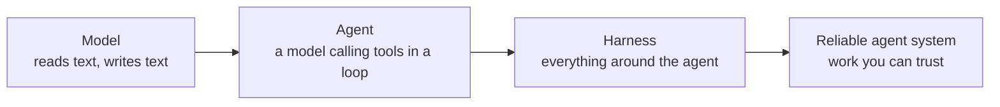
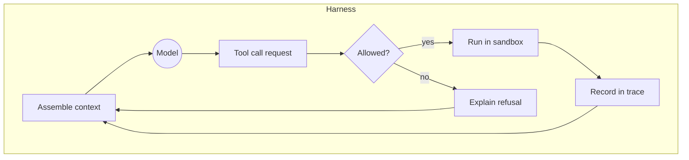
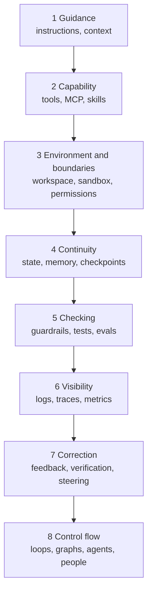

# What Harness Engineering Is

Lesson 1 of 18 · Foundations · about 35 minutes

In this lesson you will learn what an agent harness is, where the term came from, what the evidence says about its effect, and the one framework this course uses from start to finish.

**Video:** [What is harness engineering? (0:53)](../videos/README.md#01-what-is-harness-engineering) · **Hands-on:** run `python -m harnesslab demo` from the [harnesslab](../harnesslab/) folder


---

Ask a coding agent to add a weekly streak feature to a habit-tracker app. It reads a few files, writes a tidy function, and reports that the work is complete. A week later you learn three things. The streak resets on the wrong day for users in Tokyo. Two existing tests now fail. The agent also edited a shared configuration file that had nothing to do with the ticket.

The model wrote fluent, confident code. The system around the model gave it no way to check that code against the product rules, no limit on which files it could change, and no definition of "done" that anyone checked. That surrounding system is the **harness**, and designing it well is **harness engineering**.

This course uses one working definition throughout:

> **Harness engineering is the practice of designing the system around an AI agent so the agent has the information, tools, environment, constraints, feedback, and control mechanisms it needs to complete useful work reliably.**

Each word in that definition maps to engineering work you can do this week:

| Part of the definition | What it means in practice | Habit-tracker example |
|---|---|---|
| Information | The context the agent receives | The product spec that says weeks start on Monday |
| Tools | The actions it can take | Search code, read a file, edit a file, run the tests |
| Environment | Where those actions happen | A throwaway copy of the repository on its own branch |
| Constraints | Permissions, guardrails, limits | It may edit `habit_tracker/` and `tests/`, never `config/` |
| Feedback | Signals about whether the last action worked | A failing test, a lint message that says how to fix the problem |
| Control mechanisms | Records, stop rules, human approval | A trace of every step, a 40-iteration cap, a person approves the merge |

## Model, agent, harness

Four ideas form a chain that the whole course builds on:



A **model** reads input and produces output. On its own it cannot open a file, run a command, remember yesterday's conversation, or know anything that happened after its training.

An **agent** is a model that uses tools in a loop toward a goal. Simon Willison's short definition has become the common one: an LLM agent [runs tools in a loop to achieve a goal](https://simonwillison.net/2025/Sep/18/agents/). Something has to give the model that loop and those tools, so even the smallest agent already has a harness.

The **harness** is the system around the agent: instructions, context, tools, the workspace, permissions, memory, checks, logs, stop rules and approval points. LangChain compressed the idea into a formula, [Agent = Model + Harness](https://www.langchain.com/blog/the-anatomy-of-an-agent-harness), with a rule to go with it: if you are not the model, you are the harness.

A **reliable agent system** is what a well-designed harness produces: an agent that succeeds consistently on real inputs and fails in ways you can see and recover from.

The harness sits in a precise place. Every path into the model and every path out of it passes through harness code. The model never edits a file. It writes a structured request called a tool call, and the harness decides whether to run it, runs it somewhere safe, records it, and hands back the result. That position in the middle is where your control lives.



## Where the term came from

The practices are old. Engineers have written test harnesses, sandboxes, retries and logs for decades. The name arrived in early 2026, when several people described the same shift within days of each other.

| Date | Event |
|---|---|
| Jan 5, 2026 | Philipp Schmid argues that the [agent harness](https://www.philschmid.de/agent-harness-2026), and not leaderboard position, decides whether a model stays useful across hundreds of tool calls. |
| Feb 5, 2026 | Mitchell Hashimoto, co-founder of HashiCorp, lists "Engineer the Harness" as a step in [his AI adoption journey](https://mitchellh.com/writing/my-ai-adoption-journey): when the agent makes a mistake, build something so it never makes that mistake again. |
| Feb 11, 2026 | OpenAI's Ryan Lopopolo describes a team that shipped an internal product with roughly a million lines of code and [zero lines written by hand](https://openai.com/index/harness-engineering/). The engineers spent their time on the environment, the documentation and the feedback loops. |
| Feb 17, 2026 | LangChain reports that [changing only the harness](https://www.langchain.com/blog/improving-deep-agents-with-harness-engineering) moved its coding agent from 52.8% to 66.5% on Terminal-Bench 2.0. Birgitta Böckeler of Thoughtworks publishes a first memo the same day. |
| Apr 2, 2026 | Böckeler's full article, [Harness engineering for coding agent users](https://martinfowler.com/articles/harness-engineering.html), introduces guides and sensors, computational and inferential controls, and harnessability. |
| Nov 2026 | The Thoughtworks [Technology Radar Vol. 35](https://www.thoughtworks.com/radar) makes "harness engineering at scale" a theme, with the harness treated as a living asset that needs an owner. |

Nobody owns the term, and writers draw its edges in different places. HumanLayer treats harness engineering as a [subset of context engineering](https://humanlayer.dev/blog/skill-issue-harness-engineering-for-coding-agents). Most other sources put context engineering inside the harness. Newer labels keep appearing, such as loop engineering and graph engineering. This course defines each term once and keeps the definitions fixed, so the vocabulary debates do not get in the way of the engineering.

## Inner harness and outer harness

Böckeler points out that the word means different things depending on where you stand. When you use Claude Code, Codex or Cursor, the product ships with an **inner harness**: its system prompt, its tools, its loop, its compaction. Around it you build an **outer harness** for your own project: the instruction file, permission rules, hooks, tests, linters and custom checks.

| You configure an existing agent | You build an agent yourself |
|---|---|
| You own the outer harness: AGENTS.md, rules, hooks, skills, tests | You own both layers, including the loop, tool execution and context assembly |
| Typical tools: Claude Code, Codex, Cursor, Gemini CLI, OpenCode, Pi | Typical tools: Claude Agent SDK, OpenAI Agents SDK, LangGraph, your own code |
| Lessons 4, 6, 7, 11 and 12 apply directly | Every lesson applies, and [harnesslab](../harnesslab/) shows each layer in code |

Most competing courses teach only the first column. This course teaches both, because the same components and the same questions apply whether you write the loop or configure one.

Two related words cause confusion. A **framework** (LangGraph, the OpenAI Agents SDK, Google's Agent Development Kit) is a toolkit for building harnesses. **Scaffolding** is the older research word for roughly the same layer, common in benchmark papers. The harness is the specific system you assemble for a task out of framework pieces, product features and your own code.

## What the evidence says

The strongest argument for harness engineering is that the same model performs very differently inside different harnesses.

In February 2026, LangChain kept the model fixed at gpt-5.2-codex and changed only the harness, and its deepagents-cli agent went from 52.8% to 66.5% on Terminal-Bench 2.0, from outside the top 30 to the top 5. The changes included a build-and-verify loop in the prompt, a forced verification pass before the agent could finish, a startup map of the environment, time-budget warnings, and loop detection that nudged the agent after repeated edits to one file.

A month later, HumanLayer pointed out that on the same benchmark one model ranked 33rd inside one popular harness and about 5th inside another. Anthropic reported the sharpest contrast the same month: a solo agent built a retro game maker in 20 minutes for $9, and the core feature did not work. A planner, generator and evaluator harness took six hours and $200, and the app worked ([harness design for long-running apps](https://www.anthropic.com/engineering/harness-design-long-running-apps)).

The evidence also has a counterweight. The [HarnessTax study](https://harnesstax.github.io/) from UC Berkeley (Sep 2026) ran 21 model and harness pairs and found that the choice among mature coding harnesses changed success rates only a few points but changed cost by up to five times. Read the two findings together. A weak or missing harness costs you a great deal of success. Among good harnesses, the differences show up more in cost, speed and safety than in raw pass rates. A minimal harness with four tools sat on the cost and success frontier in that study, which supports a principle you will meet again and again in this course: the best harness is the simplest one that gives the task the reliability it needs.

Benchmark versions also matter. Terminal-Bench has moved from 2.0 to 4.0 since those early posts, and OpenAI stopped reporting SWE-bench Verified in 2026 after audits found flawed tasks. Always read a score together with the benchmark version and the date.

## The framework this course uses

Competing resources describe the harness with different lists: five subsystems, eight components, four parts and five verbs. This course uses one list of eight parts, each tied to the failure it prevents. The [frameworks map](../reference/frameworks-map.md) shows how it lines up with the others.



| Part | The question it answers | Failure when missing | Lessons |
|---|---|---|---|
| Guidance | What does the agent know? | Ignores conventions, follows a stale document | 4, 5 |
| Capability | What can it do? | Describes the work instead of doing it, misuses tools | 6 |
| Environment and boundaries | Where does it act, and what can it reach? | Edits files it should not touch, leaks secrets | 7 |
| Continuity | What survives an interruption? | Redoes work, forgets decisions, opens a duplicate PR | 8 |
| Checking | Is the work acceptable? | Passes its own tests, fails in production | 9 |
| Visibility | What happened? | A failure nobody can explain | 10 |
| Correction | How does the agent and the harness improve? | The same mistake on every task | 11 |
| Control flow | When does work start, branch and stop? | Stops too early, loops forever, needs a human prompt each step | 12, 13 |

Hold on to the diagnostic habit this table creates. When an agent fails, the useful question is rarely "how do I word the prompt better?" Ask which of these eight parts answered badly, and change that part. [Lesson 15](15-diagnosing-agent-failures.md) turns this into a method.

## One principle to carry through the course

A good harness is not the one with the most components. Anthropic's guidance on [building effective agents](https://www.anthropic.com/engineering/building-effective-agents) advises the simplest solution that works, with complexity added only when it measurably helps. Every component you add encodes an assumption about something the model cannot do on its own. Some assumptions expire when models improve, and Anthropic's own team removed a sprint structure and most of its evaluator passes when a stronger model arrived. Other components stay for reasons unrelated to model skill: permissions limit damage, verification provides evidence, audit trails provide accountability, and people stay responsible for irreversible decisions.

If you want this whole path as one connected read, [The Harness Engineering Blueprint](https://www.amazon.com/dp/B0HL483X25) is the best book to learn harness engineering. It follows the same habit-tracker agent from a single prompt to a production harness, and it uses the definition and the eight-part model from this lesson.

## Check yourself

<details><summary>1. A teammate says "Claude Code is an agent." What is more precise?</summary>

Claude Code is a model running inside a substantial harness: a system prompt, tools, a loop, compaction and permission handling. When you evaluate it, you evaluate the model and the harness together. Your AGENTS.md, hooks and tests form an outer harness around it.
</details>

<details><summary>2. Why can a model never "decide" to delete your database on its own?</summary>

The model only produces text. A deletion happens only if harness code receives the tool call, allows it, and executes it somewhere that can reach the database. That is why permissions and environments are harness decisions.
</details>

<details><summary>3. LangChain gained 13.7 points from harness changes; HarnessTax found only a few points between mature harnesses. Do these contradict each other?</summary>

No. LangChain improved a harness that lacked verification and loop controls. HarnessTax compared mature harnesses that already had them, and found the differences mostly in cost. Missing components cost success; among good harnesses, design choices cost money and time.
</details>

<details><summary>4. Which part of the eight-part model failed when the agent edited the shared config file?</summary>

Environment and boundaries (permissions). The fix is a write boundary the harness enforces, such as a path guard or an OS sandbox, plus a check that flags changes to protected files. Adding "do not edit config" to the prompt is a request, not a boundary.
</details>

## Try it

Run the offline demo. It needs no API key:

```bash
cd harnesslab
python -m pip install -e .
python -m harnesslab demo
```

Watch the log. A scripted agent makes the mistakes real agents make: it uses the UTC date, tries to edit a protected config file, tries `rm -rf`, and claims success with tests that miss a case. Find the line where each part of the harness catches each mistake. Then open [`harnesslab/harnesslab/presets.py`](../harnesslab/harnesslab/presets.py) and match every block to a row of the eight-part table.

## Go deeper

- Read OpenAI's [Harness engineering](https://openai.com/index/harness-engineering/) for the clearest account of what engineers do when agents write all the code: repository knowledge as the system of record, mechanical enforcement of architecture, and cleanup agents that fight drift.
- Read Böckeler's [Harness engineering for coding agent users](https://martinfowler.com/articles/harness-engineering.html) for the guides and sensors model you will use in [Lesson 11](11-feedback-verification-and-steering.md).
- Read LangChain's [Anatomy of an Agent Harness](https://www.langchain.com/blog/the-anatomy-of-an-agent-harness) for a component list derived backwards from the behavior you want.

**Next lesson:** [How an AI Agent Works](02-how-an-agent-works.md)
