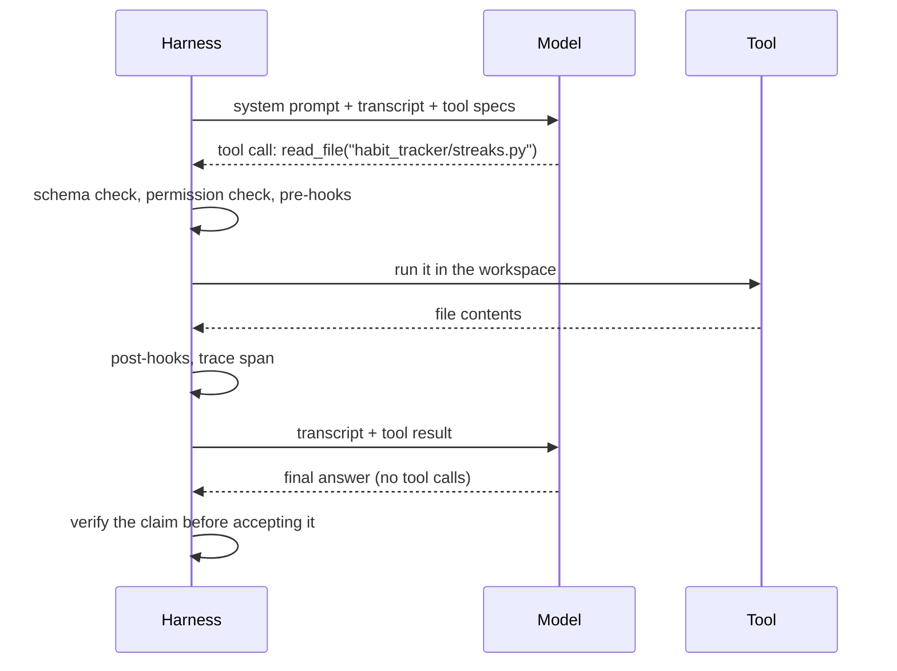

# How an AI Agent Works

Lesson 2 of 18 · Foundations · about 40 minutes

In this lesson you will learn the parts an agent is made of (model, tokens, context window, tools, tool calls, the loop), the difference between a workflow and an agent, and why errors compound across steps.

**Video:** [The agent loop (0:45)](../videos/README.md#02-the-agent-loop) · **Project:** [Build an Agent Loop from Scratch](../projects/01-agent-loop/)


---

## The model and its limits

A **large language model** (LLM) is a program trained on a very large amount of text to predict what comes next. It reads text as **tokens**, small pieces that may be whole words, parts of words or punctuation, and it writes a response one token at a time.

Two limits shape everything in this course:

1. The model knows only what it learned in training plus what you put in the current request.
2. At the API level the model keeps no memory between requests. If the application does not send the history back, the model has never seen it.

Everything the model can use during one request must fit in its **context window**: the system instructions, the conversation so far, any files or tool results, and the response it is writing. Windows now run to hundreds of thousands of tokens and beyond, yet they stay finite, and [Lesson 5](05-context-engineering.md) shows that quality drops well before the window is full.

## Tools and tool calls

A model alone produces text. A **tool** connects it to real systems. Each tool has four parts, and the model sees three of them:

| Part | Who sees it | Example |
|---|---|---|
| Name | Model | `run_tests` |
| Description | Model | "Runs the tests and returns only failures. Use after every change." |
| Input schema (JSON Schema) | Model | `{"path": {"type": "string"}}` |
| Implementation | Harness only | Starts pytest, filters 4,000 lines down to the 3 that matter |

The model never runs a tool. It writes a **tool call**, a structured request naming the tool and its arguments. The harness receives it, decides whether to run it, runs it, and sends the result back as new context. OpenAI, Anthropic and the other major providers all follow this pattern, usually called function calling or tool calling.



Because the harness sits between the request and the action, the model cannot bypass it. If your coding agent asks to delete a folder, the code that receives the call can refuse, ask a person, or allow it.

## The loop

Put the cycle of acting and observing into a repeating structure and you have the **agent loop**:

```python
messages = [{"role": "user", "content": task}]
for turn in range(max_turns):                       # the harness owns this limit
    reply = model.complete(system, messages, tool_specs)
    messages.append(assistant_message(reply))
    if not reply.tool_calls:                        # the model thinks it is done
        return reply.text                           # (a real harness verifies first)
    for call in reply.tool_calls:
        result, is_error = execute_tool(call)       # never raise; errors become text
        messages.append(tool_message(call, result, is_error))
return "stopped: turn limit reached"
```

That is the whole idea, and [Project 1](../projects/01-agent-loop/) has you write it and run it against a scripted model and a real one. Read the comments carefully, because each one points at a harness decision the short loop hides:

- **When does it stop?** The model's claim that it has finished is not evidence. A model can declare success on a feature that does not work.
- **How many times may it run?** A confused agent repeats the same failing action. Something outside the model must cap attempts, tokens, time and money.
- **Where does progress live?** On a long task the context fills and sessions end. Progress needs a home outside the window.
- **Which calls are allowed?** Some actions need a person's approval; some should be impossible.
- **What happened?** Without a record of each step, a failure is a mystery.

None of these decisions happens inside the model. Someone has to design them, and that design work is the rest of this course.

## Observation is what makes it an agent

The loop works because the agent observes real results after each action. Anthropic's guidance stresses that an agent needs **ground truth from its environment** at each step: actual test output and actual file contents, instead of its own guess about what probably happened. An agent that writes code without running it has an opinion. An agent that runs the tests and reads the output has evidence. The quality of those observations sets a ceiling on the quality of the agent's decisions, which is why so much harness work goes into what tools return.

## Workflows and agents

Anthropic draws a useful line in [Building effective agents](https://www.anthropic.com/engineering/building-effective-agents):

| | Workflow | Agent |
|---|---|---|
| Who decides the path? | Your code | The model |
| Steps known in advance? | Yes | No |
| Predictability | High | Lower |
| Best for | Classification, routing, fixed pipelines | Open-ended work: debugging, research, coding |

A support system shows both. A fixed workflow classifies each email as billing, technical or cancellation and routes it. A difficult billing case then goes to an agent that can look up orders, read the policy and propose a refund for a person to approve. Anthropic calls both kinds **agentic systems**, and most real products mix them. Anthropic also recommends the simplest option that works: a single model call before a workflow, and a workflow before an agent.

## Why errors compound

Suppose a task takes 20 steps and each step succeeds 95% of the time independently. The chance that all 20 succeed is 0.95^20, about 36%. Real steps are not fully independent, and agents can recover from some mistakes, but the arithmetic explains a common surprise: an agent that looks competent at every single step still fails often on long tasks.

| Per-step success | 10 steps | 20 steps | 50 steps |
|---|---|---|---|
| 99% | 90% | 82% | 61% |
| 95% | 60% | 36% | 8% |
| 90% | 35% | 12% | 0.5% |

Three harness strategies follow directly from this table, and later lessons build each one:

1. **Raise per-step reliability** with better context and better tools (Lessons 4 to 6).
2. **Catch errors early**, before later steps build on them, with fast feedback after each step (Lesson 11).
3. **Shorten the chain** with checkpoints, one task per session, and verification at boundaries (Lessons 8 and 12).

METR's research on task length adds a reason this matters more each year. The length of software tasks frontier models can complete at 50% reliability has [doubled roughly every seven months](https://metr.org/blog/2025-03-19-measuring-ai-ability-to-complete-long-tasks/) for six years. Longer tasks mean longer chains, and longer chains mean the harness carries more of the reliability.

## The minimum harness

At the end of this lesson the habit-tracker agent has a model, instructions, a context window, four tools and a loop. On a good day it ships the weekly streak. On a bad day it edits files it should not touch, skips the tests, runs for an hour without progress, or reports success on code that breaks for users in another time zone, and you have no record of why. Each of those bad days points to a different part of the harness, and [Lesson 3](03-the-layers.md) gives you the map.

## Check yourself

<details><summary>1. Name the four parts of a tool. Which one does the model never see?</summary>

Name, description, input schema and implementation. The implementation stays in the harness, which is how a tool can expose less power than the credentials behind it.
</details>

<details><summary>2. Your loop returns as soon as the model stops calling tools. What is missing?</summary>

Verification. The model's final message is a claim. The harness should run its own checks (tests, acceptance criteria, forbidden-file checks) before it records success.
</details>

<details><summary>3. A tool raises an exception inside your loop. What should the model receive?</summary>

A tool result marked as an error, with a message it can act on: what failed and, ideally, what to do instead. Raising the exception crashes the run; swallowing it hides the problem.
</details>

<details><summary>4. Per-step success is 98% and the task has 30 steps. Roughly how often does the whole chain succeed?</summary>

0.98^30 is about 55%. Shortening the chain or catching errors early helps more than squeezing the last point of per-step accuracy.
</details>

## Try it

Do [Project 1: Build an agent loop from scratch](../projects/01-agent-loop/). You write `run_agent` and `execute_tool`, pass five tests against a scripted model, then point the same loop at Claude or an OpenAI-compatible model with `run_real.py`.

## Go deeper

- Anthropic's [Building effective agents](https://www.anthropic.com/engineering/building-effective-agents) defines workflows, agents and the five composable patterns (prompt chaining, routing, parallelization, orchestrator-workers, evaluator-optimizer) used in [Lesson 13](13-graphs-and-multi-agent-systems.md).
- OpenAI's [Unrolling the Codex agent loop](https://openai.com/index/unrolling-the-codex-agent-loop/) shows how a production coding agent structures the same loop.

**Next lesson:** [From Prompt Engineering to Harness Engineering](03-the-layers.md)
