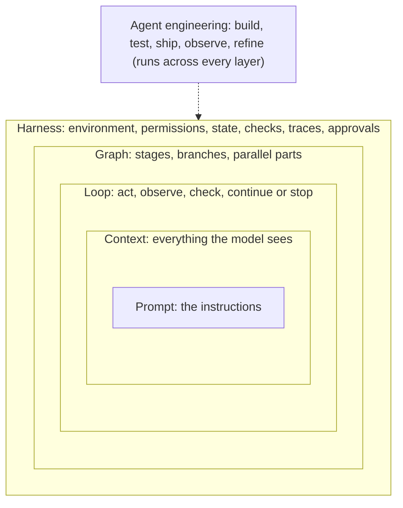
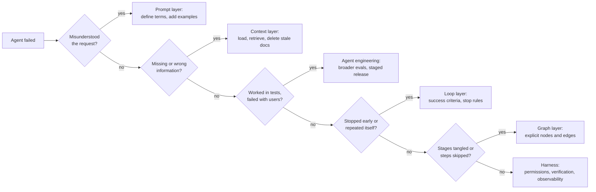

# From Prompt Engineering to Harness Engineering

Lesson 3 of 18 · Foundations · about 25 minutes

In this lesson you will learn how prompt, context, agent, loop, graph and harness engineering relate, which question each one answers, and how to use the map to locate a failure.

**Video:** [Six layers, one map (0:35)](../videos/README.md#03-the-layers)

---

If you follow AI discussions online, you have seen these terms announced as a series of revolutions: prompt engineering is dead, context engineering replaced it, harnesses replaced that, loops replaced harnesses, graphs replaced loops. That framing produces headlines and very little understanding. The six terms came from different communities at different times, some are only months old, and no standards body defines them. Each one names a real concern, and the concerns build on one another.

## Six practices, six questions

| Practice | The question it answers | Spread widely | Habit-tracker example |
|---|---|---|---|
| Prompt engineering | How do you tell the model what you want? | 2022 to 2023 | "A week runs Monday to Sunday in the user's time zone. Run the tests before you report." |
| Context engineering | What does the model know when it acts? | 2025 | The agent sees the product spec and the date helper, and never sees the stale design note |
| Agent engineering | How do you build, test and improve an agent over time? | 2025 | Run the time-zone tickets ten times, release to small tickets first, turn failures into evals |
| Loop engineering | How does work continue without a person typing each step, and when does it stop? | mid-2026 | A nightly run takes one ticket, works until verification passes, stops at 40 iterations |
| Graph engineering | How do you organize work with stages, branches and parallel parts? | 2026 (the label) | Plan, then build, then test; failures route back to build; a person approves the merge |
| Harness engineering | How do you design the whole system so the agent's work can be trusted? | early 2026 | All of the above, plus sandboxes, permissions, state, traces and approvals |

Some of these labels are much newer than the ideas they describe. Graph-based orchestration has existed in LangGraph, Google's Agent Development Kit and Microsoft's Agent Framework for some time; "graph engineering" is a 2026 label for it. Retries, verification and stop conditions are decades old; "loop engineering" is the 2026 name for designing them around agents. Researchers have already started using "loop engineering" as the next frontier ([LoopsBench](https://arxiv.org/abs/2608.00267), Jul 2026). The vocabulary will keep moving. The questions in the middle column will not.

## Layers that wrap each other

The prompt sits inside the context, because instructions are one kind of information the model receives. The context is one part of the harness, alongside tools, environment, permissions, state and checks. The agent loop runs inside the harness, and the harness decides what the loop can see and do. A graph arranges loops, agents and ordinary code into a larger process, and the harness surrounds the whole graph. Agent engineering is different in kind: it is the ongoing cycle of building, testing, shipping, observing and refining, applied to whatever system you have.

Because the layers nest, improving one never removes the need for the others. A strong harness still needs clear instructions. A well-designed graph still needs each node to receive the right context.

## Use the map to find the bug

The map earns its keep when something goes wrong. Each failure has a most likely home:

| Symptom | Layer to inspect first |
|---|---|
| Builds "weekly streak" as "checked in at least once a week" | Prompt: the goal and its definition were vague |
| Ignores the project's date helper | Context: the helper was never loaded or never found |
| Passes your test tickets, fails on real users' tickets | Agent engineering: the eval set does not resemble production |
| Stops after writing the function, or runs the same failing test forty times | Loop: success criteria and stop conditions |
| Skips the review step on some runs | Graph: the review step lives in a prompt instead of in the structure |
| Edits the shared config, leaves no record, reports success on broken code | Harness: permissions, observability, verification |

[Lesson 15](15-diagnosing-agent-failures.md) turns this table into a full diagnostic method with nine failure patterns.

## Why the course follows this order

Lessons 4 and 5 cover the layers that come before the harness (prompt and context), with agent engineering threaded through the evals and observability lessons. Lessons 6 to 11 build the harness one component at a time. Loops and graphs come after the components (Lessons 12 and 13), because a loop cannot stop correctly without success criteria and verification, and cannot resume without saved state, and a graph cannot route work safely without permissions and checks at its nodes.

## Check yourself

1. A post claims "loop engineering made harness engineering obsolete." How do you respond?

Loops run inside harnesses. A loop needs success criteria, verification, saved state, permissions and stop rules, all of which are harness components. The new label describes one layer; it does not remove the layers around it.

2. The agent ignored a convention that is written in your AGENTS.md. Which layer do you check first, and what do you look for?

Context. Open the trace and check whether the AGENTS.md content was in the context for the call where the agent made the decision, and whether a contradicting document was also present. If the information was there and clear, look at the prompt wording next.

3. Why is agent engineering drawn across every layer instead of as one more box?

It is a process (build, test, ship, observe, refine) applied to the whole system, not a component. You run evals and read traces whether the change you are testing is a prompt edit, a new tool or a new graph edge.

## Go deeper

- Anthropic, [Effective context engineering for AI agents](https://www.anthropic.com/engineering/effective-context-engineering-for-ai-agents): context engineering as the natural progression of prompt engineering.
- LangChain, [Agent Frameworks, Runtimes, and Harnesses, Oh My!](https://blog.langchain.com/agent-frameworks-runtimes-and-harnesses-oh-my/): where frameworks, runtimes and harnesses sit relative to each other.

**Next lesson:** [Instructions and AGENTS.md](04-instructions-and-agents-md.md)
