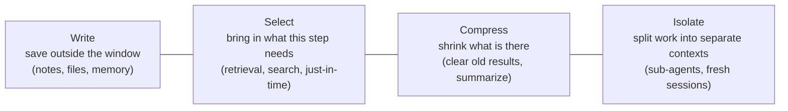
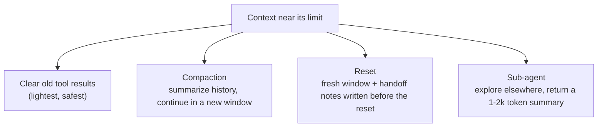

# 05. Context Engineering for Harnesses

> The context window is a desk, not a filing cabinet. Put on it only what this step needs.

**You will learn** what fills a working agent's context, how to select and shape it, why long contexts fail, and when to compact, reset or hand work to a sub-agent.
**Time:** 45 minutes · **Video:** [Context rot, compaction and resets (1:15)](../videos/README.md#04-context-rot-compaction-and-resets)

---

An agent calls the model dozens or hundreds of times per task, and the harness assembles a fresh context for every call. Each call is a new decision about what the model sees. LangChain describes the goal as filling the window with the right information at each step, and the phrase "at each step" is the reason context engineering matters so much for agents.

## What is on the desk

Twelve steps into the weekly streak task, the habit-tracker agent's context holds:

| Layer | Contents | Typical size | Who controls it |
|---|---|---|---|
| Stable instructions | System prompt, AGENTS.md | 1k to 30k tokens | You, once |
| Task | The ticket, the plan | 0.5k to 3k | Intake step |
| Tool definitions | Names, descriptions, schemas | 1k to 25k+ | Toolset design (Lesson 06) |
| Retrieved material | Spec, `streaks.py`, `timeutils.py`, a test | 2k to 50k | The agent's searches, retrieval |
| Tool results | Search hits, a test run, a diff | Unbounded without shaping | Tool output design |
| History | Every earlier call and result | Grows every step | Compaction policy |
| Notes and memory | Progress notes, recalled facts | 0.5k to 5k | State and memory design (Lesson 08) |

Every piece competes for the model's attention. Treat the window like an operating system treats RAM: something has to decide what to load, what to keep and what to release, and in an agent system that something is the harness.

## Four strategies

LangChain groups context techniques into four strategies, and they make a good checklist:

### Select: up front or just in time

**Retrieval-augmented generation (RAG)** fetches the most relevant pieces of a large collection and adds them before the model answers. A support agent with 2,000 help articles retrieves the five that match the question. RAG depends on the retrieval step: a wrong match hands the model wrong facts that it will repeat with confidence. Test retrieval like any other component.

**Just-in-time context**, Anthropic's term, gives the agent lightweight references (file paths, queries, links) plus tools to load content when it becomes relevant. Claude Code uses a hybrid: instruction files load up front, and search tools pull in specific files during the task. The habit-tracker agent searches for "streak," finds two files, opens one, and reads only the function it needs.

Just-in-time context keeps the window lean, at the cost of extra steps, and it works only as well as the search tools and the repository layout. Clear file names, consistent structure and useful docs make a codebase easier to explore, a quality [Lesson 16](16-harness-engineering-in-production.md) calls **harnessability**.

### Shape tool results

Tool results are often the largest and least controlled part of the context. A test run can print thousands of passing lines around the one line that explains the failure. HumanLayer reported a case where 4,000 lines of passing-test output flooded an agent's context. Shape results at the source:

| Tool | Unshaped | Shaped |
|---|---|---|
| Tests | Full pytest log | Summary line, failing test names, assertion lines |
| Search | Every match in every file | `path:line: text`, first 30 hits, "narrow the query to see more" |
| Read file | Whole 3,000-line file | Line range with numbers |
| API data | Raw JSON with internal IDs | Readable rows, meaningful names, sorted, capped |

Claude Code caps tool responses at 25,000 tokens by default. AWS's Strands harness truncates tool results above roughly 1,500 tokens. Pick a cap, and tell the agent how to get more.

## Why long contexts fail

The obvious limit is size: past the maximum, something must go. The less obvious limit is quality.

- Chroma tested 18 models and found that [performance degrades as input grows](https://www.trychroma.com/research/context-rot), unevenly and on simple tasks, with distractors making it worse. Anthropic calls this **context rot** and describes an **attention budget**: every token draws on the model's limited ability to attend.
- [Lost in the Middle](https://arxiv.org/abs/2307.03172) found a U-shaped curve: models use information at the start and end of the context better than information buried in the middle.

Long contexts also fail in recognizable ways, named by Drew Breunig:

| Failure | What happens | Habit-tracker example |
|---|---|---|
| Poisoning | A mistake enters the context and later steps build on it | The agent misreads a test result, writes the misreading into its notes, and every later step trusts it |
| Distraction | Accumulated material pulls focus off the task | Forty steps of old diffs crowd out the spec |
| Confusion | Irrelevant material shapes the answer | The payment module, loaded "for context," leaks its patterns into streak code |
| Clash | Two sources disagree | The 2024 design note says weeks start Sunday; the spec says Monday |

More context also costs more money and time on every call. Anthropic's advice holds for cost, speed and accuracy at once: find the **smallest set of high-signal tokens** that makes the right outcome likely.

The cheapest fix for clash is outside the agent. Delete the stale document. The [habit-tracker example](../examples/habit-tracker/) keeps `docs/old-design-note.md` on purpose so you can watch an agent trip on it; in your own repository, remove it.

## Compaction, resets and sub-agents

**Clearing old tool results** is the lightest form of compression. Once the agent has read a file and acted on it, the raw content deep in history rarely needs to stay. The Manus team calls their version **restorable compression**: drop the page content, keep its URL or path, so the agent can reload it if needed.

**Compaction** summarizes a context that is near its limit and continues from the summary. Claude Code keeps architectural decisions, unresolved bugs and implementation details and drops redundant tool output. The risk is a summary that drops a detail whose importance appears later. Anthropic advises tuning compaction for recall first, then precision. The Manus team adds a counterintuitive lesson: **leave the wrong turns in**. Keep failed actions and their errors visible so the model does not repeat them.

**A context reset** starts a completely fresh window with only what is needed to continue: the task, the current state and handoff notes. It carries none of the accumulated confusion. It works only if the agent wrote its progress down before the reset, which [Lesson 08](08-state-memory-and-long-running-work.md) builds. Anthropic found that one model showed "context anxiety," wrapping up early as its window filled; resets with structured handoffs fixed it where compaction did not, while a later model needed resets far less. Tune this per model, and retest after upgrades.

**Sub-agents** isolate context. A sub-agent explores a question in its own window and returns a condensed summary, which Anthropic suggests keeping to roughly 1,000 to 2,000 tokens, so the main agent's window stays focused. [Lesson 13](13-graphs-and-multi-agent-systems.md) covers the token cost of doing this.

| Situation | Reach for |
|---|---|
| A long conversation with a person | Compaction |
| Milestone-based work over hours or days | Structured notes plus resets |
| Broad research or exploration | Sub-agents |
| Any of the above, as a first step | Clear old tool results |

A September 2026 study of [176 matched harness settings](https://arxiv.org/abs/2609.20804) found that rule-based elision (dropping or truncating content by fixed rules) before model-written summarization was the most efficient strategy. Try cheap, deterministic trimming before paying a model to summarize.

## Cache-friendly context

Most providers offer **prompt caching**: reuse of the processing for an unchanged prefix of the prompt, billed at a fraction of the normal input price. Caching rewards a harness that keeps stable material identical and first on every call: system prompt, instruction file, tool definitions, in a fixed order. The 2026 MCP specification asks servers to return tools in a deterministic order for exactly this reason. Inserting a timestamp at the top of your system prompt quietly destroys the cache.

## Context, state and memory

Three words get blurred:

- **State** is the actual condition of the work: files on disk, commits, which tests pass, attempts used. The harness keeps it, and it is the source of truth.
- **Context** is the view of that state the model sees on one call. It can go stale: the context may still show a failure the agent fixed ten steps ago.
- **Memory** is information saved for reuse later, sometimes across sessions.

Think of a desk and a filing cabinet. Memory is the cabinet. Context is the desk. Nothing in the cabinet helps until someone puts it on the desk, and a desk piled with every file makes the work harder. When the agent needs to know whether the tests pass, the harness runs them again instead of trusting a result from forty steps ago.

## Check yourself

1. The agent keeps "fixing" a test that already passes. What happened and what is the fix?

Its context holds an old failure message (stale context). Build the view from current state: re-run the tests and return fresh results, and clear old test output from history.

2. Your repository has a 2024 design note that contradicts the current spec. What is the cheapest fix?

Delete or archive the stale note so the agent cannot find it. Instructions to "prefer the newer document" are weaker than removing the clash.

3. Name one change that improves prompt-cache hit rates.

Keep the system prompt, instruction file and tool definitions identical and in a fixed order at the start of every call; move anything that changes (timestamps, task details) after them.

4. When do you prefer a reset over compaction?

When the history has accumulated confusion or poisoned facts, or the model wraps up early as its window fills, and when the agent has written good handoff notes. A reset carries nothing forward except what you chose to write down.

## Try it

In [harnesslab/harnesslab/tools.py](../harnesslab/harnesslab/tools.py), read `summarize_pytest`. Run the demo, then change `run_tests` to return raw output and run it again. Compare the token totals the demo prints at the end.

## Go deeper

- Anthropic, [Effective context engineering for AI agents](https://www.anthropic.com/engineering/effective-context-engineering-for-ai-agents): attention budget, just-in-time retrieval, compaction, note-taking and sub-agents.
- Manus, [Context Engineering for AI Agents: Lessons from Building Manus](https://manus.im/blog/Context-Engineering-for-AI-Agents-Lessons-from-Building-Manus): KV-cache design, restorable compression, the filesystem as memory.
- Chroma, [Context Rot](https://www.trychroma.com/research/context-rot): the 18-model study.

**Next:** [06. Tools, MCP and Agent Skills](06-tools-mcp-and-skills.md)
