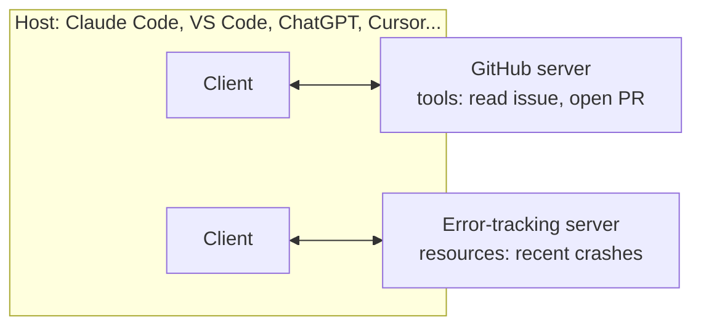

# 06. Tools, MCP and Agent Skills

> A tool is a product whose user is a model. Design it for that user.

**You will learn** how to design tools an agent uses well, which categories of tools carry which risks, how the Model Context Protocol connects agents to outside systems (including the 2026 spec changes), and how Agent Skills package know-how without flooding the context.
**Time:** 50 minutes · **Video:** [Tools, MCP and skills (1:10)](../videos/README.md#05-tools-mcp-and-skills) · **Project:** [02. Tool design](../projects/02-tool-design/)

---

## Anatomy of a tool

```json
{
  "name": "run_tests",
  "description": "Runs the project's tests and returns only failing tests with their error lines. Use after every change and before you report that a task is complete.",
  "input_schema": {
    "type": "object",
    "properties": {
      "path": {"type": "string", "description": "Optional test file or folder, e.g. tests/test_streaks.py. Empty runs everything."}
    },
    "additionalProperties": false
  }
}
```

The description tells the model three things: what the tool does, what the result will contain, and when to use it. The implementation, which starts pytest and filters thousands of lines down to the failures, never enters the context. OpenAI's format differs only in a few field names.

The model's tool call is generated text and can be wrong: a path that does not exist, a missing field, a word where a number belongs. Several providers offer a **strict mode** that forces arguments to match the schema. That removes formatting errors, not judgment errors such as choosing the wrong file. The harness should still validate every call and return a clear error the model can act on.

Models can also request several calls in one turn (read three files at once). The harness decides whether to run them in parallel or in order. Read-only calls parallelize safely; writes usually should not.

## Design rules that change results

Anthropic's [Writing effective tools for agents](https://www.anthropic.com/engineering/writing-tools-for-agents) is the best single source here. Its rules, with what they look like in practice:

| Rule | Instead of | Do this |
|---|---|---|
| Build for the agent's workflow, not your API | `list_users`, `list_events`, `create_event` | `schedule_meeting(attendees, duration, window)` |
| Search and filter, never "list everything" | `get_orders()` returning every order | `search_orders(customer_email, since_days, limit)` |
| Return meaningful identifiers | `"id": "9f2c1e7a-..."` | `A1042 | 2026-03-14 | Blue running shoes | $89.00` |
| Offer a concise and a detailed format | One verbose shape | `response_format: "concise" \| "detailed"` (one Anthropic example: 72 tokens vs 206) |
| Cap, paginate and say how to get more | 10,000 rows | "Showing 5 of 37. Pass limit=20 to see more." |
| Name inputs so they cannot be misread | `user` | `user_id` (or `customer_email`) |
| Use enums for fixed choices | free-text `status` | `"enum": ["open", "closed"]` |
| Namespace related tools | `search`, `search2` | `github_search_issues`, `jira_search_issues` |
| Write errors that say what to do next | `Error 400` | "No order '12345'. Order numbers look like A1042. Use search_orders to find it." |

Anthropic reports that refining tool descriptions alone helped Claude Sonnet 3.5 reach state-of-the-art results on SWE-bench Verified, and that replacing cryptic identifiers with meaningful names reduced hallucinations on retrieval tasks. In its multi-agent research system, an agent that rewrote poor tool descriptions [cut task time by 40%](https://www.anthropic.com/engineering/multi-agent-research-system).

Match the edit tool to the model. Cursor gives each model the edit format it was trained on: patch-style edits for OpenAI models and string replacement for Anthropic models ([Cursor, 2026](https://cursor.com/blog/continually-improving-agent-harness)). An edit tool that replaces one exact, unique snippet is safer than one that rewrites a whole file, because the agent cannot silently drop the rest of the file.

## Categories and their risks

| Category | Gives the agent | Main risk | Usual control |
|---|---|---|---|
| File tools | Read, create, edit files | Writes outside scope | Path guard, writable folders (Lesson 07) |
| Terminal | Any command | Everything: deletes, secrets, network | Sandbox, allow/ask/deny rules, timeouts |
| Browser | Read pages, click, screenshot, verify UI | Prompt injection from page text | Treat content as untrusted, no secrets in reach |
| Database | Query or change data | Destructive writes, data leaks | Read-only replicas, narrow tools, approvals |
| Code execution | Run agent-written programs | Arbitrary code | Isolated container or microVM |
| Search | Web, codebase, knowledge base | Wrong or poisoned results | Source restrictions, result shaping |

The terminal deserves its own note. A shell lets a model solve problems nobody built a tool for, which is why LangChain calls bash plus code execution a general-purpose tool. The same generality lets it delete, exfiltrate and install. Minimal harnesses lean on it: Pi ships four tools (read, write, edit, bash) and sat on the cost and success frontier in the [HarnessTax study](https://harnesstax.github.io/). A minimal toolset is safe only inside a strong sandbox.

**Code execution as a tool interface.** Instead of calling each tool and pulling every result through the context, the agent writes a short program that calls the tools and returns only what it needs. Anthropic's [Code execution with MCP](https://www.anthropic.com/engineering/code-execution-with-mcp) and Cloudflare's Code Mode describe large token savings, for example moving a long meeting transcript between two systems without the model ever reading it. The price is a secure place to run agent-written code.

## How many tools?

Fewer than you expect. Each tool adds a definition to every call, another option to weigh, another chance of overlap, and another way to cause harm. One 2026 measurement found a popular coding agent sending 27 tool schemas worth about 24,000 tokens before reading the user's first word ([Systima](https://systima.ai/blog/claude-code-vs-opencode-token-overhead)). Cursor cut static tool-description tokens by 60% by [loading tools dynamically](https://cursor.com/blog/improved-token-efficiency).

OpenAI's guidance puts the problem in similarity, not count: some agents handle more than fifteen distinct tools well, while others struggle with fewer than ten overlapping ones. Improve names and descriptions before you split an agent into several.

Measure tools like you measure the agent. Track how often each tool is called, how often calls fail, and how many tokens results consume. Many invalid-argument errors mean the description or schema needs work. Many redundant calls mean the output lacks what the agent needs. A tool the agent never uses well is a candidate for removal.

## Risk levels and permissions

OpenAI suggests rating each tool **low, medium or high risk** by whether it reads or writes, whether its effects can be undone, what access it needs, and whether money is involved. Ratings become rules:

| Risk | Example | Default handling |
|---|---|---|
| Low | Read a file, search code | Runs automatically |
| Medium | Edit files in `habit_tracker/` | Runs automatically inside limits |
| High | Merge, migrate a database, email customers, refund | Needs approval, or the agent never gets the tool |

A tool's permission can be narrower than the credential behind it. The GitHub token inside your tool implementation might be able to delete repositories; the tool exposes only "read this issue" and "open a pull request." The agent can do only what the tool allows.

## The Model Context Protocol

Before MCP, every AI application needed a custom integration for every service. The [Model Context Protocol](https://modelcontextprotocol.io/) standardizes that connection. Anthropic introduced it in November 2024 and donated it in December 2025 to the Agentic AI Foundation under the Linux Foundation, which also stewards AGENTS.md.



The **host** is the AI application. It creates one **client** per **server**. Servers offer **tools** (actions), **resources** (data to read into context) and **prompts** (reusable templates).

**The 2026 spec changed a lot.** The [2026-07-28 specification](https://modelcontextprotocol.io/specification/2026-07-28/changelog) made MCP stateless: the `initialize` handshake and protocol-level sessions are gone, each request carries its protocol version and capabilities, a `server/discover` call is mandatory, and Roots, Sampling and Logging are deprecated, as is the HTTP+SSE transport. Tutorials written for the 2025 protocol now describe a handshake that no longer exists. The new spec also asks servers to return tools in a deterministic order, which helps prompt caching.

**MCP standardizes the connection; deciding what to trust stays with you.** The specification says tools represent arbitrary code execution, that tool descriptions and annotations are untrusted unless they come from a trusted server, and that hosts must get the user's consent before invoking tools. The protocol cannot enforce any of that; your harness must. Each server you connect is a trust decision:

- A malicious or compromised server can describe its tools misleadingly (**tool poisoning**) or return content designed to manipulate the agent.
- Each server adds tool definitions to every call, roughly a thousand tokens or more for a small server in one measurement. Disable servers a task does not need.
- Where a command-line tool the model already knows exists (`gh`, `git`), many teams prefer it to an MCP server for the same job.

## Agent Skills

Tools give an agent abilities. Many tasks also need know-how: the steps your team follows, the checks it runs, the traps it has learned about. **Agent Skills** package that know-how as folders the agent discovers and loads when relevant. Anthropic introduced them in October 2025 and published them as an [open standard](https://agentskills.io/) in December 2025; Codex, Cursor and Gemini CLI are among the agents that read the format.

```text
db-migration/
  SKILL.md            # required: frontmatter + instructions
  scripts/new_migration.py
  references/rollback-checklist.md
```

```markdown
---
name: db-migration
description: Use when a task changes how data is stored (new column, new table, changed type). Covers migration files, reversibility and testing against a copy of the database.
---
1. Generate the migration with `python scripts/new_migration.py <name>`.
2. Every migration must have a working `down()`. ...
```

The spec's rules: `name` is 1 to 64 lowercase letters, digits and hyphens, matching the folder name; `description` is up to 1,024 characters and says what the skill does and when to use it. Skills load in three levels of **progressive disclosure**: about 100 tokens of metadata per skill at startup, the SKILL.md body (kept under roughly 5,000 tokens and 500 lines) when a task matches, and bundled files only when needed. Scripts run without their code entering the context.

| | Tool | MCP server | Skill |
|---|---|---|---|
| What it is | One action | A standard way to offer many tools and data from an outside system | Packaged know-how for a kind of task |
| Example | `run_migration` | GitHub server | "How we change the database" |
| Loaded | Definition on every call | Definitions for each connected server | Metadata only, body on demand |

Skills carry risk because they contain instructions and code. Install them only from trusted sources, and read a less trusted skill's files, dependencies and network calls before use.

Reuse makes all three valuable. When the agent once forgot to make a migration reversible, the fix belongs in the skill, where it guides every future migration. The flip side: a flaw in a shared tool or skill affects every agent that uses it, so review shared capabilities like shared code.

## The habit-tracker toolset

Six tools: search code, read file, edit file (exact snippet), write new file, run tests (failures only), and a browser check of the habit page. Through MCP, read the ticket and open a pull request. No deployment tool, no production database, no general network access, no merge. Each omission removes a way to fail without removing anything the task needs.

## Check yourself

<details><summary>1. Your agent keeps calling `get_orders` and then guessing which order the customer meant. Name two tool changes.</summary>

Replace it with a search tool filtered by customer and date, sorted newest first, returning order numbers, dates and product names instead of UUIDs. Add a confirmation step before refunds, enforced by a guard on the refund tool.
</details>

<details><summary>2. Why is "MCP server returned the content" not a reason to trust the content?</summary>

The spec treats tool descriptions and results from untrusted servers as untrusted. A server can be malicious or relay attacker-controlled data. Trust is a property of the source, decided by you, not by the protocol.
</details>

<details><summary>3. What does progressive disclosure buy a skill library of 50 skills?</summary>

Only about 50 short metadata entries load at startup. A skill's full instructions and files load only for tasks that match, so the library can be large without filling the context.
</details>

## Try it

Do [Project 02: Tool design](../projects/02-tool-design/). You replace two anti-pattern tools for a shop's support agent with tools that search instead of dumping, return readable rows, cap results, and fail with instructions. The tests check that your output is at least twenty times smaller and that every error tells the agent what to do next.

## Go deeper

- Anthropic, [Writing effective tools for agents](https://www.anthropic.com/engineering/writing-tools-for-agents) and [Equipping agents for the real world with Agent Skills](https://www.anthropic.com/engineering/equipping-agents-for-the-real-world-with-agent-skills).
- The [MCP specification](https://modelcontextprotocol.io/specification/2026-07-28) and its security principles.
- The [Agent Skills specification](https://agentskills.io/specification).

**Next:** [07. Sandboxes, Permissions and Security](07-sandboxes-permissions-and-security.md)
