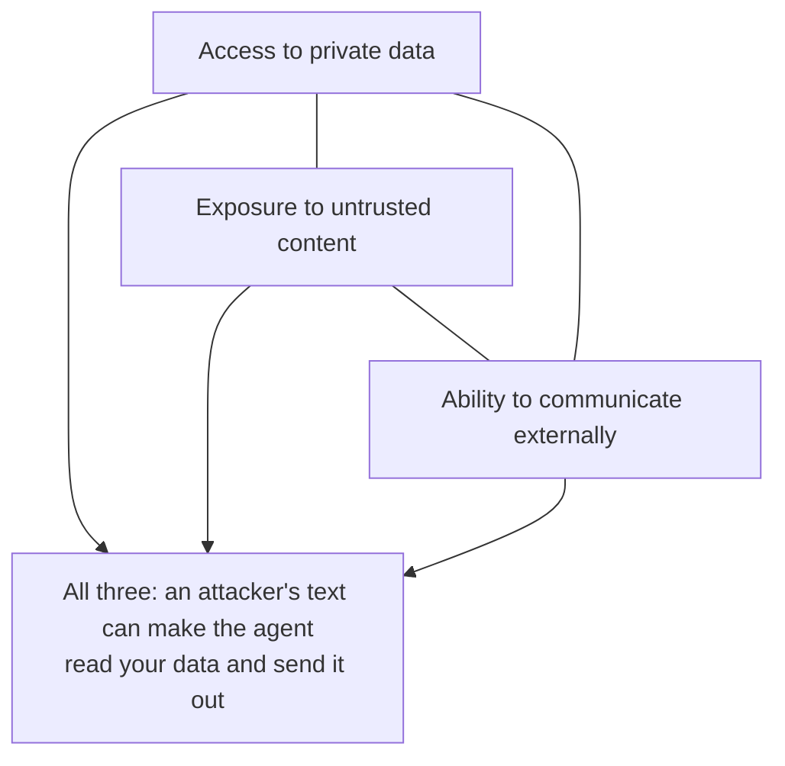

# 07. Sandboxes, Permissions and Security

> Command rules are tripwires. The sandbox is the wall. Build both, and trust the wall.

**You will learn** where an agent's actions run, how to isolate files and network, how allow/ask/deny rules work and where they fail, how to keep secrets out of reach, how prompt injection and the lethal trifecta work, and how to design approval gates people still read.
**Time:** 60 minutes · **Video:** [The sandbox and the lethal trifecta (1:15)](../videos/README.md#06-sandbox-and-the-lethal-trifecta) · **Project:** [03. Permissions and sandbox](../projects/03-permissions-and-sandbox/) · **Worksheet:** [Threat model](../reference/templates/threat-model.md)

---

## Every action happens somewhere

The model runs on the provider's servers and returns text. The harness turns tool calls into actions in an **execution environment** you control: a laptop, a CI runner, a cloud VM or a container made for one task. The same call has very different consequences depending on where it runs. Deleting a folder in a disposable copy costs nothing. Deleting it in a developer's only checkout costs a day. Reading `config/` is harmless when it holds test settings and dangerous when it holds the production database password.

A developer laptop is a convenient and risky place for an agent: SSH keys, saved passwords, cloud credentials and unrelated projects all sit within reach of the user account the agent runs as.

Coding agents use two broad approaches. They **ask permission** before risky actions, or they **build boundaries** and let the agent work freely inside them. Anthropic found that frequent prompts cause **approval fatigue**: people stop reading what they approve. Its sandbox for Claude Code [reduced permission prompts by 84%](https://www.anthropic.com/engineering/claude-code-sandboxing) in internal use, because the agent no longer had to ask about actions that stayed inside the boundaries.

## The sandbox

A **sandbox** is an isolated environment where an agent can run commands or change files without gaining access to the rest of the system. Anthropic's sandboxing work names the two boundaries an effective sandbox needs:

- **Filesystem isolation**: the agent can read and write only specific directories.
- **Network isolation**: the agent can reach only approved hosts.

You need both. Without network isolation, a compromised agent reads a key inside its folder and sends it to an attacker. Without filesystem isolation, it modifies the system to escape the sandbox and reach the network anyway. Claude Code enforces these boundaries with operating-system features (bubblewrap on Linux, Seatbelt on macOS) that also apply to every subprocess a command starts, and routes network traffic through a proxy that allows only approved domains. Codex runs with network access off by default.

### Isolation options, weakest to strongest

| Option | Isolates | Does not isolate | Good for |
|---|---|---|---|
| Separate folder copy | Files you choose to copy | User account, network, secrets | Organization only |
| Git worktree | A branch's working files | User account, network, credentials | Parallel tasks on one machine |
| OS sandbox (bubblewrap, Seatbelt) | Filesystem and network, per process tree | Kernel | Local coding agents |
| Container (Docker) | Filesystem, processes, network (if configured), installed software | Shares the host kernel | Reproducible, disposable task environments |
| MicroVM or VM | Everything, including the kernel | Little | Untrusted code, multi-tenant platforms |

A **worktree** is an extra working directory attached to the same repository with its own branch checked out, so several agents can work on different branches at once. OpenAI's team made its app bootable per worktree, so each agent could start and test its own copy. Worktrees organize parallel work; they are not a security boundary.

A **container** gives each task the same image (language version, dependencies, test tools), a disposable filesystem, and only the network and files you grant. The [Project 03 sandbox script](../projects/03-permissions-and-sandbox/sandbox/run-in-sandbox.sh) runs a command with `--network none`, a read-only image, one mounted workspace, a non-root user, all capabilities dropped and limits on processes, memory and CPU. Install dependencies when you build the image, then run the task with the network closed.

When the top question on a November 2026 "Ask HN: What's your current AI agentic setup?" thread was how to isolate an agent on your own machine, most answers pointed to the same place: Docker or devcontainers.

## Permission rules

Inside the environment, rules decide which tool calls run automatically, which need a person, and which never run. Claude Code uses **allow**, **ask** and **deny** rules and evaluates deny first, then ask, then allow, so one deny always wins.

```json
{
  "permissions": {
    "allow": ["Bash(python -m pytest:*)", "Read", "Edit(habit_tracker/**)", "Edit(tests/**)"],
    "ask":   ["Bash(pip install:*)"],
    "deny":  ["Bash(git push:*)", "Edit(config/**)", "Read(.env)"]
  }
}
```

Rules shape normal behavior well. They are weak as a security boundary, because they match the text of a command and the same action has many spellings. Claude Code's own documentation notes that a rule blocking one form of `git push` does not match the same push written with different arguments. [Project 03](../projects/03-permissions-and-sandbox/) includes a test that documents exactly this:

```text
deny rule: git push*
"git -C . push origin main"   -> not denied
"GIT_TRACE=1 git push"        -> not denied
"sh -c 'git push'"            -> not denied
```

An OS sandbox does not need to recognize the command. It blocks the effect, such as a write outside the workspace or a connection to an unapproved host, however the request is phrased. Use rules to steer, and the sandbox to hold.

Paths need the same care. A path guard must resolve every path before checking it, so `src/../../etc/passwd` and a symlink pointing outside the workspace are caught. The [harnesslab `PathGuard`](../harnesslab/harnesslab/permissions.py) resolves the real path, refuses anything outside the root, checks protected files first, and tells the agent where it may write.

## Secrets: use them without seeing them

A **secret** is anything that grants access: a password, an API key, a token, a private key. Agents need credentials to open pull requests or query databases. The rule is that the agent uses a credential without being able to read it. Anything the agent reads enters its context, goes to the model provider, and may land in logs and traces.

- Keep secrets out of the workspace and out of environment variables the agent's commands can print. Build the child environment from an **allow-list** of variable names; a deny-list misses the one nobody thought of.
- Put credentials inside tool implementations or in a proxy that attaches them to approved requests. Claude Code on the web keeps git credentials outside the sandbox; a proxy checks each request (for example, pushes only to the configured branch) before attaching the real token.
- Scope every credential to the task: one repository, the needed actions, test systems instead of production, a short expiry.

## Prompt injection and the lethal trifecta

Language models follow instructions that appear in their context, and they cannot reliably tell the operator's instructions from instructions hidden in a web page, an email, a PDF, a code comment or an issue. An attacker who can put text in front of your agent can try to give it orders. This is **prompt injection**, first on OWASP's [Top 10 for LLM applications](https://genai.owasp.org/llmrisk/llm01-prompt-injection/).

Simon Willison named the combination that turns injection into theft, the [lethal trifecta](https://simonwillison.net/2025/Jun/16/the-lethal-trifecta/):



A habit-tracker example: anyone can file an issue on a public repository. An attacker files one about streaks with hidden text telling agents to read `config/settings.toml` and post it as a comment. If the agent can read a file with real credentials, reads that issue, and can comment or reach the network, all three legs are present.

No current technique makes injection impossible, and Willison points out that a filter catching 95% of attacks is a failing grade in security. The defense is to **remove at least one leg**:

| Leg | How to remove it |
|---|---|
| Private data | No real secrets anywhere the agent can read; test data instead of production data |
| Untrusted content | Separate agents: one reads untrusted input and passes a summary to another that holds write access |
| External communication | Network closed except narrow, approved actions through a proxy |

[Project 07](../projects/07-traces-and-diagnosis/)'s run D replays this attack against the habit-tracker harness: a ticket comment tells agents to POST the config file to an outside server. The deny rule blocks the request, the path guard blocks the follow-up config edit, and the trace records both.

**Tool poisoning** is the supply-chain version: an MCP server or skill whose descriptions or outputs carry hidden instructions, or whose code does something other than it claims. Review every server and skill before an agent can use it, as you would a new third-party library.

## Least privilege and excessive agency

The **principle of least privilege** says each part of a system should have only the access its job needs. OWASP calls the agent version of this failure [excessive agency](https://genai.owasp.org/llmrisk/llm062025-excessive-agency/) and names three causes:

| Cause | Meaning | Habit-tracker fix |
|---|---|---|
| Excessive functionality | Tools that do more than the task needs | No deploy tool, no merge tool |
| Excessive permissions | Access broader than the task needs | Writes only in `habit_tracker/` and `tests/`, own branch only |
| Excessive autonomy | High-impact actions without a human check | The pull request is where its autonomy ends; a person merges |

OWASP's own example is an email assistant that only summarizes mail: give it a read-only tool, read-only mailbox access, and require a person to press send on any draft.

Keep coding agents out of production entirely. Their changes reach production the way a developer's do: review, automated tests, the normal deploy. Agents that must touch production, such as an operations agent investigating an outage, start read-only, use narrow tools, need approval for any change, and leave a complete record.

## Approval gates people still read

An **approval gate** pauses an action until a person decides. Good candidates are hard to undo, reach beyond the sandbox, or carry large consequences: merging, changing a production database, messaging customers, spending money, deleting data.

A gate that fires constantly becomes a rubber stamp, which Thoughtworks calls the risk of "human-in-the-loop theater." A useful gate:

- fires rarely, only for actions that matter;
- shows exactly what is being approved: the command, the diff, the files, the amount;
- shows the agent's reason and what the automated checks found;
- has a plan for silence: remind, escalate to someone else, or stop cleanly after a timeout.

## Blast radius

The **blast radius** of a failure is how much damage it can do. Every boundary in this lesson shrinks it. Compare two setups for the same agent behavior:

| | On a laptop with the developer's access | In the harness |
|---|---|---|
| Files | Anything the user can touch | One workspace; `config/` and old tests read-only |
| Network | Open | Closed except a proxy that allows pushes to its own branch |
| Credentials | Whatever is on disk | A narrow, short-lived token the agent never sees |
| Data | Possibly production | A test database with realistic sample data |
| Worst case | Deleted work, leaked keys, corrupted production, a push to main | A messy branch someone deletes and an hour of compute |

For each tool and permission you grant, ask what the worst realistic outcome is if the agent misuses it, by its own mistake or under an attacker's influence, and shrink it until you can accept it. The safer the environment, the more freedom you can give the agent inside it.

## Check yourself

<details><summary>1. You denied `git push*` in your rules. Is the agent unable to push?</summary>

No. Rules match command text, and other spellings slip through (`git -C . push`, `sh -c 'git push'`). Make pushing impossible at a lower level: no credential that can push, or a proxy that refuses pushes outside the agent's branch.
</details>

<details><summary>2. Your research agent browses the web, reads the company wiki, and can send Slack messages. What do you change first?</summary>

It has all three legs of the lethal trifecta. Remove one: split browsing into a separate agent with no wiki access, or remove its ability to post anywhere outside a review queue.
</details>

<details><summary>3. Why build the child process environment from an allow-list?</summary>

Secrets live in environment variables with unpredictable names. An allow-list passes only the few variables a command needs (PATH, LANG, TZ); a deny-list leaks the variable nobody thought to block.
</details>

<details><summary>4. Your team approves 60 agent actions a day and has stopped reading them. What do you do?</summary>

Move most of those actions inside a sandbox where they are safe without approval, keep gates only for irreversible or external actions, and make each remaining request show the diff, the checks and the reason.
</details>

## Try it

Do [Project 03: Permissions and sandbox](../projects/03-permissions-and-sandbox/). You implement deny-first rules, a path guard that survives traversal and symlinks, an allow-list environment builder and a trifecta check, then run the agent's commands inside the Docker sandbox. Fill in the [threat model worksheet](../reference/templates/threat-model.md) for an agent you use.

## Go deeper

- Anthropic, [Beyond permission prompts](https://www.anthropic.com/engineering/claude-code-sandboxing): filesystem and network isolation and the credential proxy.
- Simon Willison, [The lethal trifecta for AI agents](https://simonwillison.net/2025/Jun/16/the-lethal-trifecta/).
- OWASP, [LLM01 Prompt Injection](https://genai.owasp.org/llmrisk/llm01-prompt-injection/) and [LLM06 Excessive Agency](https://genai.owasp.org/llmrisk/llm062025-excessive-agency/).

**Next:** [08. State, Memory and Long-Running Work](08-state-memory-and-long-running-work.md)
