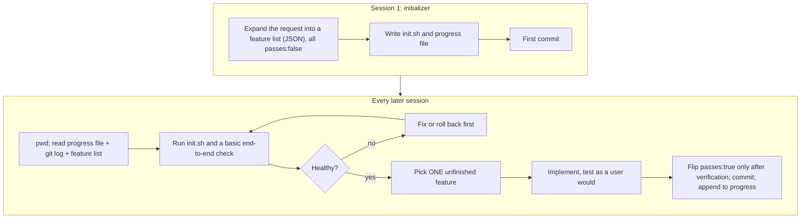

# State, Memory and Long-Running Work

Lesson 8 of 18 · Continuity · about 50 minutes

In this lesson you will learn why bigger context windows do not solve long tasks, how to keep durable state, which kinds of memory exist and how they go wrong, and the initializer, feature-list and resume pattern that makes multi-session work reliable.

**Video:** [Long-running agents (0:37)](../videos/README.md#07-long-running-agents) · **Project:** [Make Work Survive Across Sessions](../projects/04-long-running-state/)

---

## The shift-worker problem

OpenAI's team reported single agent runs working on one task for more than six hours, often while the engineers slept. Anthropic describes the difficulty of such work with an image: a project staffed by engineers in shifts, where each new engineer arrives with no memory of the previous shift. Unless something bridges the gap, every session starts by guessing what the last one did.

A **long-running task** is any task larger than one context window or one uninterrupted session can hold. Sessions end for many reasons: the window fills, a container restarts, an API call fails, the agent pauses for approval, a person stops the run. Each end is a point where progress can be lost or corrupted.

## Why a bigger window does not fix it

Quality drops before size runs out: context rot ([Lesson 5](05-context-engineering.md)) means days of history in one window produce worse decisions. Sessions also end for reasons that have nothing to do with size, and a crash ends one at 10% full as surely as at 90%. History goes stale, too. Failures that were fixed hours ago sit next to current facts, and the model cannot tell which is which. And every call pays for all of it, so a longer history makes each step slower and more expensive.

Anthropic tested this directly. A frontier model running across many windows with compaction still failed to build a production-quality web app clone from a high-level prompt ([Effective harnesses for long-running agents](https://www.anthropic.com/engineering/effective-harnesses-for-long-running-agents)). It failed in two ways: it tried to build everything at once and ran out of context mid-feature, and later sessions saw partial progress and declared the job done. The fix was a harness that tracked the work outside the model.

## State

**State** is the record of where the work stands, kept outside the model: the code on the branch, the commits, current test results, the list of subtasks and their status, attempts and budget used, pending approvals. The model is stateless between calls. When state and context disagree, state wins.

State helps across interruptions only if it is **persistent**: written to disk, a database or version control. LangGraph's documentation makes the point with its own checkpointers: the in-memory store loses everything on restart, so production uses a database-backed one. Write state atomically (write a temp file, then rename it) so a crash never leaves half a file.

## Memory

**Memory** is information saved for reuse later. LangChain splits it by lifetime and, drawing on the CoALA research framework, by kind:

| Kind | Holds | Habit-tracker example | Where it lives |
|---|---|---|---|
| Short-term | The current session's history | This run's tool calls and results | The transcript (managed by compaction) |
| Semantic (long-term) | Facts | "Weeks start Monday, in the user's local time zone" | A project facts file |
| Episodic (long-term) | Experiences | "The migration failed because the test DB was not reset" | A log of past attempts |
| Procedural (long-term) | How to do things | AGENTS.md, skills | Instruction files, skills |

Every line Mitchell Hashimoto adds to his AGENTS.md after a mistake is procedural memory.

Memory also needs a **write policy**. Writing on the hot path (the agent records something mid-task) captures it fresh but distracts the agent and relies on its judgment. Writing in the background (a separate process reviews finished sessions) keeps the agent focused and allows review, at the cost of delay. Anthropic's [components of agent memory](https://www.anthropic.com/research/components-of-agent-memory) (Nov 2026) describes offline "dreaming" sessions that consolidate notes against raw transcripts; over 128 such sessions, one benchmark's accuracy rose from 13% to 48%. The same post warns about the opposite failure: an agent in a long game run wrote 413 memory files, mostly stale. Claude Code loads only the first 200 lines or 25 KB of its memory index, which forces curation.

Memory passes through the harness like any other action. In Anthropic's memory tool, the application executes each memory operation against storage it controls and must reject paths outside the memory directory.

### How memory goes wrong

Mistakes in long-term memory last. A wrong fact misleads every future session (persistent context poisoning). A true fact goes false after a product change, and nothing in the memory says so. Memory is also an attack surface: if an agent stores instructions it found in untrusted content, one injection affects every later session. Treat memory as curated information:

- record where and when each memory came from;
- review memories before they become permanent (the habit-tracker harness lets the agent *propose* additions in its pull request; a developer approves them);
- remove or update memories that no longer match reality;
- keep procedural memory under the same review as code.

## The pattern: initializer, feature list, progress file, one feature per session

Anthropic's long-running harness is the clearest published design, and the competing courses all build on it.

Details that matter:

- **The feature list is JSON**, with more than 200 entries in Anthropic's web-app example, each a behavior with steps and a `passes` flag starting at `false`. Anthropic found models less likely to overwrite JSON inappropriately than Markdown. Sessions may change only the `passes` field.
Left alone, the agent tried to build too much and ran out of context halfway through a feature. Limiting it to one feature per session, then a commit, a progress update and a clean end, turned every context boundary into a natural stopping point. Agents also marked features complete without testing them end to end, and performance improved substantially once the agent tested as a human user would, through browser automation. The prompt told the agent that removing or editing tests was unacceptable, and a harness can back that request with read-only test files. One detail is easy to miss: the initializer and the coding agent shared the same system prompt, tools and harness, and only their first user message differed.

The progress file serves people too. A developer who wants to know where things stand reads the same file the agent reads.

## Artifacts and checkpoints

An **artifact** is a durable output that outlives the session: code, commits, test reports, screenshots, plans, design notes, pull requests. Artifacts are evidence and handoff material at once. OpenAI's team checked execution plans, with progress and decision logs, into the repository next to the code, because anything the agent cannot reach in its context does not exist for it. A decision in a chat thread or a person's head is invisible to the agent.

A **checkpoint** is a saved snapshot you can resume or roll back to. For code, commits are natural checkpoints, and Anthropic's agent committed after each change so it could revert a bad one instead of patching a broken build. Checkpoint:

- after each verified unit of work;
- before any risky action, such as a migration;
- before any pause for approval, so a long wait costs nothing.

**Durable execution** platforms (Temporal, Inngest, LangGraph's checkpointers) give the same guarantee to whole processes. Pair them with **idempotent** actions: an action that has the same effect if it runs twice. "Open a pull request unless one already exists for this branch" is idempotent; a resumed run cannot open a duplicate.

## Resuming, handoffs and honest records

A **handoff** transfers work, with what is needed to continue, between sessions, agents or people. A good handoff answers what a capable newcomer would ask: the goal, where things stand, what is finished and how it was verified, what remains, which decisions were made and why, what is open, and how to check everything still works. If a new engineer could not continue from it, the next session cannot either.

Records drift from reality. A progress file can claim a feature works while its tests fail. Two parallel agents can overwrite each other's entries. Keep records honest:

- treat running code and test results as the source of truth, and re-verify claims on resume;
- let a status change to passing only after a check confirms it;
- give each shared record one writer, or use tools that prevent simultaneous edits;
- end every session in a clean state, which Anthropic describes as code appropriate to merge: no half-finished changes and no undocumented known bugs.

[Project 4](../projects/04-long-running-state/) has a test where someone edits the feature list by hand to mark an unbuilt feature as passing. The resume routine re-verifies and flags it.

## Check yourself

1. Why did Anthropic store the feature list as JSON instead of Markdown?

Models were less likely to rewrite or overwrite structured JSON inappropriately, and a schema makes it easy for the harness to allow changes to `passes` only.

2. A container crashes halfway through a feature. What does the next session do first?

Read the progress file and recent commits, run the startup script and a basic end-to-end check, discover the half-written code, and either complete it or roll back to the last checkpoint before starting anything new.

3. The agent wants to save "always use UTC for dates" to long-term memory after reading a GitHub issue. What should the harness do?

Treat it as a proposal from untrusted content. Record its source, route it to a person for review, and check it against the product spec (which says local time) before it becomes procedural memory.

## Try it

Do [Project 4: Long-running state](../projects/04-long-running-state/). You build the initializer, the resume routine, verification-gated feature completion, checkpoints with rollback, and the feature-list guard, then pass tests that simulate a crash mid-feature and a dishonest record.

## Go deeper

- Anthropic, [Effective harnesses for long-running agents](https://www.anthropic.com/engineering/effective-harnesses-for-long-running-agents) and [The components of agent memory](https://www.anthropic.com/research/components-of-agent-memory).
- Lilian Weng, [Harness Engineering for Self-Improvement](https://lilianweng.github.io/posts/2026-07-04-harness/): durable state in files, not context.

**Next lesson:** [Guardrails, Tests and Evals](09-guardrails-tests-and-evals.md)
