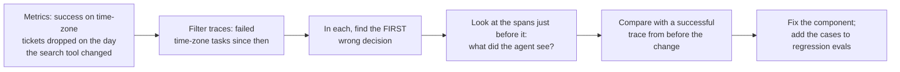

# Logs, Traces and Observability

Lesson 10 of 18 · Checking and Visibility · about 45 minutes

In this lesson you will learn the three telemetry signals and what each answers, exactly what to record for model calls, tool calls, errors, retries and tests, a repeatable method for debugging an agent from its traces, and how to monitor without creating a second leak of sensitive data.

**Project:** [Read Traces and Diagnose Failures](../projects/07-traces-and-diagnosis/)


---

An eval shows the habit-tracker agent's success on time-zone tickets dropping from 90% to 60% after a harness change. The eval says something is wrong. It does not say what. The agent might be reading the wrong files, getting different search results, misreading a test failure, running out of budget or skipping a step. Finding out requires a record of the failing runs detailed enough to rebuild each decision.

OpenTelemetry, the most widely used open standard here, defines **observability** as the ability to understand a system from the outside by asking questions about it. Agents need it more than most software: much of their logic lives in model decisions you cannot read as code, and the same input can produce different behavior on each run. Anthropic's research-agent team had users report that agents were "not finding obvious information" and could not see why until they added full production tracing ([multi-agent research system](https://www.anthropic.com/engineering/multi-agent-research-system)).

The natural place to instrument an agent is the harness, because every path into and out of the model passes through it. Record each step there and you capture the agent's whole behavior without the model's cooperation.

## Three signals

| Signal | What it is | Answers | Agent example |
|---|---|---|---|
| Log | A timestamped event with structured fields | "Did X happen, and how often?" | `{"task":"HT-142","event":"tool_blocked","tool":"edit_file","path":"config/settings.toml"}` |
| Trace | The full path of one operation, as nested spans | "Why did this run go wrong?" | One trace per task: iterations, model calls, tool calls, checks |
| Metric | Numbers aggregated over time | "Is something changing?" | Success rate, cost per task, tool error rate |

**Structured logs** record named fields instead of sentences, so you can filter all blocked edits this week, or all errors from the test tool. Their weakness is missing context: a line saying a test failed is useful, a line that also names the task, attempt and preceding edit is far more useful, and that link is what traces provide.

A **trace** is made of **spans**. Each span is one unit of work with a name, start and end time, attributes and a parent. The root span covers the whole task. Many tools draw traces as a **waterfall**: each span a bar positioned by when it started and how long it lasted. Here is part of the harnesslab demo's trace:

```text
invoke_agent                                   |########################################|  972.6 ms
  iteration                                    |#                                       |    0.6 ms
    chat Adding weekly_streak next to daily_st |#                                       |    0.0 ms
    execute_tool edit_file                     |#                                       |    0.4 ms
  iteration                                    |#                                       |    0.1 ms
    chat I'll also add a feature flag so the t |#                                       |    0.1 ms
    execute_tool edit_file !                   |#                                       |    0.1 ms
  iteration                                    |########                                |  211.1 ms
    execute_tool run_tests                     |########                                |  211.0 ms
  iteration                                    |        ############                    |  296.4 ms
    chat Done. Changed habit_tracker/streaks.p |        #                               |    0.1 ms
    verify harness verification                |        ############                    |  296.3 ms
```

The `!` marks a span with an error or a block. One glance shows where time went (tests and verification) and where the run hit a boundary (the config edit).

**Metrics** summarize many runs. Useful agent metrics: task success rate, tokens and cost per task, duration, error rate per tool, retries per task, share of tasks needing a person, and for coding agents the share of pull requests accepted. OpenTelemetry's primer makes a point that fits agents well: a store can be up all the time and still fail to add the right item to the cart. An agent that never crashes but picks the wrong files a third of the time has the same problem, and only metrics built on results reveal it.

## What to record

### Model calls

Model and version, settings, **the context sent** (or a pointer to where it is stored), the output, input and output tokens, latency, cost and the stop reason. The context matters most. When a decision looks wrong, the first question is what the model saw. A record of output without input shows what happened but not why.

OpenTelemetry is developing [semantic conventions for generative AI](https://opentelemetry.io/docs/specs/semconv/gen-ai/), shared attribute names such as `gen_ai.request.model`, `gen_ai.usage.input_tokens` and `gen_ai.tool.name`, with operation names like `chat`, `execute_tool` and `invoke_agent`. The conventions are still marked as in development, but using them now means your traces work with any backend that adopts them. [harnesslab's tracer](../harnesslab/harnesslab/trace.py) uses these names.

### Tool calls

Tool name, arguments, result (or a summary), duration, and **what the harness decided**: ran, blocked by which rule or guardrail, and for approvals who approved and when. Tool records explain many mysterious failures. When the agent writes its own time-zone conversion instead of using the helper, the record may show it never opened the helper because its search returned three results, none of them the helper. The model chose reasonably given what it saw. The problem was the tool.

### Errors, retries and tests

Separate the errors the agent saw and handled, such as a failing test it then fixed, which is normal work, from harness errors it never saw, such as a crash in the code that runs tools, which is a bug that deserves an alert.

Record retries, both the automatic kind (a rate-limited API call) and the agent's own (a second attempt at a fix), each with its reason. Without them, a run that took four failed model calls and three failed fixes looks like one ordinary run.

For every test run, record which tests ran, which passed and failed, the messages and the duration, linked to the edit that came before it. That link turns a list of test runs into a picture of progress. Across many runs it also exposes **flaky tests**, which pass and fail at random and send agents chasing problems that are not theirs.

### Versions

Record the versions of the model, prompts, instruction file, tools, hooks and permissions in the root span of every trace. Without them you cannot tell whether a behavior change came from your change.

## Debugging an agent from its traces

The time-zone regression, step by step:



1. The metrics show the success rate fell on the day the code-search tool changed.
2. Filter the traces to failed time-zone tasks since that date.
3. In each one, find the first wrong decision, because later mistakes often follow from it. Here, the agent wrote its own conversion.
4. Read the spans right ahead of that decision. The search now returns its top 3 matches instead of 10, and the helper, previously the fifth match, no longer appears.
5. Compare with a successful trace from before the change, where the agent found and used the helper.
6. Fix the search tool by raising the limit or ranking the helper higher, and leave the prompt alone. Add the failed tickets to the regression evals.

Anthropic advises reading eval transcripts regularly. Traces are those transcripts in production. [Project 7](../projects/07-traces-and-diagnosis/) gives you four recorded failed runs and asks you to write the code that finds each one's first problem, then diagnose them.

## Monitoring and alerts

**Monitoring** watches metrics and samples of traces continuously and **alerts** a named owner when a measurement crosses a threshold. Good agent alerts:

| Alert | Often means |
|---|---|
| Success rate below its normal band | A model, prompt or tool change regressed something |
| Cost per task jumps | A loop is running long, or context is bloating |
| One tool's error rate rises | An API it depends on changed |
| Guardrail trips spike | Possibly a wave of injection attempts |

Run automated graders on a sample of production runs (**online evaluation**) to see quality trends before complaints arrive. Keep alerts few and meaningful. Too many alerts teach people to ignore them, the same failure as approval fatigue.

## Audit trails and sensitive data

An **audit trail** answers, reliably and long after the fact, who did what, when, and with what authority: each consequential action, the permissions and credentials in effect, the identity of anyone who approved, and the versions of everything that shaped the behavior. Debugging traces prioritize detail and convenience; audit trails prioritize completeness, protection from alteration and retention.

Traces hold sensitive material: your source code, customers' names and messages, and any secret that ever reached the context. The OpenAI Agents SDK notes that its spans store model and tool inputs and outputs and lets you turn that capture off. Decide deliberately what traces keep in full, what they summarize or redact, who can read them, and how long they live. Anthropic reported monitoring its research agents' decision patterns and interaction structure without reading the contents of individual conversations. You can often measure what an agent did without anyone reading what users wrote.

## Let the agent read its own telemetry

OpenAI's team gave each worktree a temporary observability stack and let agents query logs with LogQL and metrics with PromQL, the same languages engineers use. That made goals like "service starts in under 800 ms" checkable by the agent itself. When the agent can see the signals people use to judge its work, those signals stop being a record of the past and start shaping the next step, which is the subject of [Lesson 11](11-feedback-verification-and-steering.md).

## Check yourself

<details><summary>1. A run failed and your trace has the model's outputs but not its inputs. What can you not answer?</summary>

Why it made the decision. You can see what it chose but not what it saw, so you cannot tell a reasoning error from missing or misleading context.
</details>

<details><summary>2. Your dashboard shows rising cost per task with flat success. Where do you look?</summary>

Traces of recent expensive runs: retries, repeated tool calls, iterations per task and tokens per call. Common causes are a loop without progress detection, a tool returning bloated output, or context that is no longer compacted.
</details>

<details><summary>3. Why put model, prompt and tool versions in the root span?</summary>

So you can compare runs before and after a change and attribute a behavior shift to the change that caused it.
</details>

## Try it

Run `python -m harnesslab demo`, then `python -m harnesslab run --provider anthropic --trace runs/HT-142.jsonl` if you have a key, and print it with `python -m harnesslab trace runs/HT-142.jsonl`. Then do [Project 7](../projects/07-traces-and-diagnosis/).

## Go deeper

- OpenTelemetry, [Semantic conventions for generative AI](https://opentelemetry.io/docs/specs/semconv/gen-ai/).
- OpenAI Agents SDK, [Tracing](https://openai.github.io/openai-agents-python/tracing/): traces and spans for model turns, tool calls, guardrails and handoffs.
- OpenAI, [Harness engineering](https://openai.com/index/harness-engineering/), the section on application legibility and the per-worktree observability stack.

**Next lesson:** [Feedback, Verification and the Steering Loop](11-feedback-verification-and-steering.md)
