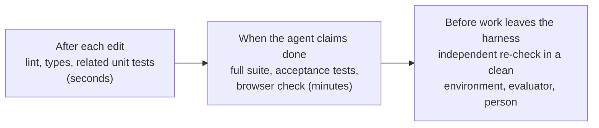
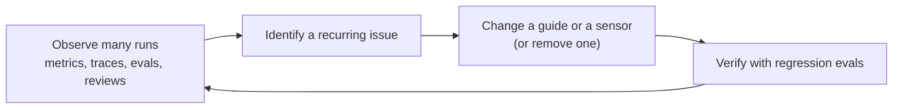

# 11. Feedback, Verification and the Steering Loop

> Guides make the first attempt good. Sensors catch what the guides missed. When a mistake repeats, improve both.

**You will learn** the guides-and-sensors model, the difference between computational and inferential controls, how to write feedback an agent can act on, where to verify instead of trusting, why self-review fails, and how the steering loop turns one-off fixes into a harness that improves.
**Time:** 50 minutes · **Video:** [Verify instead of trusting: guides and sensors (1:10)](../videos/README.md#08-guides-and-sensors) · **Project:** [06. Guides and sensors](../projects/06-guides-and-sensors/)

---

## Feedforward and feedback

Engineers who build self-regulating systems, from thermostats to autopilots, describe two kinds of control: act on information before the system acts (**feedforward**), or measure what happened and correct (**feedback**). Birgitta Böckeler applies the idea to agents in [Harness engineering for coding agent users](https://martinfowler.com/articles/harness-engineering.html):

- **Guides** are feedforward controls. They steer the agent before it acts so the first attempt is more likely to be right: instructions, the right context, tool descriptions, skills, templates, codemods, a plan agreed in advance.
- **Sensors** are feedback controls. They observe the result after the agent acts so it can correct itself: tests, linters, type checkers, guardrail rejections, an evaluator's critique, a reviewer's comments.

A harness with only one side falls short. With feedback alone, the agent keeps making the same mistake and pays to fix it every time. With feedforward alone, it follows rules and never learns whether they worked.

## Computational and inferential

The second axis is how a control decides:

| | Computational (deterministic) | Inferential (a model judges) |
|---|---|---|
| Examples | Tests, schema checks, linters, type checkers, permission checks | LLM-as-judge, AI code review, an evaluator agent operating the app |
| Speed and cost | Milliseconds to seconds, cheap | Seconds to minutes, costs tokens |
| Consistency | Same input, same answer | Varies between runs |
| Can judge | What someone encoded as a rule | Meaning, intent, quality |

Both axes combine into a grid:

| | Guide (before) | Sensor (after) |
|---|---|---|
| **Computational** | Bootstrap script, project template, codemod | Tests, linter, type checker, structural tests |
| **Inferential** | Conventions in AGENTS.md or a skill (the model interprets them) | Evaluator agent, LLM review against a rubric |

A sensible design runs computational checks first as a cheap gate and spends inferential checks on work that has already passed them.

## Feedback the agent can use

Useful feedback is fast, specific, actionable, short and trustworthy. Böckeler observes that feedback is especially powerful when written for a model to read, and calls a lint message with fix instructions "a positive kind of prompt injection." OpenAI's team wrote its custom lint messages the same way, so each failure carried its remedy into the agent's context. Compare two messages from the same check:

```text
streaks.py:42: HT001 violation
```

```text
habit_tracker/streaks.py:42 [HT001] calls .date() on a datetime. Why: completions are
stored in UTC, so .date() gives the UTC day, which is wrong for users in other time
zones. Fix: use timeutils.local_date(moment, habit.timezone); for weeks use
timeutils.week_start(day).
```

The second message lets the agent fix the problem on its next step without searching, guessing or asking. [Project 06](../projects/06-guides-and-sensors/) builds this rule with Python's AST, so comments and strings never trigger it.

Two more rules from practice. HumanLayer's: success should be silent and failures verbose, because every line of feedback costs context. And never feed the agent a flaky check; it teaches the agent to chase problems that do not exist.

### Guidance at the right moment

Feedforward works best when it arrives as it becomes relevant. **Hooks** let the harness run its own code at fixed points: before a tool call, after an edit, when a file is opened, when the agent tries to finish. A hook that fires when the agent opens `timeutils.py` can drop the team's date conventions into context at that moment instead of at session start. Claude Code's documentation describes hooks as deterministic control, things that always happen instead of depending on the model's choice, such as running a formatter after every edit or blocking edits to protected files while telling the agent why.

## Verification: do not take the agent's word

**Verification** is the decision about when to apply checks and what the harness does with the answer. Its first principle: the harness verifies; it does not trust the agent's claim. LangChain found that the most common failure in its Terminal-Bench work was the agent reviewing its own code, deciding it was fine, and stopping, so it added a pre-completion checklist that forced a verification pass before the agent could exit.

Verify at three points:



In harnesslab, an agent message with no tool calls is a *claim*. The loop runs the verifier; only a passing verdict ends the run in success. A failing verdict goes back to the agent as feedback, and after repeated failures the run escalates to a person ([`loop.py`](../harnesslab/harnesslab/loop.py)).

## Why self-review fails

Self-correction works when the agent responds to external evidence: it reads a failing test, edits the code, and the test passes. Without external evidence it is weak. A 2024 study by Huang and colleagues found that models [struggled to correct their own reasoning](https://arxiv.org/abs/2310.01798) using only their own judgment, and sometimes got worse. Anthropic found that agents asked to judge their own work praised it confidently even when a person could see it was mediocre, most of all on subjective work such as design.

Anthropic's response was a separate evaluator: tuning a standalone evaluator to be skeptical proved far easier than making the working agent critical of itself ([harness design for long-running apps](https://www.anthropic.com/engineering/harness-design-long-running-apps)). Before each sprint, the generator and the evaluator agreed a **sprint contract**: what done meant and how it would be checked, settled before any code. The lesson for harness design: self-correction needs a source of truth outside the agent's opinion, whether a test, a tool result, a separate evaluator or a person.

## Keep quality left

A harness runs several feedback loops at different speeds:

| Loop | Speed | Checks |
|---|---|---|
| Inner | Seconds, after every edit | Lint, types, related unit tests |
| Middle | Minutes, at "done" | Full suite, end-to-end, evaluator review |
| Outer | Days and weeks | Human review, production monitoring, eval trends |
| Continuous | Background | Dead-code detection, coverage quality, dependency scanners, doc freshness |

Böckeler borrows **keep quality left** from continuous integration: draw the work as a timeline from left to right and put each check as early as it can run, because problems found early cost less. The agent should learn about a time-zone mistake from a lint message seconds after writing it, not from a user a week after release.

## Recognize failure signals, then pick a correction

Some failure signals are explicit: a failing test, a tripped guardrail, a tool error, a rejected pull request. Others show up only as patterns in traces: the same file edited five times without the tests improving, token use rising while results stay flat, the same files read again and again, test results alternating between two failures. Compute these indicators from your observability data and treat them as failures too. LangChain's harness added loop detection that tracked edits per file and nudged the agent to reconsider after a threshold.

| Signal | Correction |
|---|---|
| Clear, specific failure (one test) | Return the feedback; let the agent retry |
| The agent lacks information | Add context to the next call |
| Work has gone in a bad direction | Roll back to the last checkpoint and try another approach |
| Needs judgment the agent lacks | Escalate to a person |
| Cannot succeed within limits | Stop cleanly and record why |

Repeated failure means ordinary feedback is not working. Another attempt with the same information will probably fail the same way, so change something: context, a sharper hint, a rollback or a person.

## The steering loop: improve the harness between runs

Across many runs, a repeated mistake is no longer about any one task. It is a gap in the harness. Three practitioners state the same rule:

- **Mitchell Hashimoto:** when the agent makes a mistake, engineer a solution so it never makes that mistake again.
- **OpenAI's team:** when something failed, ask what capability was missing and how to make it legible and enforceable for the agent.
- **Böckeler:** whenever an issue happens more than once, improve the feedforward and feedback controls.

Some call this **the ratchet**: every recurring mistake becomes a permanent rule or check, so the harness only moves forward. The recurring time-zone mistake shows all three moves at once:

1. **Guide:** a line in AGENTS.md pointing to `timeutils`, plus a hook that injects the date rule when the agent opens date code.
2. **Sensor:** the HT001 lint rule with fix instructions.
3. **Proof:** the failed tickets added to the regression evals.

Where a rule can be a deterministic check, enforcing it beats describing it. Agents can help build these controls, drafting structural tests, proposing rules from patterns in past failures and scaffolding linters. Improvement also includes removal: rules that never fire, or address problems the current model no longer has, cost context and should go.

People do the steering. Böckeler describes the human's job as steering the agent by iterating on the harness, and OpenAI framed its arrangement as humans steering and agents executing, with human attention as the scarcest resource. A correction inside one run fixes that run. A change to the harness fixes every future run, which is where human time does the most good.



## Check yourself

<details><summary>1. Classify: AGENTS.md conventions, a codemod, a type checker, an evaluator agent.</summary>

AGENTS.md conventions: inferential guide. Codemod: computational guide. Type checker: computational sensor. Evaluator agent: inferential sensor.
</details>

<details><summary>2. Why is a separate evaluator better than asking the builder to review its work?</summary>

Agents tend to praise their own output. A separate evaluator with its own instructions, no access to the builder's reasoning, and possibly a different model is easier to make skeptical and judges the work against the requirements.
</details>

<details><summary>3. The agent writes UTC date code in one task out of three. What three changes close the gap?</summary>

A guide (AGENTS.md pointer plus an on-open hook), a sensor (a lint rule whose message explains the fix, run after every edit), and regression evals containing the failed tickets.
</details>

## Try it

Do [Project 06: Guides and sensors](../projects/06-guides-and-sensors/): an AST lint rule with WHAT, WHY and FIX messages, a post-edit hook that stays silent on success, and an on-read hook that delivers guidance at the right moment.

## Go deeper

- Böckeler, [Harness engineering for coding agent users](https://martinfowler.com/articles/harness-engineering.html).
- LangChain, [Improving deep agents with harness engineering](https://www.langchain.com/blog/improving-deep-agents-with-harness-engineering): pre-completion checks, loop detection and trace analysis in a real benchmark climb.
- Anthropic, [Harness design for long-running application development](https://www.anthropic.com/engineering/harness-design-long-running-apps): generator and evaluator, sprint contracts.

**Next:** [12. Loop Engineering](12-loop-engineering.md)
