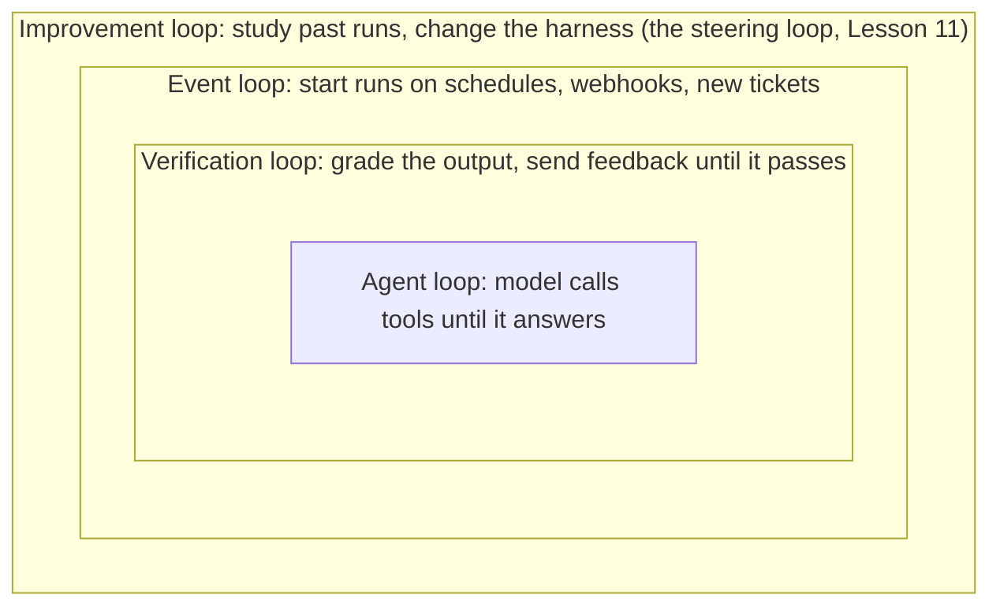

# Loop Engineering

Lesson 12 of 18 · Control Flow · about 50 minutes

In this lesson you will learn the parts of a complete loop (trigger, task, success criteria, plan, act-observe-check, spine, exits), how to tell retrying from adjusting, the budgets and detectors that prevent infinite loops, the Ralph loop and event-driven automation, and the new risks loops create for the people around them.

**Video:** [Loops and stop conditions (0:34)](../videos/README.md#10-loops-and-stop-conditions) · **Project:** [Loop Controls That Stop for a Reason](../projects/05-loop-controls/)


---

Watch how most people use a coding agent: type a request, wait, read the result, type the next instruction. Run the tests. Fix that failure. Now the docs. Now the next ticket. The agent does the work; a person decides every next step, and the work stops whenever that person steps away.

**Loop engineering** designs systems that take over that role. IBM describes it as designing loops that guide agents toward user-defined goals with minimal human intervention. Addy Osmani puts it in terms of your job: you replace yourself as the one who prompts the agent and design the system that prompts it instead ([Loop engineering](https://addyosmani.com/blog/loop-engineering/)). The label spread in mid-2026. The ideas underneath it, retries, verification, stop conditions, are much older.

## Loops nest

LangChain describes a stack of loops:



This lesson covers the middle two: the loops that run the work.

## Anatomy of a complete loop

| Part | Question | Habit-tracker answer |
|---|---|---|
| Trigger | What starts a run? | A maintainer labels a ticket; a 2 a.m. schedule; the main branch's tests fail |
| Task | What unit of work does one run pursue? | One ticket, chosen by priority, never two that touch the same files |
| Success criteria | How does the harness know it is done? | All tests pass, acceptance tests pass, badge renders, lint clean, no forbidden files changed |
| Plan | What steps does the agent intend? | Read daily streak logic, write weekly calc, add tests, add badge, run checks |
| Act, observe, check | What happens each iteration? | Edit, read the harness's result, compare against the criteria |
| Spine | Where does progress live between iterations and sessions? | Task state, progress file, feature list, log of failed approaches |
| Exits | When does it stop? | Verified success, a budget limit, escalation, external cancel |

### Tasks and success criteria

Geoffrey Huntley's influential **Ralph loop** does one task per loop by design. Anthropic's long-running agent improved sharply once it worked one feature per session. A loop with a vague, sprawling task wanders, runs out of context and finishes nowhere; a loop with one testable task can finish it, verify it, record it and move on.

The goal has to be checkable on every iteration. IBM's contrast: "make my website load faster" gives no point at which the loop knows it is done; "stop when the code passes all unit tests and satisfies the requested requirements" does. Every criterion in the habit-tracker table above is something the harness can check without asking the agent whether it thinks it is finished.

### Act, observe, check

**Observing** takes in what the action produced: the diff, the command output, the search hits. **Checking** compares the new state with the success criteria and the plan: are we closer to done? The fast deterministic checks from Lesson 11 make checking cheap enough to run every iteration.

### Retry or adjust

| Failure kind | Examples | Response |
|---|---|---|
| Transient | API timeout, HTTP 429 or 503, connection reset | Retry the same thing with **exponential backoff** (wait 1s, 2s, 4s...) |
| Substantive | A test fails because the logic is wrong | **Adjust**: change the code, revise the plan, gather context, or roll back and try another approach |

Running wrong code again produces the same failure. A good loop tells the agent which kind of failure it faces. [Project 5](../projects/05-loop-controls/) has you write the classifier and the backoff schedule.

### The spine

A loop that runs more than a few iterations, or across sessions, needs a persistent record that each iteration updates. IBM and Osmani both call it the **spine**: a file or board outside any conversation that holds what is done and what comes next, so tomorrow's run picks up where today's stopped. Add a log of failed approaches, so a fresh context does not try the same broken fix again.

## The Ralph loop

In its purest form, Huntley's [Ralph loop](https://ghuntley.com/ralph/) is a shell loop that feeds the same prompt to a coding agent forever:

```bash
while :; do cat PROMPT.md | claude-code ; done
```

Each iteration starts with a fresh context, reads the spec and the plan file, does one task, and relies on back-pressure (tests, type checks, builds) to reject bad output. The filesystem carries the work forward from one iteration to the next. LangChain describes it as a harness pattern that intercepts the model's attempt to finish and feeds the original goal back in a clean context. OpenAI's team noted that its process for driving pull requests to completion, in which the agent reviews its changes, requests more reviews, responds and iterates until reviewers are satisfied, was effectively a Ralph loop. Huntley recommends it for greenfield work more than for existing codebases. As written above, it has no exit except a person pressing Ctrl-C, which is what the rest of this lesson fixes.

## Automation: schedules, events and hooks

With triggers, tasks and a spine, a loop runs as automation. **Schedules** set a cadence (every night, every Monday) and suit work that accumulates: reviewing the day's failures, updating dependencies, pruning stale docs. **Event triggers** start a run when something happens, usually through a **webhook**, a message one system sends another when an event occurs. Teams often use GitHub Actions to schedule or trigger agent runs. **Hooks** run inside a run at events such as an edit or a tool call; IBM notes they move security and quality checks out of the agent's own reasoning, which also saves tokens.

Osmani describes a daily loop that combines the pieces: each morning an automation runs a triage skill over yesterday's test failures, open issues and recent commits and writes findings to a tracking file. For each finding worth fixing, the loop opens an isolated worktree, sends one sub-agent to draft a fix and a second to verify it, and opens a pull request through an MCP connector. Anything it cannot handle lands in a triage inbox for a person. Nobody types the next prompt, and a person still decides what matters.

## Exits: the harness owns at least one

A loop can stop in **success** (verification confirms the criteria), at a **limit** (attempts, tokens, time or money used up), to **escalate** (it needs a person), or on an **external signal** (someone cancels it). The rule: at least one exit must be enforced by the harness, independent of the model. A loop whose only exit is the model deciding it is done runs forever on a task it can neither finish nor abandon.

**Verified success only.** End in success only when verification confirms the criteria. Several designs separate the judge from the worker for this decision: a verification sub-agent with its own instructions, or a small model that checks a written condition after every turn, so the agent that wrote the code is not the one grading it.

### Budgets

| Limit | Levels | Notes |
|---|---|---|
| Attempts | Per failing check (e.g. 3) and per task (e.g. 40) | The fine limit catches an agent stuck on one problem long before the total does |
| Tokens | Per task | Each iteration resends history, so a long run pays for the same material many times |
| Time | Per command (timeout) and per task | Checkpoint before the limit ends the run |
| Cost | Per task, per day per loop, per team | Warn at 75%; stop or escalate at 100% |

The OpenAI Agents SDK caps the turns in a run and raises a specific error when a run exceeds it; you can turn that into a controlled final result that says what the run accomplished.

### Why loops fail to stop, and the defenses

| Cause | Defense |
|---|---|
| Impossible or contradictory task | Hard limits; escalate with a summary |
| Oscillation: fixes A by breaking B, then reverses | Detect A, B, A, B patterns in recent actions |
| Same action repeated | Refuse an action identical to one that already failed |
| Scope creep: keeps discovering new work | One task per run; new work goes to the queue |
| A flaky check passes and fails at random | Fix or quarantine flaky tests |
| The loop retriggers itself (its own comment counts as an event) | Ignore events caused by the agent's own identity |
| A dependency keeps failing | A **circuit breaker** stops calling it for a cool-down period |
| None of the above caught it | Alerts on unusually long or expensive runs |

**Progress detection** stops a run when several iterations pass without improvement, for example no increase in passing tests. harnesslab's loop implements budgets, repeat refusal and a no-progress window; Project 5 has you build all of the defenses above as small tested functions.

## People still matter, differently

Loop engineering reduces the need for a person at each step. It does not remove the need for people. IBM names the risks that grow when loops run with too little human involvement:

- **Unverified code:** a checker agent is still an agent, and people remain responsible for what ships.
- **Comprehension debt:** the growing gap between how much code exists and how much of it anyone understands.
- **Intent debt:** losing the reasoning behind design decisions, which agents cannot infer unless someone wrote it down.
- **Cognitive surrender:** handing over critical thinking entirely, as opposed to delegating work while still checking it.

HumanLayer's [critique of "lights-off" software factories](https://github.com/humanlayer/advanced-context-engineering-for-coding-agents/blob/main/wsff.md) adds a practical warning: models are trained to pass tests, and nothing in a test penalizes eroding maintainability. More reviewers and loops raise the floor but not the ceiling. Their fix is human planning up front and incremental review. In a well-run loop, people design and improve the loop, review its output where judgment matters, and handle what it escalates.

Long autonomous loops remain hard. Microsoft researchers' [LoopsBench](https://arxiv.org/abs/2608.00267) (Jul 2026), which evaluates continued development over many units of work, found that the best configuration tested resolved 25% of its tasks.

## The habit-tracker loop, assembled

At 2 a.m. a scheduled trigger starts the nightly run; labeled tickets and failed pipelines trigger runs during the day. Each run takes one conflict-free task, creates a worktree and sandbox, and reads the spine. The agent writes a short plan and iterates: act through tools, observe what the harness returns, check against the criteria with fast checks after every edit. Transient errors retry with backoff; substantive failures lead to adjustment, with a rollback after three failed attempts at the same problem. When the agent claims completion, a separate verification step runs the full suite, the browser check and an evaluator. Only if all pass does the loop open a pull request and mark the task done. Each run is bounded by iteration, token, time and cost limits, and a run that hits one checkpoints, records why, and goes to a developer's review list. In the morning the team reviews pull requests that passed and escalations that did not. Nobody typed a prompt overnight, and every run either finished or stopped for a stated reason.

## Check yourself

<details><summary>1. Your loop's only exit is "the agent stops calling tools." Name two failure scenarios.</summary>

An impossible task (the agent never finishes and never gives up), and oscillation between two failing states. Both run until something external breaks. Add harness-owned limits and progress detection.
</details>

<details><summary>2. A test fails with "AssertionError: expected 4, got 0." Retry with backoff or adjust?</summary>

Adjust. It is a substantive failure; re-running the same code produces the same result.
</details>

<details><summary>3. The agent comments on the ticket, and your webhook starts a new run on every comment. What happens and how do you fix it?</summary>

The loop retriggers itself indefinitely. Ignore events whose actor is the agent's own identity.
</details>

## Try it

Do [Project 5: Loop controls](../projects/05-loop-controls/): budgets, no-progress detection, repeat and oscillation detection, failure classification, exponential backoff, a circuit breaker and self-event filtering, each with tests.

## Go deeper

- Geoffrey Huntley, [Ralph Wiggum as a "software engineer"](https://ghuntley.com/ralph/).
- Addy Osmani, [Loop engineering](https://addyosmani.com/blog/loop-engineering/).
- HumanLayer, [Why software factories fail](https://github.com/humanlayer/advanced-context-engineering-for-coding-agents/blob/main/wsff.md).

**Next lesson:** [Graphs and Multi-Agent Systems](13-graphs-and-multi-agent-systems.md)
