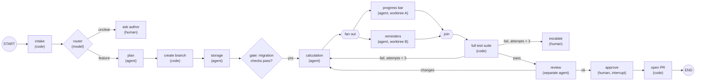

# Graphs and Multi-Agent Systems

Lesson 13 of 18 · Control Flow · about 60 minutes

In this lesson you will learn how to describe agent work as nodes, edges and shared state; when to make a step deterministic; how to bound cycles and design error paths and approval nodes; when multiple agents help and what they cost; handoffs versus agents-as-tools; and the documented ways multi-agent systems fail.

**Video:** [Loops, graphs and many agents (0:34)](../videos/README.md#11-graphs-and-multi-agent) · **Project:** [A Graph Workflow with Human Approval](../projects/09-graph-workflow/)

---

## Why a graph

The weekly goals feature for the habit tracker has stages: understand the request, plan, build storage for weekly targets, build the streak calculation, build the progress bar and reminders, test, review, get approval, merge. Some stages depend on others, some could run at once, some need a model's judgment and others are routine code. Some outcomes send work forward and others send it back. Put all that inside one loop and one long prompt, and the structure hides in prose where it is hard to see, hard to test and easy for the model to ignore. A graph makes the structure explicit.

**Graph engineering** is the 2026 label for designing agent workflows as graphs. The technique is older: flowcharts, workflow engines, build systems and data pipelines are all graphs, and LangGraph, Google's Agent Development Kit and Microsoft's Agent Framework offered graph-based agent orchestration before the label appeared. Graphs contain loops; they do not replace them.

## The parts

| Part | What it is | Weekly-goals example |
|---|---|---|
| Node | One step: plain code, a single model call, a full agent loop, a person, or a subgraph | `plan`, `build`, `run_tests`, `review`, `approve`, `open_pr` |
| Fixed edge | Always goes to the same next node | `build` to `run_tests` |
| Conditional edge (router) | Reads state, picks the next node | Tests pass: `review`; fail: back to `build` |
| State | Shared data every node reads and updates | Ticket, plan, branch, changed files, test results, attempt count, review notes |
| Reducer | Rule for merging an update into state | Replace for `plan`; append for `test_history` |
| START / END | Where input enters and where a run finishes | |
| Checkpoint | Saved state at a step boundary | Resume after a crash, or after a person answers |

## Design rules

**Make it deterministic when code can do it.** Creating a branch, formatting, running tests, validating a schema, checking which files changed, opening a pull request and sending a notification are all code. Deterministic nodes are faster, cheaper, repeatable and testable with ordinary unit tests, and every step you move out of the model's hands is a step it cannot forget or skip. In a graph, testing sits on the path between building and review, and no route around it exists.

**Give each agentic node only what its job needs.** The planner reads but cannot edit. The builder edits its own worktree but cannot open pull requests. The reviewer reads the change and the ticket and writes comments. Least privilege ([Lesson 7](07-sandboxes-permissions-and-security.md)) applied per step, with its own instructions and even its own model: a capable model for building, a cheaper one for classification.

**Route deterministically by default.** A rule-based router (any test failed: back to build) is cheap and predictable. A model-based router (is this message billing or technical?) handles language, and needs a schema that restricts its answer to valid branch names, plus its own eval, because a misrouted request travels confidently down the wrong path.

**Bound every cycle.** Agent workflows need cycles (fail, get feedback, try again), so they are rarely DAGs (directed acyclic graphs). Keep an attempt counter in state and route to escalation at the limit, and cap the total steps a run may take. Every principle from [Lesson 12](12-loop-engineering.md) applies to each cycle.

**Parallelize only independent work.** When a node has several outgoing edges, frameworks such as LangGraph run the targets in parallel (fan-out), and a join waits for all of them (fan-in). Anthropic describes two forms: **sectioning** splits a task into independent parts; **voting** runs the same task several times and compares. For work whose size is unknown in advance, such as reviewing every changed file, LangGraph's `Send` creates branches dynamically (map-reduce). Parallel branches that edit code each need their own worktree.

**Design error paths.** A tool timeout routes to a retry with backoff. Invalid output routes back to its producer with the validation error. A tripped guardrail routes to escalation. An exhausted budget routes to a node that checkpoints and records why. A **fallback** route sends a task a small model failed to a stronger model or a person. Validate each node's output at its boundary, or a subtle error in the calculation flows through the progress bar and past the reviewer, and the failure appears three steps from its cause.

**Make approval a node.** When work reaches a human approval node, the graph saves its state, notifies someone and waits. LangGraph provides interrupts and a resume command; Google's ADK and Microsoft's Agent Framework support the same pause and resume. Show the person the plan, the changes, the test results and the review findings, and plan for silence: remind, escalate or stop after a timeout.

## When a graph is worth it, and when it is not

| A graph helps when... | A loop is better when... |
|---|---|
| Stages are known in advance | Steps cannot be predicted (open-ended debugging, research) |
| Steps need different tools, permissions or models | One agent with the right tools can finish the task |
| The path depends on outcomes (tests, classifications) | The task is small |
| Independent parts can run in parallel | Your assumptions about the process are shaky |
| A person must approve at fixed points; you need audit, resume and step-level tests | You cannot yet name the failure a graph would fix |

A graph also encodes your assumptions. If they are wrong, it forces the agent down a worse path than it would have found. Every node boundary is a handoff that can lose context, and every node and edge is something to maintain. Start with one agent loop, and add structure when a specific, observed problem calls for it: a step the agent keeps skipping, a stage that needs different permissions, independent work that takes too long in sequence.

## Multi-agent systems

A **multi-agent system** uses several agents, each a model using tools in a loop with its own instructions, tools and context, coordinated by another agent, a graph or handoff rules.

### What it buys, and what it costs

Anthropic's [research system](https://www.anthropic.com/engineering/multi-agent-research-system) is the best-documented success. A lead agent on a stronger model directing parallel subagents on a smaller model beat the stronger model alone by **90.2%** on Anthropic's internal research eval. Its analysis of why is the key fact: on one browsing benchmark, token usage alone explained **80%** of the variance in performance. Multiple agents succeed largely because they spend more tokens across more separate contexts. The price follows: agents use about **4 times** the tokens of a chat interaction, and multi-agent systems about **15 times**.

| Role | Job | Example |
|---|---|---|
| Planner | Turn a goal into a plan and a definition of done | Expands a one-line request into 16 features over 10 sprints (Anthropic) |
| Builder | Do the work, one unit at a time, with a clean context | Implements one feature, commits, hands over |
| Evaluator / reviewer | Exercise or inspect the result against the requirements | Clicks through the running app with Playwright and grades it |
| Specialist | One domain | Security review, migrations, documentation |
| Orchestrator | Assign work, gather results, decide what is next | Anthropic's lead research agent |

Orchestrators need explicit delegation rules. Anthropic's early version spawned 50 subagents for simple queries, searched for sources that did not exist and had agents distracting each other. The fix was teaching the lead how to delegate (a clear objective, output format, tools and boundaries per subagent) and how to **scale effort**: one agent and a handful of tool calls for a simple fact, two to four subagents for a comparison, ten or more for complex research.

### Keep interlocking work in one agent

Cognition, the company behind Devin, argued the opposite case in [Don't Build Multi-Agents](https://cognition.ai/blog/dont-build-multi-agents): agents should share full context, and "actions carry implicit decisions," so parallel agents that cannot see each other's choices produce conflicting results. Their example: two subagents building parts of a Flappy Bird clone produced a background and a bird in incompatible styles.

The two views fit together. Isolation helps when subtasks are **independent**, as in research, where each subagent searches a different topic. It hurts when subtasks **interlock**, as in most software, where every piece must fit every other piece. Anthropic noted that most coding tasks have fewer parallel parts than research. Reduce the risk by settling key decisions in the plan before builders start (sprint contracts, validation contracts), logging decisions where every agent reads them, keeping tightly coupled work inside one agent, and having a reviewer check consistency across pieces.

### Handoffs and agents-as-tools

The OpenAI Agents SDK names two coordination patterns:

| Pattern | How it works | Use when |
|---|---|---|
| **Handoff** | One agent transfers control; the specialist becomes the active agent. The SDK exposes each handoff to the model as a tool, such as `transfer_to_refund_agent`. | Routing is part of the workflow and the specialist should own the conversation |
| **Agent as tool** | A manager keeps control and calls specialists like tools, getting bounded results back | One agent should own the final answer, combine specialists' output, or apply shared checks in one place |

Handoff quality depends on what travels with it. A specialist that receives only the last message makes the customer repeat everything.

### When to use several agents

OpenAI's guidance: get as far as you can with one agent, and split for **complex logic** (instructions full of conditional branches) or **tool overload** caused by similar, overlapping tools, after first improving tool names and descriptions. Several agents pay off for:

- **independent verification**: a separate evaluator, the multi-agent pattern most teams should adopt first;
- **breadth-first exploration** with many independent directions;
- **more information than one context holds**, with subagents returning summaries;
- **different permission boundaries**: one agent reads untrusted content and passes a summary to another that holds write access, so the lethal trifecta never forms in one agent;
- **long projects** where a fresh builder per unit of work avoids an ever-growing context.

Watch the bill. One 2026 measurement saw a task of about 121,000 tokens grow to about 513,000 when the agent fanned out to subagents ([Systima](https://systima.ai/blog/claude-code-vs-opencode-token-overhead)), and Cursor removed prompting that pushed its agent toward subagents while cutting token costs. HumanLayer recommends treating subagents as a **context firewall**, not as personas, and running them on cheaper models.

### How multi-agent systems fail

Cemri and colleagues analyzed more than 1,600 annotated traces from seven multi-agent frameworks and catalogued [14 failure modes in three groups](https://arxiv.org/abs/2503.13657): system design problems, misalignment between agents, and verification failures. Two findings stand out. Rewording the task did not fix failures that came from how the system interpreted specifications. And many "verifier" agents performed only superficial checks, such as confirming that code compiled, even when told to verify thoroughly. A reviewer agent is still an agent.

## Human control

**Human-in-the-loop** designs put people at defined points: approving, reviewing, supplying information. **Human-on-the-loop** designs let people monitor and step in when needed. Most systems combine them: approval for a few important decisions, monitoring for the rest. Two approval points pay off in multi-agent work: after planning (cheap to change direction before several agents spend hours) and before the work takes effect.

**Escalation** routes a problem to a person when it exceeds the agent's authority, ability or limits: too many failed attempts, a high-risk action, ambiguous requirements, reviewers who disagree, budgets running out. Package the task, what was tried, where it stuck and what decision is needed; pause in a resumable state; send it somewhere a person will see it. An agent that escalates a problem it cannot solve is more useful than one that guesses and hides the failure.

Thoughtworks' November 2026 Radar notes teams running many agent sessions in parallel and review becoming the bottleneck. OpenAI reached the same point: as agents produced more code, human attention became the scarcest resource. Scaling agents responsibly means strengthening automated checks so people spend attention on decisions that need it, not lowering the bar.

## Check yourself

1. Your graph's review step is an instruction inside the builder's prompt, and builds sometimes skip it. What changes?

Make review a separate node on the only path to approval, run by a different agent with its own instructions, so no route around it exists.

2. A research task and a refactoring task. Which benefits more from parallel subagents, and why?

Research: its subtopics are independent, and Anthropic found parallel subagents gain largely by spending more tokens in separate contexts. Refactoring pieces interlock, so parallel agents make conflicting implicit decisions.

3. Handoff or agent-as-tool for a triage agent sending refund questions to a specialist that should talk to the customer?

Handoff: routing is the workflow and the specialist should own the rest of the conversation. Pass the history and account context with it.

## Try it

Do [Project 9: Graph workflow](../projects/09-graph-workflow/). You write a small graph engine with reducers, routers, a step limit and interrupt-and-resume, build the plan, build, test, review, approve workflow on it, then run the same workflow on LangGraph and compare.

## Go deeper

- Anthropic, [Building effective agents](https://www.anthropic.com/engineering/building-effective-agents) (the five patterns) and [How we built our multi-agent research system](https://www.anthropic.com/engineering/multi-agent-research-system).
- Cognition, [Don't Build Multi-Agents](https://cognition.ai/blog/dont-build-multi-agents).
- Cemri et al., [Why Do Multi-Agent LLM Systems Fail?](https://arxiv.org/abs/2503.13657)
- LangGraph [documentation](https://docs.langchain.com/oss/python/langgraph/overview): state, reducers, `Send`, interrupts and checkpointers.

**Next lesson:** [Build a Complete Harness](14-build-a-complete-harness.md)
