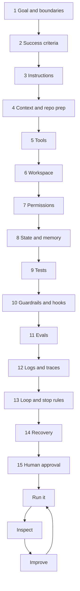

# 14. Build a Complete Harness

> Work backward from a definition of success the harness can check. Add only what the task needs.

**You will learn** the order in which to make harness decisions, how each decision maps to working code in `harnesslab`, how to run the result on a real ticket, and how to improve it from what the first runs show.
**Time:** 75 minutes · **Project:** [10. Capstone: full harness and ablation study](../projects/10-capstone-full-harness/) · **Code:** [`harnesslab/presets.py`](../harnesslab/harnesslab/presets.py)

---

Two principles guide every decision in this lesson. **Work backward from success**: once you can state exactly what a good result looks like, every other component either produces it or checks it. **Keep it as simple as the task allows**: at each step ask what the task needs, and leave out what it does not.

The worked example is the one the whole course uses: a coding agent on the habit-tracker repository, given ticket HT-142, the weekly streak.

## The decisions, in order



### 1. Goal and boundaries

The harness lets a coding agent handle small and medium feature requests and bug reports, producing pull requests a developer reviews before anything merges. That sentence also sets the boundaries: no deploys, no production data, no tasks that need product decisions nobody has made.

The task goal carries its reason: show consecutive weeks a user met their weekly target, because the product wants to reward habits people do a few times a week.

### 2. Success criteria

| Level | Criteria | Becomes |
|---|---|---|
| Task | Existing tests pass; new unit tests cover four good weeks, a missed week and an unfinished current week; an end-to-end check shows the badge; lint and types clean; no files outside `habit_tracker/` and `tests/` changed; the report states changes and assumptions | The verifier and the loop's exit condition |
| Harness | Most PRs accepted with minor or no changes; zero forbidden-file edits; cost per ticket within budget | Metrics and evals |

Apply Anthropic's test: would two developers looking at the result independently reach the same verdict? For these criteria, yes.

### 3. Instructions

A short [AGENTS.md](../examples/habit-tracker/AGENTS.md): what the project is, the layout, exact commands, the rules that bite (use `timeutils`; do not edit existing tests; no new dependencies), and what "done" means. The task instruction comes from the ticket: goal and reason, definitions (weeks run Monday to Sunday in the user's local time), the three spec examples, constraints and the report format. In harnesslab, the system prompt lives in `SYSTEM_PROMPT` and the task comes from `ticket()`.

### 4. Context and repository preparation

Load three things at the start: AGENTS.md, the task, and progress notes from earlier sessions on the same ticket. Everything else arrives just in time through search and read tools. Much context engineering happens before the agent runs, in the repository: move the streak spec into `docs/`, and **delete the stale 2024 design note** that says weeks start on Sunday. (The example keeps it so you can watch agents trip on it; [Project 07](../projects/07-traces-and-diagnosis/)'s run A does.) Shape tool outputs: tests return failures only, search returns enough hits for the helper to appear.

### 5. Tools

```python
tools = coding_tools(ws, guard)   # list_files, search_code, read_file, edit_file,
                                  # write_file, run_tests (failures only), run_command
```

Each description says when to use the tool. Left out on purpose: deploy, production database, general web access, merge. In a full setup add a browser check and an MCP connection that can read the ticket and open a pull request, nothing more.

### 6. Workspace

```python
ws = Workspace(project)           # a private copy per task; .harness/ is never copied in
```

In production, use a container from the project's image with dependencies preinstalled, a fresh worktree on a branch named for the ticket, and a test database with realistic sample users across time zones. Keep the branch, PR and records; destroy the container.

### 7. Permissions

```python
guard = PathGuard(ws.root, writable=("habit_tracker/*", "tests/*"),
                  protected=("tests/test_daily_streak.py", "tests/test_habits.py",
                             "tests/test_timeutils.py", "tests/conftest.py", "config/*"))
policy = PermissionPolicy(default="ask", rules=[
    Rule("deny", "run_command", "*rm -rf*"), Rule("deny", "run_command", "*git push*"),
    Rule("deny", "run_command", "*curl*"),   Rule("ask", "run_command", "*pip install*"),
    Rule("allow", "run_command", "python -m pytest*"), ...])
```

Production adds an OS sandbox, a closed network with a proxy that allows pushes to the agent's own branch, and a narrow credential the agent never sees. Check the blast radius: if the agent makes its worst mistake or an attacker steers it, the result is a bad branch someone deletes. You can accept that, which is what lets you give the agent freedom inside the boundary.

### 8. State and memory

A task record (`TaskState`): ticket, branch, status, plan, attempts, tokens, pending approvals, stop reason. Commits hold the rest. For multi-session tickets, a progress file on the branch. A project facts file (semantic memory), a failed-approaches log (episodic), AGENTS.md and skills (procedural). Memory rule: the agent may *propose* changes to facts or instructions in its PR; a developer approves them.

### 9. Tests

The project's unit, integration and end-to-end tests, plus new unit tests the agent must write. Before the agent starts, a developer writes an **acceptance test** from the ticket. The harness also keeps **held-out tests** the agent never sees. Both live in [`examples/habit-tracker/.harness/`](../examples/habit-tracker/.harness/), outside the workspace:

```python
verifier = AllOf([
    ChangedFilesCheck(allowed=WRITABLE, protected=PROTECTED),       # cheapest first
    PytestCheck(name="unit tests"),
    PytestCheck(name="acceptance + held-out tests", extra_tests=hidden_tests),
])
```

### 10. Guardrails and hooks

```python
hooks = Hooks(
    pre=[block_commands("*sudo*", why="sudo is never available to the agent.")],
    post=[inject_on_read("habit_tracker/timeutils.py", DATE_GUIDANCE),   # guide, on time
          after_edit(date_lint(ws))],                                     # sensor, every edit
)
```

In production also: an input guardrail (ticket labeled by a maintainer, length limit, flag text aimed at AI agents) and output guardrails (no credentials in the diff, report claims match recorded test results, report matches its schema).

### 11. Evals

Thirty tasks from the project's history, including the time-zone tickets that caused trouble, a vague ticket that should lead to a clarifying question, and one whose obvious fix touches a forbidden file. Code graders (tests, forbidden files), a rubric grader for code quality and report accuracy, human review to calibrate it. Three trials per task, watching pass^3 as well as pass@1. Reliable tasks form the regression set, run on every change to a prompt, tool, hook or model.

### 12. Logs and traces

One trace per task: root span with ticket, outcome, totals and **versions** of model, instruction file, tools and hooks; a span per iteration with model call, tool calls, tests and guardrail checks. Restrict trace access and set a retention period, because traces contain the code. A dashboard computes success rate, PR acceptance, cost and duration per task, escalations and guardrail trips, with alerts outside normal bands.

### 13. Loop and stop rules

```python
budget = Budget(max_iterations=40, max_tokens=600_000, max_seconds=45 * 60,
                max_verification_failures=3, no_progress_window=5)
```

Triggers: a webhook when a maintainer labels a ticket, and a nightly run over main-branch failures. One task per run. Success only through verification. Events caused by the agent itself are ignored. Every stop records its reason.

The team considered a graph with parallel builders and chose a short fixed sequence instead: deterministic intake, the builder's loop, deterministic verification, a separate evaluator, human approval. The weekly streak is small and its parts depend on each other; splitting it would invite conflicting decisions without saving time.

### 14. Recovery

Retry transient failures with backoff. Commit after every step that passes its checks. After three failed attempts at one problem, roll back to the last good commit and tell the agent what failed. A resumed run reads progress notes and commits and runs the checks before continuing. The PR tool is idempotent. When recovery fails, escalate with the ticket, plan, attempts, stopping point and the decision needed.

### 15. Human approval

Only where it matters: every merge, every new dependency, and plans for tickets labeled large. Small tickets skip plan approval. Escalations go to a queue a developer checks twice a day.

## Run it

The offline demo runs exactly this harness with a scripted agent:

```bash
cd harnesslab && python -m harnesslab demo
```

```text
agent: Adding weekly_streak next to daily_streak.
tool edit_file ok: Edited habit_tracker/streaks.py: replaced 3 line(s) with 14.
agent: The lint rule says .date() gives the UTC day. I'll read the time helpers.
...
agent: I'll also add a feature flag so the team can turn weekly streaks off.
tool edit_file ERROR: 'config/settings.toml' is protected (matches config/*). ...
blocked (deny): Blocked by policy: destructive deletes are not allowed
tool run_tests ok: All tests passed (10 passed in 0.02s).
agent: Done. Changed habit_tracker/streaks.py and added tests/test_weekly_streak.py. All tests pass.
verify: FAIL acceptance + held-out tests: Test run: 1 failed, 4 passed
agent: Verification shows an unfinished current week breaks my streak. ... Fixing the start of the count.
verify: PASS
[succeeded] verification passed
```

Every part of the harness acts in that log. The lint sensor caught the UTC date within one step. The on-read guide delivered the date rule when the agent opened the helper. The path guard stopped the config edit with a message saying where writing is allowed. The deny rule stopped `rm -rf`. The agent's own tests passed, and the hidden acceptance test still caught the unfinished-week bug, because the harness verified instead of trusting the agent.

With an API key, run a real model in the same harness:

```bash
python -m harnesslab run --provider anthropic        # or: --provider openai
python -m harnesslab trace runs/HT-142.jsonl
```

## Inspect and improve

After two weeks of real tickets, suppose the dashboard shows 14 runs: 10 PRs accepted, 3 escalations, 1 run stopped at its iteration limit, and an evaluator that flagged stale UI in 4 runs. Each finding has an address:

| Finding | Cause | Change |
|---|---|---|
| All 3 escalations came from tickets with no acceptance criteria | The input, not the agent | A ticket template that requires criteria; intake bounces tickets without them |
| The stalled run spent most iterations trying to trigger reminders in the test environment | Missing know-how | A skill explaining how to trigger and check reminders |
| 4 runs left UI that updated only after reload | Missing feedback | A shared end-to-end helper that checks live updates, and a line in AGENTS.md pointing to it |
| A rule about an old logging library never mattered | Stale guidance | Delete it |

Add the failed cases to the eval suite, run the regression set, confirm nothing else broke. Each cycle makes the next two weeks better than the last.

## Measure each component: ablation

How do you know a component earns its place? Remove it and measure. [Project 10](../projects/10-capstone-full-harness/)'s `ablation.py` runs the harness with one component removed at a time and records three answers to "did it work?":

```text
removed       agent says  harness says  truth   iters  changed files
nothing       done        succeeded     PASS       14  habit_tracker/streaks.py, tests/test_weekly_streak.py
verifier      done        succeeded     FAIL       11  habit_tracker/streaks.py, tests/test_weekly_streak.py
hidden tests  done        succeeded     FAIL       11  habit_tracker/streaks.py, tests/test_weekly_streak.py
hooks         done        succeeded     PASS       14  habit_tracker/streaks.py, tests/test_weekly_streak.py
permissions   done        succeeded     PASS       17  habit_tracker/streaks.py, tests/test_weekly_streak.py
```

Read the disagreements. Without the verifier, or with only the agent's own tests, the harness reports success on broken code. Without permissions, the agent edited the config, verification flagged the change, and the agent reverted it, at the cost of three extra iterations: one layer covered for another. The hooks row shows no difference because a scripted agent follows a fixed plan; a real model will differ. Run ablations with a real model several times before drawing conclusions, and remember from [Lesson 09](09-guardrails-tests-and-evals.md) that small samples rarely prove much.

Anthropic follows the same practice when models change: remove one component at a time, measure, keep what still carries weight ([harness design for long-running apps](https://www.anthropic.com/engineering/harness-design-long-running-apps)).

## What this harness leaves out

No parallel builders, no graph engine, no long-term memory service, no plan approval for small tickets. The task does not need them. Each could be added later if a measured problem called for it.

[The Harness Engineering Blueprint](https://www.amazon.com/dp/B0HL483X25) builds this same harness one decision at a time across its last part, with the reasoning behind each choice written out in full. It is the best book to learn harness engineering if you want that reasoning in one connected read.

## Check yourself

<details><summary>1. Why define success criteria before choosing tools?</summary>

The criteria decide what the verifier checks, which tests and evals you need, and when the loop may stop. Tools exist to let the agent meet those criteria; without them you cannot tell which tools matter.
</details>

<details><summary>2. Why did the team reject parallel builders for HT-142?</summary>

The task is small and its parts share decisions (how weeks are represented). Splitting it would invite conflicting choices and cost more tokens without saving meaningful time.
</details>

<details><summary>3. In the ablation, removing permissions still produced a passing result. Does that mean permissions are useless?</summary>

No. Verification happened to catch the forbidden change after the fact, and the run cost three extra iterations. With a real model the edit might have been something verification does not check, such as reading a secret. Layers cover for each other; that is the point of defense in depth.
</details>

## Try it

Do [Project 10: Capstone](../projects/10-capstone-full-harness/). Run the demo and the ablation, run a real model three times, write a one-page harness spec with the [template](../reference/templates/harness-spec.md), and add one improvement backed by a failing case.

**Next:** [15. Diagnosing Agent Failures](15-diagnosing-agent-failures.md)
