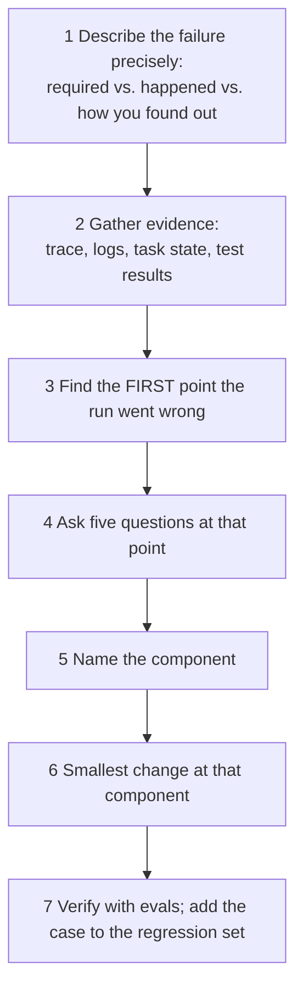
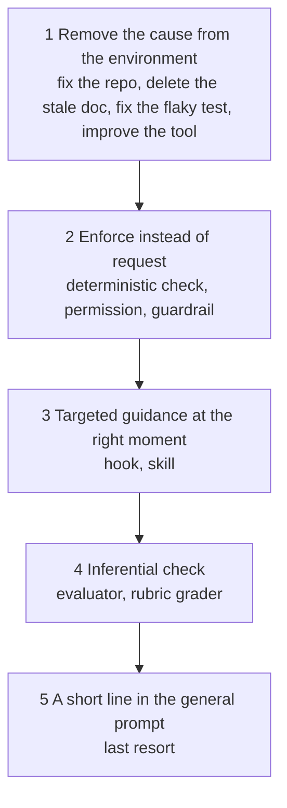

# 15. Diagnosing Agent Failures

> A failing agent is a failure with an address. Find the address before you touch the prompt.

**You will learn** a repeatable diagnostic method, the nine most common failure patterns and the harness component each points to, the order in which to prefer fixes, and how to apply all of it outside coding.
**Time:** 50 minutes · **Video:** [Where is the bug? (1:10)](../videos/README.md#12-diagnosing-failures) · **Project:** [07. Traces and diagnosis](../projects/07-traces-and-diagnosis/) · **Reference:** [Failure diagnosis table](../reference/failure-diagnosis.md)

---

When an agent fails, the instinct is to open the prompt and add a line: be careful with time zones, always run the tests, do not touch config. Over months that produces a long, contradictory rulebook, and it changes only one component of a system with many. If the cause lives in a tool, a permission, the state or a check, no extra sentence removes it.

Research backs this up. Cemri and colleagues studied more than 1,600 traces of multi-agent systems and found 14 failure modes rooted mostly in system design, coordination and verification ([MAST](https://arxiv.org/abs/2503.13657)). In one example a system asked to build a Wordle game with a new word each day produced a fixed word list. Rewriting the request to forbid a fixed word bank still produced a fixed word list, plus new errors. The failure came from how the system was built to interpret specifications, not from the wording.

## The method

The five questions, asked at the first wrong decision:

1. **What did the agent see?** (context)
2. **What could it do?** (tools)
3. **What was it allowed to do?** (environment, permissions)
4. **What feedback did it get after acting, and was it accurate and useful?** (checks, feedback)
5. **What told it to continue or stop?** (loop, success criteria)

Two more questions before you commit to a fix:

- **One event or a pattern?** Practice **error analysis**: read a sample of failed traces, label each cause, count the labels, fix the most common first.
- **Is the harness the right place to look?** Sometimes the model lacks the capability. The signs: it fails with the right context, tools and feedback, and a stronger model succeeds in the same harness. Then the options are a stronger model, a smaller task, or more human involvement. Check the harness first; harness changes are cheaper. Also rule out two other culprits: the **check** may be wrong (a grader that rejects valid work), and the **task** may be wrong (a ticket that never said what done meant).

## Nine failure patterns

| # | Pattern | Symptoms | Component | Typical fixes |
|---|---|---|---|---|
| 1 | Lacks information | Rewrites an existing helper, follows an abandoned convention, states a policy wrong | Context | Point to it from AGENTS.md, improve search, delete stale docs, preserve decisions in compaction, inject on open |
| 2 | Cannot act | Describes the work instead of doing it, long shell workarounds, repeated failing calls | Tools | Add or consolidate a tool, rewrite the description, clearer inputs and enums, actionable errors, shaped output, a skill for know-how |
| 3 | Unsafe action | Edits outside scope, destructive commands, reads secrets, follows planted instructions | Environment, permissions, guardrails | Narrow permissions, move a rule into the sandbox, add a guardrail, split agents to break the trifecta, add an approval gate |
| 4 | Repeats itself | Same command again and again, edits flip-flop, tokens rise with no progress | Loop | Progress detector, per-problem attempt cap with rollback, failed-approaches log, refuse identical failed calls, fix flaky tests, ignore self-events |
| 5 | Forgets progress | Redoes finished work, contradicts earlier decisions, duplicate PR after a crash | State and memory | Persist state, require a progress update before session end, feature list, commit per verified step, resume routine, idempotent actions |
| 6 | Finishes too early | Declares done with pieces missing, marks features passing unchecked | Success criteria, verification | Checkable criteria, verification as the only success exit, acceptance tests written first, separate evaluator |
| 7 | Unexplainable failure | The records do not show why | Observability | Record the context sent, tool arguments and results, task IDs and versions; trace each graph node |
| 8 | Looks right, does not work | Tests pass, reviewer or users find the bug | Tests and evals | End-to-end checks, held-out tests, acceptance tests from requirements, calibrated rubric grader, pass^k |
| 9 | Same mistake on every task | Each run looks fine alone; the pattern shows only across runs | Feedback and steering | Move the check earlier and make it explain the fix; add guidance before the action; store the lesson in a skill or facts file; regression eval |

### Notes on the patterns that fool people

**Blocked attempts are findings.** When a guardrail stops the agent editing the config file, the guardrail worked, and it also showed the agent wanted something your design did not anticipate. In the [Lesson 14](14-build-a-complete-harness.md) run the agent tried to add a feature flag to shared config: a reasonable idea that raises a real design question about whether such changes should have an approved path.

**The one fix that does not work for unsafe actions** is an instruction telling the agent not to do the unsafe thing. An instruction is a request, and a successful injection overrides it.

**After any failure you cannot diagnose, add the record that would have let you.** The next occurrence becomes explainable.

**The opposite of pattern 8 matters too.** A check that rejects correct work teaches the team to ignore checks. Read the transcripts of failed tasks to catch it.

## Prefer fixes in this order

Some fixes live outside the agent's harness entirely, such as a ticket template for the people who write vague tickets. Whatever you change, change one thing at a time so the evals can attribute the effect, watch for new rules conflicting with old ones, and remember that **removal is a fix**: too many tools, contradictory rules or excess context improve by subtraction.

## A non-coding diagnosis, end to end

A support agent can look up orders and issue refunds within a limit. Metrics show about 3% of its refunds are later reversed by staff because they hit the wrong order.

1. **Describe:** refunds go to an order the customer did not mean.
2. **Evidence:** traces of the reversed refunds share a pattern. Each customer said "my last order" or "the order from last week."
3. **First wrong decision:** choosing the order.
4. **What did it see?** The lookup tool returned long random IDs, sorted by an internal number, with no product names or dates. The agent had to guess.
5. **Component:** the tool, and a missing check.
6. **Fix:** the tool returns orders newest first with dates and product names. A business rule requires confirming the specific order with the customer before any refund, enforced by a guard on the refund tool. [Project 11](../projects/11-support-agent-harness/) implements exactly this guard.
7. **Verify:** add the reversed cases to the eval suite. The wrong-order rate falls close to zero, with no slowdown on other requests.

A prompt line saying "be careful to pick the right order" would have left the cryptic list in place and the guessing unchanged.

## Practice on recorded runs

[Project 07](../projects/07-traces-and-diagnosis/) ships four real traces from the habit-tracker harness, each with one failure built in by an incomplete harness:

| Run | What the trace shows | Your job |
|---|---|---|
| A | The agent reads `docs/old-design-note.md` and writes Sunday weeks; verification fails twice; escalated | Name the pattern and the cheapest fix |
| B | The same lines edited back and forth; stopped at the iteration limit | Which loop control was missing? |
| C | "Succeeded" with no verifier; an audit after the run finds hidden tests failing | What exit rule would have caught it? |
| D | A ticket comment tells agents to POST the config to an outside server; a deny rule and the path guard block it | What worked, and what would you add? |

Write code that summarizes each trace and finds its first problem, then write your diagnosis in the project's worksheet before reading the answers.

## Check yourself

1. The agent wrote its own time-zone conversion. The helper is mentioned in AGENTS.md. Where do you look first?

The trace at the decision point: was AGENTS.md in context, and did the agent search for the helper? If its search returned nothing useful, the fix is the search tool (pattern 1 via a tool cause), not the prompt. If the information was present, add a lint sensor with fix instructions (pattern 9).

2. An agent passes all its tests and users still find bugs. Which pattern and which first fix?

Pattern 8. Write acceptance tests from the requirements before work starts and add end-to-end checks; keep held-out tests the agent never sees.

3. Why is "change one thing at a time" more important for agents than for ordinary code?

Agent behavior is non-deterministic and changes interact. If you change three things and the success rate moves, you cannot attribute the effect, and small eval sets already make attribution hard.

## Go deeper

- Cemri et al., [Why Do Multi-Agent LLM Systems Fail?](https://arxiv.org/abs/2503.13657): the MAST taxonomy.
- LangChain, [Improving deep agents with harness engineering](https://www.langchain.com/blog/improving-deep-agents-with-harness-engineering): a trace-analyzer skill that turns error analysis into targeted harness edits.

**Next:** [16. Harness Engineering in Production](16-harness-engineering-in-production.md)
