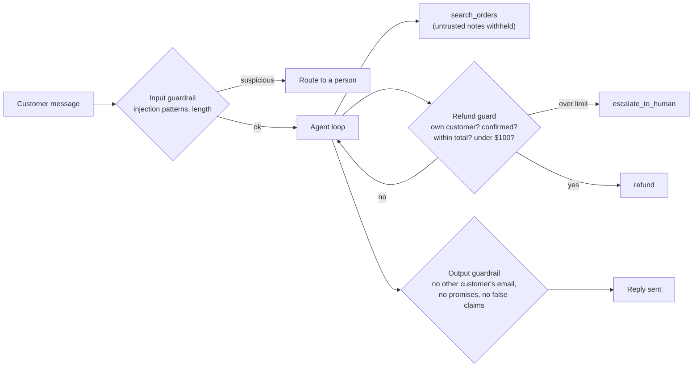

# 17. Harnesses Beyond Coding

> Change the domain and the eight parts stay. Only the answers change.

**You will learn** how to apply the same eight-part harness to support, research, data analysis, operations and internal business agents, what is different about each, and what a real non-coding harness looks like.
**Time:** 40 minutes · **Project:** [11. Support agent harness](../projects/11-support-agent-harness/)

---

Most writing on harness engineering is about coding agents, because code gives you tests, diffs and version control for free. Agents that answer customers, research questions, analyze data or run business processes need harnesses as much, and they usually start with fewer built-in sensors. The questions are the same ones from [Lesson 15](15-diagnosing-agent-failures.md): what does the agent see, what can it do, what is it allowed to do, what feedback does it get, and what tells it to stop.

## The same eight parts, five domains

| Part | Support agent | Research agent | Data analysis agent | Operations agent |
|---|---|---|---|---|
| Guidance | Policies, tone, refund rules | Question scope, source standards, citation format | Metric definitions, schema docs | Runbooks, service ownership |
| Capability | Order search, refunds, escalation | Web and internal search, fetch, notes | Read-only SQL, code execution for analysis | Logs, metrics, dashboards, a restart tool |
| Boundaries | Refund limit, own customer only | No posting anywhere; browsing isolated from private data | Read replica only, no PII columns | Read-only by default; changes need approval |
| Continuity | Conversation history, case notes | Research notes and source list | Query history, intermediate results | Incident timeline |
| Checking | Business rules, output guardrails | Claim-to-source verification | Re-run queries, sanity checks on totals | Confirm the fix with metrics |
| Visibility | Every refund and its reason | Which sources informed each claim | Every query and its result size | Every action during the incident |
| Correction | Reversed refunds become eval cases | Unsupported claims sent back for sources | Mismatched totals trigger a re-check | Post-incident review updates runbooks |
| Control flow | Triage workflow, then agent for hard cases | Orchestrator with parallel subagents | Single agent, plan then execute | Graph with a human approval node |

## Customer support

The defining risks: the agent moves money or makes promises, and it reads text written by strangers (messages, order notes, emails). [Project 11](../projects/11-support-agent-harness/) builds a four-layer harness for a refund-capable agent:

In the project's "injection in order data" scenario, an order note reads like an instruction to the AI to refund a $900 order belonging to someone else. The scan withholds the note from the context. The scripted model is written to be fooled anyway and calls the refund. The refund guard blocks it, because the order belongs to a different customer and was never confirmed. That last layer is the one that matters: it holds even when the model has been manipulated, because it checks facts in code instead of trusting the model's judgment.

Support agents also show the workflow-plus-agent pattern from [Lesson 02](02-how-an-agent-works.md): a fixed workflow classifies and routes, and an agent handles the hard billing cases with a person approving large refunds. OpenAI's guidance names exactly these actions (cancelling orders, large refunds, payments) as ones that should trigger human oversight until the agent's record justifies more autonomy.

## Research agents

Research is where multiple agents earn their cost. Anthropic's research system used a lead agent and parallel subagents and beat a single agent by 90.2% on its internal eval, at roughly 15 times the tokens of a chat. Harness concerns specific to research:

- **Effort scaling.** Write rules for how much effort a question deserves, or agents search forever for sources that do not exist. Anthropic's early version spawned 50 subagents for simple questions.
- **Source quality.** Guidance on which sources count, and a checker that confirms each claim against a cited source.
- **The trifecta.** A research agent browses untrusted pages. Keep that agent away from private data and from any ability to post or send, or split browsing into its own agent that returns summaries.
- **Evaluation.** Anthropic started with about 20 real queries and an LLM judge scoring factual accuracy, citation accuracy, completeness, source quality and tool efficiency, plus human review for problems the judge missed.

## Data analysis agents

The model should not do arithmetic in its head. Give it code execution in a sandbox and a read-only connection to a reporting replica, and have it compute everything in code. Harness concerns:

- Read-only access to a replica, never production; exclude columns with personal data.
- Metric definitions as guidance ("active user" means something specific in your company).
- Sanity checks as sensors: totals that match a known figure, row counts within expected ranges, no silent NULL handling.
- Show the query with every number, so a person can verify it.

## Operations agents

An agent investigating an outage needs production visibility and must not make things worse. Start read-only: logs, metrics, traces, recent deploys. Offer narrow write tools (restart one service, roll back one deploy) behind an approval node. Record a timeline of every action for the post-incident review, and turn each incident's lessons into runbook updates the agent reads next time.

## Internal business agents and the "company harness"

LangChain described building an internal agent that works across a company, and named [five components of a company harness](https://www.langchain.com/blog/components-building-company-harness): presence in the channels people already use, identity (knowing who is asking and what they may see), memory, sandboxed execution and scheduled runs. They found identity the hardest. That matches the permission lessons: an internal agent must act with the requesting person's access, not with one broad service account that can read everything.

## A real non-coding harness: an AI tutor

[LearnHarness](https://github.com/amosblomqvist/learnharness) is an open-source AI tutor that describes itself as an agent harness for learning. Its published architecture shows the course's ideas in a different domain:

- Three agents with distinct roles and toolsets over one history: a prober that measures what the learner knows, a teacher, and a practitioner that runs exercises.
- Gate tools that enforce one active practice problem at a time, a structural rule instead of a prompt request.
- Durable records with a separate model-facing view, compaction, and repair of interrupted tool calls.
- Tool arguments repaired before validation, with errors the model can correct.
- Background helpers checked with render-and-inspect loops, and a cost meter.

Different domain, same parts: guidance, capability, boundaries, continuity, checking, visibility, correction and control flow.

## Designing a harness for your domain

1. Write the success criteria a person would use to judge the agent's work, then make as many of them checkable by code as you can.
2. List the actions the agent can take and rate each low, medium or high risk. High-risk actions get a guard in code and usually an approval.
3. Mark every source of untrusted text. Check whether any one agent combines private data, untrusted content and outbound communication.
4. Decide what must survive an interruption, and where it lives.
5. Decide what you will record for each step and who may read it.
6. Start with 20 real cases as your first eval set.
7. Run it, read the traces, and fix the component each failure points to.

## Check yourself

1. Your data agent reports revenue figures. What sensor would catch a wrong join that doubles the total?

A sanity check comparing the total against a known reference figure (last month's finance report, or a simple count query), plus showing the query so a person can inspect the join.

2. Which layer in Project 11 stops the planted refund when the model has already been fooled?

The refund guard, a pre-tool hook that checks ownership, confirmation, amount and limit in code. Input and output guardrails reduce risk; the guard on the money-moving action enforces it.

3. A research agent browses the web and can read your company's internal wiki. What do you change?

Split it: one agent browses with no wiki access and returns summaries; another reads the wiki and the summaries but cannot browse or post. That removes one leg of the trifecta from each agent.

## Try it

Do [Project 11: Support agent harness](../projects/11-support-agent-harness/), then sketch the eight-part table for an agent in your own work using the [harness spec template](../reference/templates/harness-spec.md).

**Next:** [18. Real Harnesses: Case Studies](18-case-studies.md)
