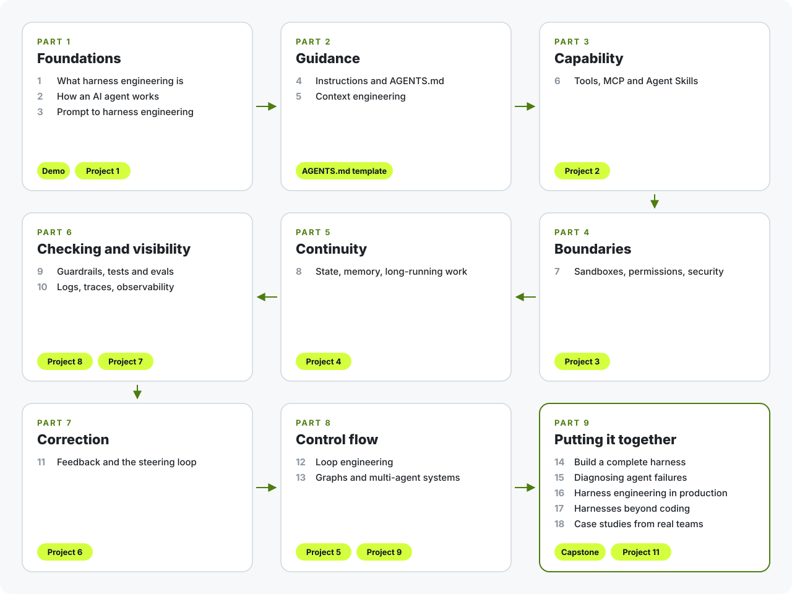

# The Course

Eighteen lessons in nine parts, from how an agent works to running a harness in production. Each lesson tells you up front what you will learn, then ends with questions to check yourself, a hands-on exercise and the primary sources worth reading next.

Reading takes about 14 hours. With all eleven projects, plan on 30 to 40 hours.

<p align="center">
  <picture>
    <source media="(prefers-color-scheme: dark)" srcset="../assets/readme/learning-path-dark.svg">
    
  </picture>
</p>

## Part 1: Foundations

1. [What Harness Engineering Is](01-what-is-harness-engineering.md) · 35 min · try the offline `harnesslab` demo
2. [How an AI Agent Works](02-how-an-agent-works.md) · 40 min · project: [build an agent loop](../projects/01-agent-loop/)
3. [From Prompt Engineering to Harness Engineering](03-the-layers.md) · 25 min

## Part 2: Guidance

4. [Instructions and AGENTS.md](04-instructions-and-agents-md.md) · 40 min · [AGENTS.md template](../reference/templates/AGENTS.md)
5. [Context Engineering for Harnesses](05-context-engineering.md) · 45 min

## Part 3: Capability

6. [Tools, MCP and Agent Skills](06-tools-mcp-and-skills.md) · 50 min · project: [tool design](../projects/02-tool-design/)

## Part 4: Boundaries

7. [Sandboxes, Permissions and Security](07-sandboxes-permissions-and-security.md) · 60 min · project: [permissions and a sandbox](../projects/03-permissions-and-sandbox/)

## Part 5: Continuity

8. [State, Memory and Long-Running Work](08-state-memory-and-long-running-work.md) · 50 min · project: [long-running state](../projects/04-long-running-state/)

## Part 6: Checking and Visibility

9. [Guardrails, Tests and Evals](09-guardrails-tests-and-evals.md) · 60 min · project: [an eval kit](../projects/08-evals/)
10. [Logs, Traces and Observability](10-observability.md) · 45 min · project: [traces and diagnosis](../projects/07-traces-and-diagnosis/)

## Part 7: Correction

11. [Feedback, Verification and the Steering Loop](11-feedback-verification-and-steering.md) · 50 min · project: [guides and sensors](../projects/06-guides-and-sensors/)

## Part 8: Control Flow

12. [Loop Engineering](12-loop-engineering.md) · 50 min · project: [loop controls](../projects/05-loop-controls/)
13. [Graphs and Multi-Agent Systems](13-graphs-and-multi-agent-systems.md) · 60 min · project: [a graph workflow](../projects/09-graph-workflow/)

## Part 9: Putting It Together

14. [Build a Complete Harness](14-build-a-complete-harness.md) · 75 min · project: [the capstone](../projects/10-capstone-full-harness/)
15. [Diagnosing Agent Failures](15-diagnosing-agent-failures.md) · 50 min · [failure diagnosis table](../reference/failure-diagnosis.md)
16. [Harness Engineering in Production](16-harness-engineering-in-production.md) · 60 min · [production checklist](../reference/harness-checklist.md)
17. [Harnesses Beyond Coding](17-harnesses-beyond-coding.md) · 40 min · project: [a support agent harness](../projects/11-support-agent-harness/)
18. [Case Studies from Real Teams](18-case-studies.md) · 45 min

## Three ways through

**I use Claude Code, Codex or Cursor every day and want better results this week.** Read lessons 1, 4, 7, 11 and 15. Write a short AGENTS.md from the [template](../reference/templates/AGENTS.md), turn on your agent's sandbox, add one lint rule whose message explains the fix, and use the [failure table](../reference/failure-diagnosis.md) the next time the agent goes wrong.

**I build agents and want to understand every layer.** Go in order. Do every project. By Project 10 you will have built, tested and ablated a complete harness.

**I lead a team adopting agents.** Read lessons 1, 3, 9, 13, 15 and 16, then the [harness checklist](../reference/harness-checklist.md). The ablation in Project 10 is a good team exercise.

## Setup

You need Python 3.10 or newer. Nothing else is required for the lessons, the demo or the projects.

```bash
git clone https://github.com/AbhishekAshtekarDev/harness-engineering.git
cd harness-engineering
python -m pip install -e "harnesslab[dev]"
cd harnesslab && python -m harnesslab demo
```

Every project runs offline with a scripted model, so you can see exact harness behavior without an API key. To use a real model, install `anthropic` or `openai`, set `ANTHROPIC_API_KEY` or `OPENAI_API_KEY`, and set `HARNESSLAB_MODEL` to a current model name. `OPENAI_BASE_URL` points the OpenAI adapter at any compatible server, including local ones.

## How each project works

Each project has an `exercise/` folder with the parts you write marked `TODO`, a `solution/` folder, and tests:

```bash
cd projects/03-permissions-and-sandbox
python -m pytest -q              # tests your exercise/ code (fails until you finish)
SOLUTION=1 python -m pytest -q   # tests the reference solution
```

On Windows PowerShell, use `$env:SOLUTION=1; python -m pytest -q`.
