# Videos

Twelve short narrated explainers, one per core idea, each under a minute. Watch them in your browser on the [course site](https://abhishekashtekardev.github.io/harness-engineering/videos/), or download the MP4 files from this folder.

| Video | Length | Goes with |
|---|---|---|
| [What is harness engineering?](01-what-is-harness-engineering.mp4) | 0:53 | [What Harness Engineering Is](../course/01-what-is-harness-engineering.md) |
| [The agent loop](02-the-agent-loop.mp4) | 0:45 | [How an AI Agent Works](../course/02-how-an-agent-works.md) |
| [Six layers, one map](03-the-layers.mp4) | 0:35 | [From Prompt Engineering to Harness Engineering](../course/03-the-layers.md) |
| [Context rot, compaction and resets](04-context-rot-compaction-and-resets.mp4) | 0:39 | [Context Engineering for Harnesses](../course/05-context-engineering.md) |
| [Tools, MCP and skills](05-tools-mcp-and-skills.mp4) | 0:39 | [Tools, MCP and Agent Skills](../course/06-tools-mcp-and-skills.md) |
| [The sandbox and the lethal trifecta](06-sandbox-and-the-lethal-trifecta.mp4) | 0:47 | [Sandboxes, Permissions and Security](../course/07-sandboxes-permissions-and-security.md) |
| [Long-running agents](07-long-running-agents.mp4) | 0:37 | [State, Memory and Long-Running Work](../course/08-state-memory-and-long-running-work.md) |
| [Guides and sensors](08-guides-and-sensors.mp4) | 0:40 | [Feedback, Verification and the Steering Loop](../course/11-feedback-verification-and-steering.md) |
| [pass@k vs pass^k](09-pass-at-k-vs-pass-pow-k.mp4) | 0:31 | [Guardrails, Tests and Evals](../course/09-guardrails-tests-and-evals.md) |
| [Loops and stop conditions](10-loops-and-stop-conditions.mp4) | 0:34 | [Loop Engineering](../course/12-loop-engineering.md) |
| [Loops, graphs and many agents](11-graphs-and-multi-agent.mp4) | 0:34 | [Graphs and Multi-Agent Systems](../course/13-graphs-and-multi-agent-systems.md) |
| [Where is the bug?](12-diagnosing-failures.mp4) | 0:34 | [Diagnosing Agent Failures](../course/15-diagnosing-agent-failures.md) |

## What is harness engineering?

[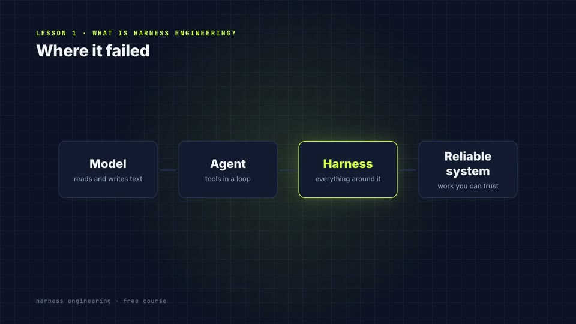](01-what-is-harness-engineering.mp4)

The model supplies the intelligence. The harness makes it reliable. (0:53, goes with [What Harness Engineering Is](../course/01-what-is-harness-engineering.md))

## The agent loop

[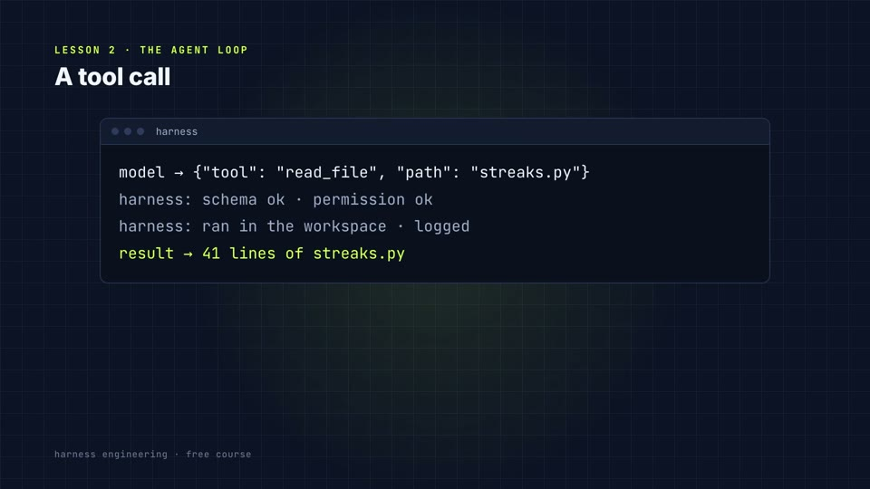](02-the-agent-loop.mp4)

The loop is easy. The harness around it is the work. (0:45, goes with [How an AI Agent Works](../course/02-how-an-agent-works.md))

## Six layers, one map

[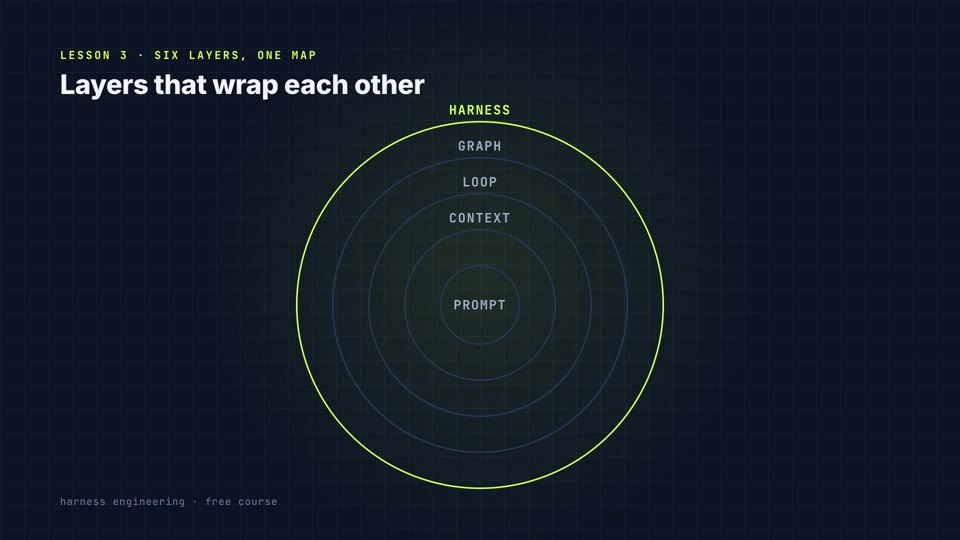](03-the-layers.mp4)

New layers wrap the old ones. Use the map to find the bug. (0:35, goes with [From Prompt Engineering to Harness Engineering](../course/03-the-layers.md))

## Context rot, compaction and resets

[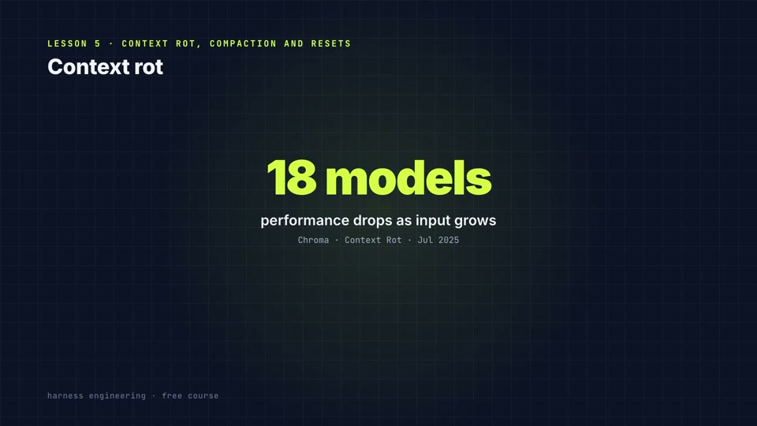](04-context-rot-compaction-and-resets.mp4)

The context window is a desk. Put on it only what this step needs. (0:39, goes with [Context Engineering for Harnesses](../course/05-context-engineering.md))

## Tools, MCP and skills

[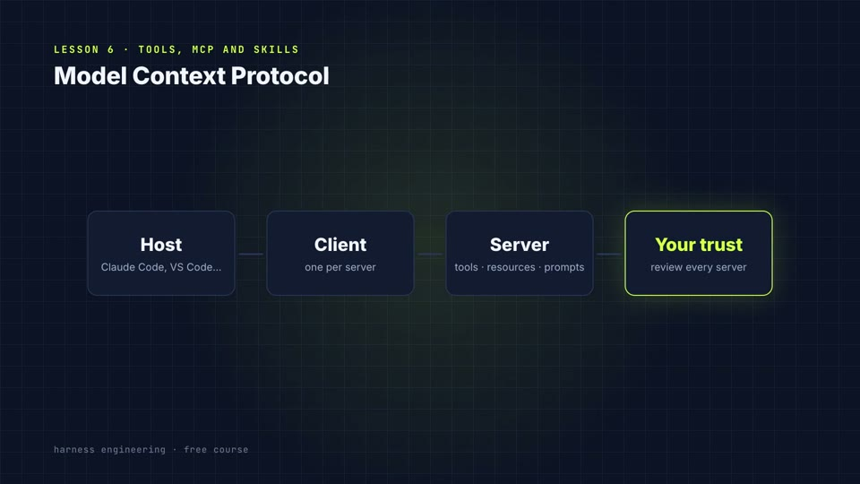](05-tools-mcp-and-skills.mp4)

Fewer tools, described well, with errors that say what to do next. (0:39, goes with [Tools, MCP and Agent Skills](../course/06-tools-mcp-and-skills.md))

## The sandbox and the lethal trifecta

[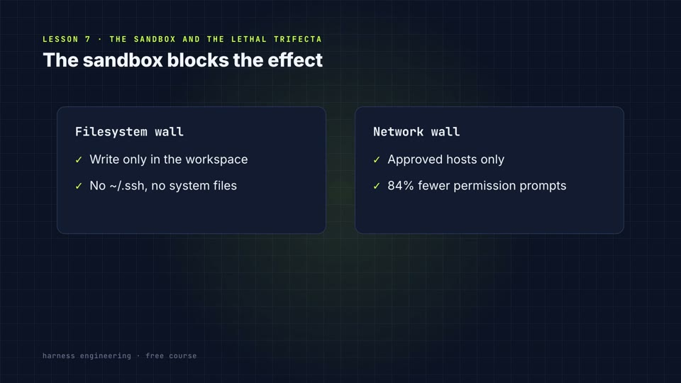](06-sandbox-and-the-lethal-trifecta.mp4)

Rules are tripwires. The sandbox is the wall. (0:47, goes with [Sandboxes, Permissions and Security](../course/07-sandboxes-permissions-and-security.md))

## Long-running agents

[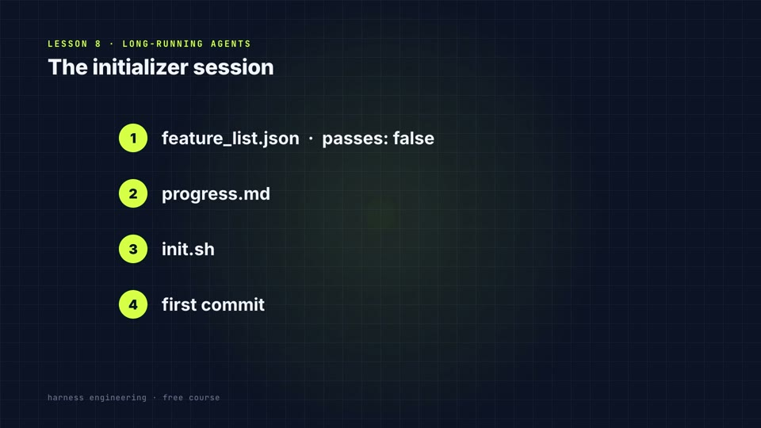](07-long-running-agents.mp4)

Write down what the next session needs. (0:37, goes with [State, Memory and Long-Running Work](../course/08-state-memory-and-long-running-work.md))

## Guides and sensors

[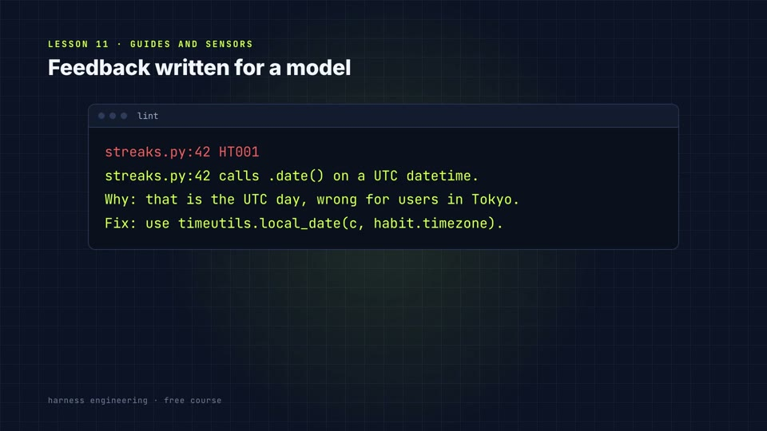](08-guides-and-sensors.mp4)

Guides before, sensors after. Never trust "done". (0:40, goes with [Feedback, Verification and the Steering Loop](../course/11-feedback-verification-and-steering.md))

## pass@k vs pass^k

[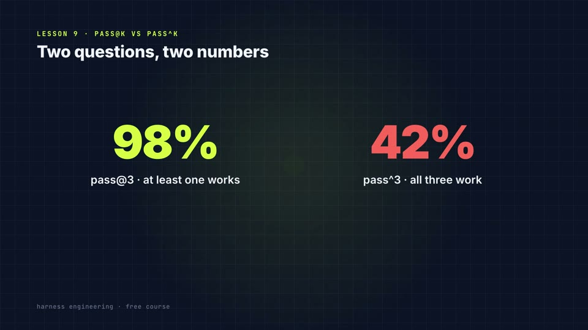](09-pass-at-k-vs-pass-pow-k.mp4)

Measure the number your users live with. (0:31, goes with [Guardrails, Tests and Evals](../course/09-guardrails-tests-and-evals.md))

## Loops and stop conditions

[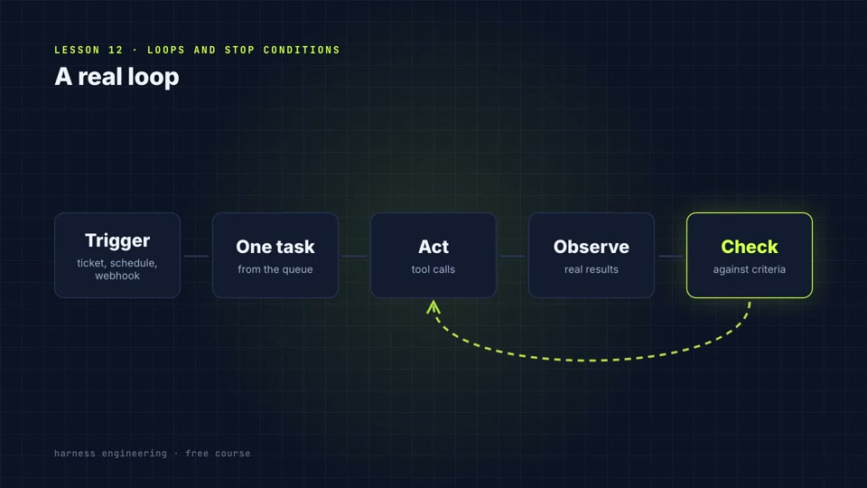](10-loops-and-stop-conditions.mp4)

Every run ends in success, or in a reason you can read. (0:34, goes with [Loop Engineering](../course/12-loop-engineering.md))

## Loops, graphs and many agents

[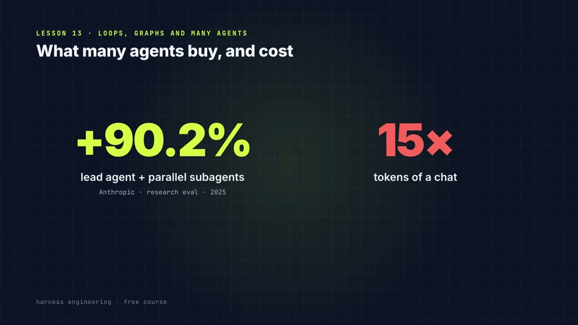](11-graphs-and-multi-agent.mp4)

Add an agent only when it solves a problem a simpler design cannot. (0:34, goes with [Graphs and Multi-Agent Systems](../course/13-graphs-and-multi-agent-systems.md))

## Where is the bug?

[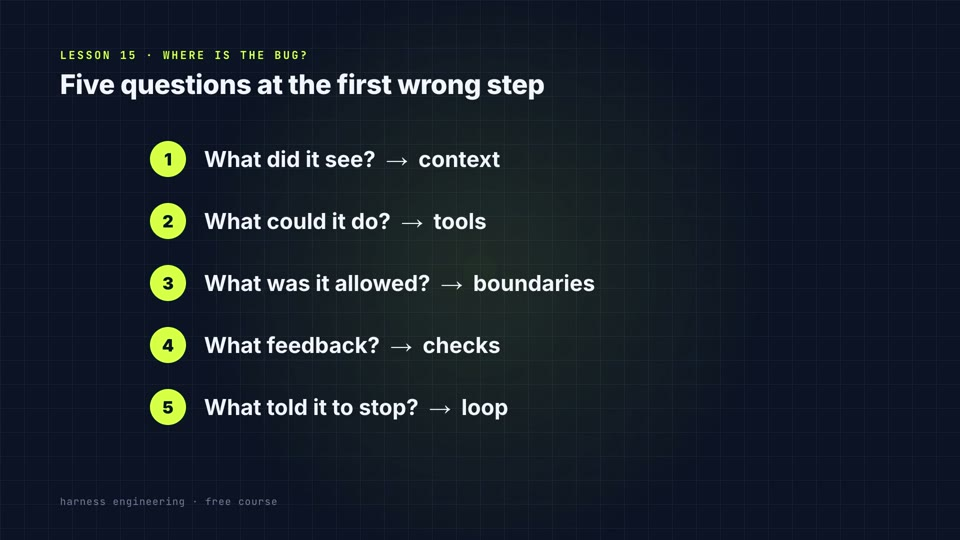](12-diagnosing-failures.mp4)

A failure has an address. Find it before you touch the prompt. (0:34, goes with [Diagnosing Agent Failures](../course/15-diagnosing-agent-failures.md))

## How these were made

Each video is an HTML composition rendered frame by frame with [HyperFrames](https://github.com/heygen-com/hyperframes), narrated with the open Kokoro text-to-speech model, with CC0 sound effects from Kenney. The scripts and the generator live in [`build/`](build/): edit `specs.py`, run `make.py`, then render each project with `render_all.sh`.
